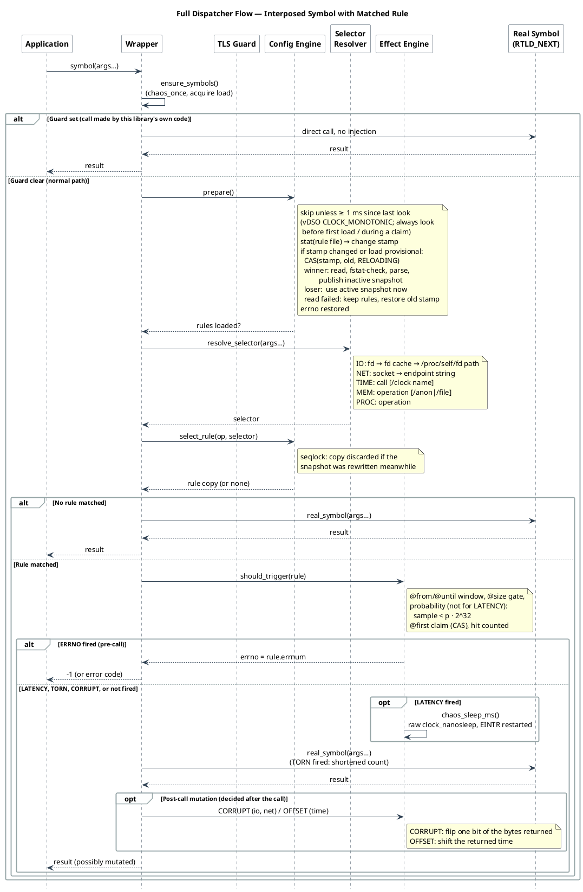
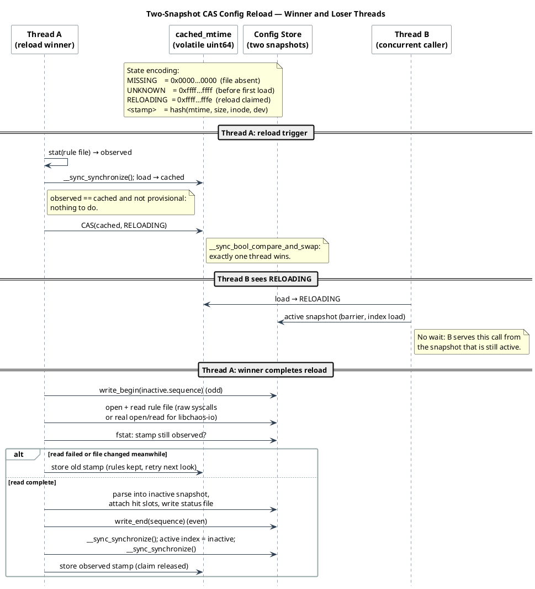
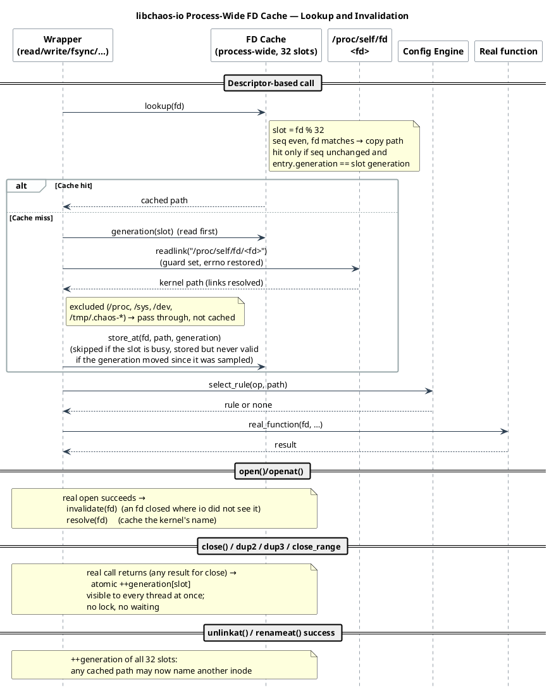

<!--
━━━━━━━━━━━━━━━━━━━━━━━━━━━━━━━━━━━━━━━━━━━━━━━━━━━━━━━━━━━━━
  Engineered by  Christian Schnapka
                 Embedded Principal+ Engineer
                 Macstab GmbH · Hamburg, Germany
                 https://macstab.com
━━━━━━━━━━━━━━━━━━━━━━━━━━━━━━━━━━━━━━━━━━━━━━━━━━━━━━━━━━━━━
-->

# Architecture

> *Engineered by* **[Christian Schnapka](https://macstab.com)** — Embedded Principal+ Engineer · [Macstab GmbH](https://macstab.com) · Hamburg, Germany

---

This document specifies the execution model every libchaos library shares: symbol
resolution, the rule-file reload protocol, the status file and hits files, fd-to-path
resolution and the test gates. `libchaos-io` serves as the reference implementation; the
other five libraries follow the same model with their own selectors and effects, each
documented in its own reference:

| Library | Reference |
|---|---|
| `libchaos-io` | [`docs/IO.md`](IO.md) |
| `libchaos-net` | [`docs/NETWORK.md`](NETWORK.md) |
| `libchaos-dns` | [`docs/DNS.md`](DNS.md) |
| `libchaos-time` | [`docs/TIME.md`](TIME.md) |
| `libchaos-memory` | [`docs/MEMORY.md`](MEMORY.md) |
| `libchaos-process` | [`docs/PROCESS.md`](PROCESS.md) |

## Table of Contents

- [Purpose](#purpose)
- [Execution Model](#execution-model)
- [Config Reloading](#config-reloading)
- [FD Path Resolution](#fd-path-resolution)
- [Fault Effects](#fault-effects)
- [Testing Strategy](#testing-strategy)
- [Platform Internals and Symbol Resolution](#platform-internals-and-symbol-resolution)
- [Formal Symbol-Ownership Theorem](#formal-symbol-ownership-theorem)
- [Maintenance Rules](#maintenance-rules)

## Purpose

The libraries inject controlled failures at the Linux libc boundary. Each one is a single
`LD_PRELOAD` shared object (LD_PRELOAD mode) that exports wrappers for a family of libc
functions, decides per call whether a rule applies, and otherwise forwards to the real
function (the next definition, found with `dlsym(RTLD_NEXT, ...)`).

A second front end, `chaos-init` (`src/init/`), applies the same rule files to statically
linked programs through seccomp user notification (SECCOMP mode; see
[SECCOMP.md](SECCOMP.md)). It `#include`s each library's config and actions sources
unchanged; `src/init/chaos_init_<lib>.c` only translates a notified system call into the
arguments the wrapper would have passed. A rule SECCOMP mode cannot apply rejects the whole
rule file (`reason=unsupported in seccomp mode` in the status file) through the
`CHAOS_<LIB>_RULE_SUPPORTED` hook.

Design constraints, and why:

- **No public API, no daemon, no background thread.** Control is a file per library
  (`/tmp/.chaos-<lib>.conf`); the library polls it from the calling thread. Nothing runs
  when the application does not call an interposed function.
- **No large static TLS.** Per-thread state is limited to the reentrancy guard and the PRNG
  word. glibc reserves static TLS in every thread and adds it to each thread's minimum
  stack; a 256 KiB `__thread` buffer made `pthread_create()` fail with `EINVAL` in runtimes
  that use small explicit stacks (the Erlang VM). The rule-file buffer and the fd cache are
  therefore process-wide.
- **No allocation on the rule path.** Snapshots, hit pools and buffers are static; the fd
  cache is mapped with a raw `mmap` system call. `libchaos-dns` is the exception where an
  effect needs heap memory: synthetic answer lists it hands to the caller, and a temporary
  pointer array for SHUFFLE (on allocation failure the list is returned unchanged).
- **The library's own I/O never meets a rule.** Rule files of five libraries, all status
  and hits files, injected sleeps and the fd-cache mapping use raw system calls, so no
  preloaded library (another libchaos library included) can fault or delay them.

## Execution Model

### Library initialization

[`src/core/chaos_io.c`](../src/core/chaos_io.c)

The constructor (`__attribute__((constructor))`) runs these steps in order; each depends on
the previous one:

1. **Resolve the real functions** through `chaos_io_ensure_symbols()`: one `chaos_once()`
   that fills the whole `g_chaos_io_real_*` table with `dlsym(RTLD_NEXT, ...)`. Every
   wrapper calls the same function first, because ELF initialisers run in dependency order:
   another library's constructor can reach a wrapper before this constructor has run
   (`libcap-ng` does file I/O in its initialiser; `setpriv`, `su` and `runuser` crashed
   with SIGSEGV before resolution became lazy). `chaos_once()` uses compiler atomics and
   `sched_yield()`, not `pthread_once()`, which lives in libpthread before glibc 2.34.
2. **Seed the process entropy** from `/dev/urandom`, read with raw `SYS_openat`/`SYS_read`.
   On failure the seed is `0x6a09e667f3bcc909 ^ getpid()`. errno is preserved.
3. **Seed the constructing thread's PRNG** (SplitMix64 finaliser into xorshift64\* state).
   Other threads seed lazily on their first draw from the process seed, their TID and a
   stack address.
4. **Reset config state**, register the `pthread_atfork` child handler and look up the vDSO
   clock once (so a signal handler never performs the first lookup).
5. **Load the rule file**, so a rejected file is reported in the [status file](#status-file)
   as soon as the program starts.
6. **Reset the fd cache.**

A symbol that `dlsym(RTLD_NEXT, ...)` cannot find calls `abort()`, except the symbols older
C libraries lack: `close_range`, `closefrom`, `renameat2`, `__vfprintf_chk`, `__fread_chk`
and `__fgets_chk` in `libchaos-io`; `execveat`, `execvpe`, `fexecve` and `pthread_create` in
`libchaos-process`. Their pointers stay NULL and the wrapper falls back to a raw system call,
the unfortified function, `ENOSYS`, or (`pthread_create`) a retried lookup and `EAGAIN`; the
per-symbol table is in [SAFETY.md §5.1](SAFETY.md#51-the-one-exception-unresolvable-symbols).

### Request flow

For each intercepted call, a descriptor-based `libchaos-io` wrapper:

1. Calls `chaos_io_ensure_symbols()` (one acquire load after the first call).
2. If this thread's reentrancy guard is set, calls the real function and returns.
3. Passes through fds 0, 1 and 2.
4. Refreshes the rules if due (see [Change check](#change-check)).
5. Resolves the fd to a path through the [fd cache](#fd-path-resolution) and passes through
   excluded paths (`/proc`, `/sys`, `/dev`, every `/tmp/.chaos-*` control file).
6. Selects the longest matching rule for the operation from the active snapshot.
7. Applies the rule's effect: LATENCY, or ERRNO (returns `-1` without calling libc), or
   TORN (shortens the request) before the call; CORRUPT after it.
8. Calls the real function.

Path-based wrappers (`open`, `unlinkat`, `renameat`, ...) check exclusion before the
refresh, so a call on an excluded path costs no `stat()`. `close` is the exception to
pre-call ERRNO: the descriptor is closed first (Linux releases it even when `close` reports
an error), then the injected errno is returned.

Config refresh guarantees, identical in every library:

- **Writes within one mtime tick are seen.** File systems stamp mtime from a coarse clock,
  so the change stamp hashes mtime (s, ns), size, inode and device: an append changes the
  size, a rewrite through `rename` (`sed -i`) the inode. A same-size rewrite in place within
  one tick changes none of them, so a file whose mtime is less than 20 ms old
  (`CHAOS_RACY_WINDOW_MS`) is loaded provisionally and read again on each look until it is
  older, as git treats "racily clean" index entries. A re-read whose FNV-1a content hash is
  unchanged keeps the snapshot, with its hit counts, `@first` claims and FAIL_AFTER counters.
- **A failed read keeps the rules.** If the file vanishes between `stat` and `open`, or
  `open`/`read` fail for any reason other than `EACCES`/`EPERM`/`EISDIR`, the active snapshot
  stays and the reload claim is released with the previous stamp, so the next look retries.
  `EINTR` is retried inside the read loop. Only a missing file, a file that fails to parse,
  an unreadable file (`EACCES`, `EPERM`, a directory), a file of 256 KiB or more, or a file
  holding a NUL byte changes the rules; the last four are reported and leave no rules.
- **A file that changes while it is read is not used.** After reading, the library compares
  the open descriptor's stamp (`fstat`) with the stamp that started the reload. A writer
  that appended or rewrote the file meanwhile leaves a different stamp; the copy may be half
  old, half new, so the active rules stay and the next look reloads the finished file.
  Writers must still replace the file atomically (write a temporary file in the same
  directory, then `rename` it over the rule file), as the Java framework does: a writer that
  pauses between two `write` calls can otherwise be read with a stable stamp in between.
- **A fork during a reload does not freeze the child.** Each library registers a
  `pthread_atfork` child handler that releases an inherited reload claim and hits-writer
  flag, zeroes the hit counters and `@first` claims, resets FAIL_AFTER counters
  (`libchaos-process`) and clears the PRNG so the child reseeds from its own TID. A `vfork`
  child (and glibc's `posix_spawn`, JDK 8/11 process launching) shares the parent's memory
  and runs no atfork handler: it sees the parent's claims as held, takes over nothing, and
  writes no hits file because its pid differs from the recorded owner.
- **errno is the caller's.** The library's own `stat`/`open`/`read`, `/proc` lookups, socket
  lookups, seeding, status and hits writes and latency sleeps save and restore errno, so a
  successful interposed call never reports an errno the library caused.
  `test/runtime/test_errno_glibc.sh` checks this for every library.

`libchaos-io` wrapper families by translation unit (each `64` name is an alias of the base
wrapper; `_chk`/`_2` variants exist on 64-bit glibc only):

| Unit | Exported symbols |
|---|---|
| [`chaos_io_open.c`](../src/wrappers/chaos_io_open.c) | `open`, `openat`, `creat`, `fopen`, `freopen`, `open64`, `openat64`, `creat64`, `fopen64`, `freopen64`, `__open_2`, `__open64_2`, `__openat_2`, `__openat64_2` |
| [`chaos_io_rw.c`](../src/wrappers/chaos_io_rw.c) | `read`, `readv`, `write`, `writev`, `pread`, `preadv`, `pwrite`, `pwritev`, `sendfile`, `copy_file_range`, their `64` aliases, `__read_chk`, `__pread_chk`, `__pread64_chk` |
| [`chaos_io_fsops.c`](../src/wrappers/chaos_io_fsops.c) | `ftruncate`, `truncate`, `fallocate`, `posix_fallocate`, `unlinkat`, `unlink`, `rmdir`, `remove`, `renameat`, `renameat2`, `rename`, their `64` aliases |
| [`chaos_io_sync.c`](../src/wrappers/chaos_io_sync.c) | `close`, `dup2`, `dup3`, `close_range`, `closefrom`, `closedir`, `pclose`, `fsync`, `fdatasync` |
| [`chaos_io_stdio.c`](../src/wrappers/chaos_io_stdio.c) | `fread`, `fgets`, `fgetc`, `getc`, `getdelim`, `__getdelim`, `getline`, `fwrite`, `fputs`, `fputc`, `putc`, `fprintf`, `vfprintf`, `fflush`, `fclose`, `__fread_chk`, `__fgets_chk`, `__fprintf_chk`, `__vfprintf_chk` |

`dup2`, `dup3`, `close_range`, `closefrom`, `closedir` and `pclose` inject nothing; they
exist so the fd cache sees every descriptor the C library frees or reassigns.

Diagram: dispatch of one interposed call with a matching rule ([source](diagrams/dispatch.puml)).
The selector and post-call rows show what each library resolves and mutates.



## Config Reloading

[`src/config/chaos_io_config.c`](../src/config/chaos_io_config.c)

Contract: readers never block and never take a lock; at most one thread per process reloads
at a time; a reader sees either the old or the new rule set, never a mix.

- **Two static snapshots.** `g_chaos_io_config_states[2]`, each holding up to 256 rules
  (`CHAOS_IO_MAX_RULES`). A reload rewrites the inactive one in place, then publishes it by
  flipping `g_chaos_io_active_config_index` between two full barriers.
- **The change stamp is the lock.** `g_chaos_io_cached_mtime` holds the 64-bit stamp of
  the loaded file or a sentinel: `MISSING` (0), `RELOADING` (`0xff…fe`), `UNKNOWN`
  (`0xff…ff`, before the first load). A thread that sees a new stamp CASes the cached value to `RELOADING`; the
  winner reloads and stores the new stamp last. A thread that sees `RELOADING` uses the
  active snapshot immediately: it does not wait. A genuine stamp equal to a sentinel is XORed
  with `0x9e3779b97f4a7c15`.
- **A seqlock guards rule copies.** A snapshot's sequence is odd while a reload rewrites it.
  A reader preempted while it copies a rule can find the same snapshot rewritten two reloads
  later; `chaos_snapshot_read_valid()` then rejects the copy and the call passes through.
- **Missing file**: empty snapshot, status file removed. **Rejected file** (any invalid
  line, more than 256 rules, unsupported in SECCOMP mode, too large, unreadable, NUL byte):
  empty snapshot, `state=error` in the status file. Parsing is all-or-nothing.
- **Longest prefix wins**, with a path-boundary check: `/data` matches `/data` and
  `/data/file`, not `/database`; a prefix ending in `/` matches by bytes. `*` matches every
  absolute path except memfds (`/memfd:`); pipes, sockets and anonymous inodes match only a
  rule that names them (`socket:[N]`), so TORN or CORRUPT meant for files cannot break an
  eventfd or a socket protocol.
- **Links are resolved at load.** A rule's absolute prefix is normalised lexically and, where
  it differs, also stored with links resolved (`realpath`), because `/proc/self/fd` reports
  the kernel's name (`/usr/lib` for `/lib`, a ConfigMap's target behind `..data`). When any
  prefix went through a link or did not fully exist, the resolution is repeated every 1 s
  (`CHAOS_IO_LINKS_RECHECK_MS`) even if the rule file is unchanged.

Diagram: two threads racing a reload ([source](diagrams/config_reload.puml)).



### Change check

[`src/common/chaos_clock.h`](../src/common/chaos_clock.h)

A `stat()` of the rule file on every intercepted call was the largest part of a wrapper's
cost. Once a load has completed, each library looks at the file at most once per
millisecond (`CHAOS_CHECK_INTERVAL_NS`); only calls before the first load completes, and
calls while another thread holds the reload claim, look every time. The throttle also
applies to a missing or rejected rule file. A change therefore takes effect within about
1 ms instead of on the next call. Tests that write rules and call at once must wait a few
milliseconds; the runtime probes sleep 2 ms after each write. The Java side's `docker exec`
round trip is far longer.

The time comes from the kernel's vDSO `clock_gettime` (`__vdso_clock_gettime` on x86_64,
`__kernel_clock_gettime` on aarch64), found once through `getauxval(AT_SYSINFO_EHDR)` and a
walk of the vDSO's `DT_HASH` symbol table, and called directly: no system call, and not the
C library's `clock_gettime`, which `libchaos-time` interposes (a time rule must not change
how often the other libraries see their rules). Without a vDSO clock, or on any other
architecture, the file is looked at on every call. The lookup never waits: a caller that
finds it in progress (another thread, or a signal handler on the same thread) uses the
unthrottled path for that call.

Per-call cost with a rule file whose rules do not match (glibc, arm64 Docker,
best of 5 × 200 000 calls):

| library | operation | native | every call | throttled |
|---|---|---:|---:|---:|
| time | `clock_gettime` | 21 ns | 974 ns | 86 ns |
| process | `waitpid(WNOHANG)` | 177 ns | 1140 ns | 240 ns |
| memory | `mmap` + `munmap` | 973 ns | 2312 ns | 1079 ns |
| dns | `getaddrinfo` | 9237 ns | 12044 ns | 9698 ns |
| io | `write` | 161 ns | 1069 ns | 769 ns |
| net | `send` + `recv` | 462 ns | 875 ns | 831 ns |

### Status file

[`src/common/chaos_status.h`](../src/common/chaos_status.h)

Parsing is all-or-nothing, so one bad line leaves a library with no rules, which looks
exactly like a rule that never fires. Every library therefore reports the outcome of each
load in `/tmp/.chaos-<lib>.status`:

```text
state=error
rules=0
line=3
reason=invalid rule
text=bogus-rule # typo
pid=4711
```

| Outcome | Report |
|---|---|
| Rules loaded | `state=ok`, `rules=<n>`, `pid` |
| Invalid line | `state=error`, `rules=0`, 1-based `line`, `reason=invalid rule`, `text` (the line as written, at most 200 bytes, control characters as spaces), `pid` |
| More than 256 rules | as above, `reason=too many rules`, naming the 257th rule |
| Rule SECCOMP mode cannot apply | as above, `reason=unsupported in seccomp mode` (`chaos-init` only) |
| File of 256 KiB (262 144 bytes) or more | `line=0`, `reason=file too large` |
| `open` fails with `EACCES`/`EPERM`, or the path is a directory | `line=0`, `reason=file unreadable` |
| File holds a NUL byte | `line=0`, `reason=file contains a NUL byte` |
| No rule file | status file removed |

- The three `line=0` cases are not re-read until the file's stamp changes.
- `pid` is the process that loaded the rules. Every process with the library loaded writes
  the same report for the same rule file; a writer that wants the report for its own change
  starts one program under `LD_PRELOAD` and checks that `pid` is that program's. The
  constructor loads the rules, so even `/bin/true` writes a fresh report.
- The report is written to `/tmp/.chaos-staging-<pid>-<nonce>-<name>` (created
  `O_EXCL | O_NOFOLLOW`, up to four nonces) and renamed over the old one, a name no reader
  of status or hits files lists. All of it uses raw system calls: `libchaos-io` interposes
  `open`, `write` and `rename`, and a user's io rule must not be able to fail the report.
  A failed write is ignored (the previous report stays) and leaves errno untouched.
- A read that sees the file change mid-read publishes nothing and writes no report; the next
  look retries.

### Hit counters

[`src/common/chaos_hits.h`](../src/common/chaos_hits.h)

A rule that parses but never matches what the program does is the other silent failure.
Every library counts, per rule, how often the rule's effect was applied, and each process
reports its counts in `/tmp/.chaos-<lib>.hits.<n>`, one line per rule of the active rule
file:

```text
3	tcp4://127.0.0.1:5432:connect:ECONNREFUSED:1.0 # net
0	tcp4://127.0.0.1:6379:recv:LATENCY:200 # redis
```

- **What is a hit.** A hit is counted where the library decides the effect fires
  (`chaos_<lib>_rule_should_trigger`, and FAIL_AFTER in `libchaos-process`), after the
  window, `@size` gate, probability and `@first` claim have all passed. A matching call the
  probability does not select is not a hit.
- **Slots survive reloads.** Counters live in a pool of `2 × 256` slots beside the two
  snapshots; every rule copy a wrapper takes carries a pointer to its slot and the slot's
  generation. A rule whose text is unchanged by a reload keeps the same slot, so its count,
  `@first` claims and REGRESS state continue, and a firing through a copy taken before the
  reload still lands. A slot whose rule left the file gets a new generation: a copy held
  across a blocking call then neither fires nor counts, also after the slot is reused.
  `@first` claims are one CAS on a word holding the claim count (low 32 bits) and the
  generation (high 32 bits).
- **Write schedule.** The file is rewritten on each of a process's first 64 hits
  (`CHAOS_HITS_EAGER`), then at most every 100 ms (`CHAOS_HITS_INTERVAL_MS`), from a hit or
  from the next rule-file look, and at normal exit (a destructor). A hit not due to be
  written makes no system call (the time comes from the vDSO). One thread writes at a time;
  a hit that finds the writer busy sets a pending flag the writer drains before it lets go.
- **Per process.** A forked child starts from zero, so the parent's hits are not reported
  twice; `@first` budgets and once-only effects (REGRESS) restart in the child too. A `vfork`
  child counts into the parent's slots and writes no file of its own.
- **File number.** Normally the pid. A program started by `execve` keeps its pid but loads
  the library anew, and the replaced image ran no exit report: when a file of that pid
  already exists, the new image uses `<pid>` followed by nine digits derived from its load
  time, a number beyond `pid_max` (at most 2^22), so the earlier hits stay.
- **Pid collisions.** Containers sharing `/tmp` each run their application as pid 1. A
  process's first write only creates its file (a hard link of the staging file, which fails
  when the name exists); when the name is taken it picks another number the same way, up to
  four times. Later writes replace the file it created.
- **Reading.** Sum every `.hits.<digits>` file. Files of finished processes stay, so counts
  are cumulative until the files are removed: remove them between test runs.

Known limits, kept on purpose:

- A rule is identified across reloads by its first 200 bytes of text; two rules that share
  them share a count and an `@first` budget.
- `@size` compares the byte count the call asked for, also for effects applied after the
  call (CORRUPT, TRICKLE, DUP).
- Status and hits files are created mode 0644 and then `fchmod`ed to 0666, independent of
  the umask. In a sticky `/tmp` another user may not rename over a file it does not own (an
  image that starts as root and runs the application as another user); the write then falls
  back to rewriting the file in place (`O_TRUNC | O_NOFOLLOW`, no `O_CREAT`), which a reader
  may briefly see short.

## FD Path Resolution

[`src/config/chaos_io_fdcache.c`](../src/config/chaos_io_fdcache.c)

Rules match paths; descriptor-based calls (`read`, `write`, `fsync`, `ftruncate`, the stdio
functions, ...) carry only an fd. The library resolves the fd through
`readlink("/proc/self/fd/<fd>")` and caches the answer.

- **Process-wide, direct-mapped, 32 slots** (`CHAOS_IO_FD_CACHE_SLOTS`), indexed by
  `fd % 32`, each holding the fd and a `PATH_MAX` path. A descriptor belongs to the process,
  so the cache does too. The earlier per-thread table cost `32 × PATH_MAX` bytes of static TLS
  in every thread and left other threads' entries stale after a `close`.
- **Mapped lazily** on the first store with a raw `SYS_mmap` (no allocator, and
  `libchaos-memory` cannot fault it). Two threads may map concurrently; the CAS loser unmaps.
  If mapping fails, every lookup reads `/proc/self/fd`: slower, still correct.
- **Readers never block.** A per-slot seqlock (odd while a writer fills the slot) makes a
  lookup that races a writer miss instead of returning a torn path. A writer that finds the
  slot busy skips the store.
- **Invalidation is one atomic increment** of a per-slot generation, kept outside the mapped
  table. An entry is valid only while its recorded generation is current. The resolver reads
  the generation before `readlink`, so a `close` that runs during the lookup prevents the
  stale path from being stored.
- **Who invalidates:** `close` (after the real close, whatever it returned), `dup2`/`dup3`
  (the target fd), `close_range` (the range, or the whole cache for a range of 32 or more fds),
  `closedir`, `pclose`, `fclose` (the stream's fd), `closefrom` (the whole cache). Every
  successful open invalidates and then re-resolves its new fd. `unlinkat`, `renameat` and
  their path forms reset the whole cache on success, because a rename can change any path
  alias.
- Excluded paths (`/proc`, `/sys`, `/dev`, `/tmp/.chaos-*`) are never stored, and fds 0-2 are
  never resolved.

Diagram: lookup and invalidation ([source](diagrams/fdcache.puml)).



## Fault Effects

[`src/effects/chaos_io_actions.c`](../src/effects/chaos_io_actions.c)

`libchaos-io` effects (other libraries: see their references). Every effect is gated by the
qualifiers (`@first`, `@from`, `@until`, `@size`); all but LATENCY also by the probability.
Probability `p` fires when a 32-bit sample from the thread's xorshift64\* PRNG is below
`p × 2^32`; 0 never fires, 1 always.

| Effect | Allowed operations | When | Behaviour |
|---|---|---|---|
| ERRNO | all | before the call (`close`: after) | returns `-1` with one of `EIO`, `ENOSPC`, `EDQUOT`, `EROFS`, `EACCES`, `EMFILE`, `ENFILE`, `ENOENT` |
| LATENCY | all | before the call | sleeps the configured milliseconds (`0` to `4294967295`) with `chaos_sleep_ms()`, then calls libc |
| TORN | `write`, `pwrite` | before the call | shortens the count to `1 + sample % (n − 1)`, i.e. `[1, n−1]`; `n = 1` stays 1 |
| CORRUPT | `read`, `pread` | after a call that returned `> 0` | flips one bit (byte `sample % rc`, bit `sample & 7`) of the bytes returned |

`chaos_sleep_ms()` ([`src/common/chaos_sleep.h`](../src/common/chaos_sleep.h)) issues
`clock_nanosleep(CLOCK_MONOTONIC)` as a raw system call, restarts with the remaining time on
`EINTR` and restores errno, so the delay is always the configured length and no other
preloaded library (`libchaos-time` in particular) can shorten or lengthen it.

## Testing Strategy

### Unit tests

Each unit test is one translation unit (`test/unit/test_<name>.c`) that `#include`s the
sources under test; no library object is linked. That gives tests direct access to `static`
functions and lets them replace system calls through compile-time seams (macros such as
`CHAOS_SLEEP_SYSCALL`, `CHAOS_STATUS_OPEN`, `CHAOS_CLOCK_RAW_GETTIME`,
`CHAOS_IO_CONSTRUCTOR`) and replaceable function pointers, without exporting test-only
symbols from the shipped objects. Unit tests build and run on macOS too. The cost is coarse
dependencies: every test depends on every source, so any edit rebuilds all tests.

`test/fuzz/` holds one libFuzzer harness per rule-file parser (`make fuzz`, clang with
`-fsanitize=fuzzer,address`).

### Coverage gate

[`test/runtime/check_coverage.sh`](../test/runtime/check_coverage.sh) (`make coverage`)

- Builds the unit tests with `--coverage -O0` into `build-coverage/` and runs them.
- Requires 100.00 % line coverage for every source file of all six libraries and of
  `chaos-init` (`src/init/*.c` except `chaos_init.c`).
- Requires every line of the shared headers (`src/common/*.h`, each `*_internal.h`) to be run
  by at least one test, measured as the union over all test binaries.

### Style gate

[`test/runtime/check_format.sh`](../test/runtime/check_format.sh) (`make fmt-check`,
`make fmt`)

- Finds `clang-format` through `$CLANG_FORMAT`, then `PATH`, then `xcrun`.
- `--check` fails on the first `.c`/`.h` file under `src/` or `test/` that differs from the
  repository `.clang-format` output and prints the diff; `--write` rewrites in place.

### Integration checks

All Docker suites accept `linux/amd64` or `linux/arm64` as an optional argument (default:
the host architecture) and skip with `CHAOS_SKIP_EXIT` (default 0) on unsupported hosts.

Per-library behaviour on both C libraries:

| Script | Proves |
|---|---|
| [`test_integration.sh`](../test/runtime/test_integration.sh) | native Linux build, no Docker: ERRNO, LATENCY and fd-based wrappers including `sendfile`, `copy_file_range`, `fallocate`, `unlinkat`, `renameat` |
| [`test_glibc.sh`](../test/runtime/test_glibc.sh), [`test_alpine.sh`](../test/runtime/test_alpine.sh) | every `libchaos-io` wrapper with ERRNO, TORN, CORRUPT, LATENCY (Debian bookworm / Alpine) |
| [`test_net_glibc.sh`](../test/runtime/test_net_glibc.sh), [`test_net_alpine.sh`](../test/runtime/test_net_alpine.sh) | `libchaos-net`: connect, send, recv, accept, poll, epoll with endpoint rules |
| [`test_dns_glibc.sh`](../test/runtime/test_dns_glibc.sh), [`test_dns_alpine.sh`](../test/runtime/test_dns_alpine.sh) | `libchaos-dns`: `getaddrinfo`/`getnameinfo` failures, REWRITE, OVERRIDE, FILTER_FAMILY, SHUFFLE, LIMIT, LATENCY |
| [`test_time_*.sh`](../test/runtime/test_time_glibc.sh), [`test_memory_*.sh`](../test/runtime/test_memory_glibc.sh), [`test_process_*.sh`](../test/runtime/test_process_glibc.sh) | each library's runtime probe on glibc and musl |
| [`test_path_forms.sh`](../test/runtime/test_path_forms.sh) | `unlink`, `rmdir`, `rename`, `truncate`, `creat` are faulted (both libcs implement them with their own system calls) |
| [`test_stdio.sh`](../test/runtime/test_stdio.sh) | buffered stdio is faulted, including `_FORTIFY_SOURCE=2` `__*_chk` variants on glibc |
| [`test_variants_glibc.sh`](../test/runtime/test_variants_glibc.sh) | every large-file name and fortified variant of io, memory and net injects like the base call |

Cross-cutting guarantees:

| Script | Proves |
|---|---|
| [`test_status.sh`](../test/runtime/test_status.sh) | all six libraries, both libcs: a third-line error reports `state=error`, line 3 and its text; one valid rule reports `state=ok`, `rules=1`; no rule file, no status file; each report carries the loading program's pid; on glibc a reload under `de_DE.UTF-8` parses identically, and a user other than the owner can update the file |
| [`test_hits.sh`](../test/runtime/test_hits.sh) | all six libraries: two runs of two firings sum to 4 across the hits files, a non-matching rule to 0; `@first=1` fires once per process; an expired `@until` never fires |
| [`test_fork.sh`](../test/runtime/test_fork.sh) | `@first=1` across `vfork` (shares the parent's budget, writes no hits file), `fork` and `posix_spawn` (own budget and file) |
| [`test_reload.sh`](../test/runtime/test_reload.sh) | six threads on two CPUs fire an `@first=1` rule while the file is reloaded twice per round; no round fails more than one open |
| [`test_errno_glibc.sh`](../test/runtime/test_errno_glibc.sh) | no library changes errno on a successful call, with and without an empty rule file |
| [`test_isolation_glibc.sh`](../test/runtime/test_isolation_glibc.sh) | each library's LATENCY lasts its full length while `libchaos-time` fails every `usleep`/`nanosleep`, in both preload orders; net, dns, memory and process read their rule files while `libchaos-io` fails every access under `/tmp` |
| [`test_sharing_glibc.sh`](../test/runtime/test_sharing_glibc.sh) | io and net together in both orders: files see only io's rules, sockets only net's; the fd cache follows `close`, `dup2` and other threads; a program whose library constructors do file I/O starts |
| [`test_baseline_glibc.sh`](../test/runtime/test_baseline_glibc.sh) | the release build (gcc:10, glibc 2.31) loads into `cat` and `sh`, which never link libpthread, alone and all six together |
| [`check_glibc_baseline.sh`](../test/runtime/check_glibc_baseline.sh) | no release object imports a glibc symbol version above `GLIBC_2.17` |

SECCOMP mode:

| Script | Proves |
|---|---|
| [`test_init.sh`](../test/runtime/test_init.sh) | `chaos-init` with every library's filter under Docker's default profile: files, sockets, mmap, fork and exec work for static and dynamic programs; exit codes and signals pass through; SIGTERM reaches the application; orphans are reaped; a missing command exits 127; a test build on a kernel older than 5.5 reports `state=unsupported` and still starts the application (the only path checked under emulation) |
| [`test_seccomp.sh`](../test/runtime/test_seccomp.sh) | io, net, memory and process rules fault a static C probe and a `CGO_ENABLED=0` Go program (ERRNO, LATENCY, refused connections, failed mmap, fork, exec, `os/exec`); `@first` and hits are per process; a TORN rule rejects its file |
| [`test_mptcp.sh`](../test/runtime/test_mptcp.sh) | host only: `chaos-init`'s `sock_diag` queries find Multipath TCP sockets; skipped without MPTCP |

## Platform Internals and Symbol Resolution

ELF link-map ordering, PLT/GOT binding, vDSO dispatch, `AT_SECURE`, `STT_GNU_IFUNC` and the
glibc/musl divergence matrix are specified in [`docs/PLATFORM.md`](PLATFORM.md). The facts
every wrapper depends on:

- **Link-map order and `RTLD_NEXT`.** `LD_PRELOAD` objects enter the global scope after the
  executable and before its `DT_NEEDED` libraries. `dlsym(RTLD_NEXT, name)` searches from
  the object after the caller, so a libchaos wrapper reaches the next definition: another
  libchaos library that exports the same name, or the C library. The ownership rule below
  makes that safe.
- **Hot-path cost.** Once the application's GOT slot is bound (lazily on first call, or at
  load time under `BIND_NOW`), it points at the wrapper: one indirect branch. The wrapper's
  own forward is an indirect call through the cached `g_chaos_<lib>_real_*` pointer.
- **IFUNC and `dlsym`.** For an `STT_GNU_IFUNC` symbol, `dlsym` runs the resolver and
  returns the implementation it selected, so the cached pointer is the CPU-specific variant
  the application would otherwise have called.

## Formal Symbol-Ownership Theorem

See §17 of [`docs/SYSTEM.md`](SYSTEM.md) for the full statement. Short form:

> **Every fault decision has exactly one owner, and every wrapper forwards along the
> chain.** A symbol may be exported by more than one libchaos library only when their
> domains are disjoint by descriptor kind: `read`, `write`, `readv`, `writev`, `close` and
> `__read_chk` belong to `libchaos-io` for files and to `libchaos-net` for sockets. Each
> wrapper acts only on its own kind and always calls the next definition
> (`dlsym(RTLD_NEXT, ...)`), never libc directly. Whatever the `LD_PRELOAD` order, a call is
> faulted by at most one library, and every library sees every call (so `libchaos-io` keeps
> its fd cache right for sockets too).

The original rule, "one symbol, one owner", prevents double injection, and it still holds
per decision. It left socket `read`/`write` unreachable, though: Redis and the JDK's NIO
channels do socket I/O with `read`/`write`, so `recv`/`send` rules never touched them, and a
socket `close` could not be faulted at all. Splitting the decision by descriptor kind keeps
the guarantee and closes that gap. `test_sharing_glibc.sh` checks it in both orders.

## Maintenance Rules

A change to any library must keep these invariants:

- No public API and no exported symbol other than wrappers (`-fvisibility=hidden`; only
  `CHAOS_<LIB>_EXPORT` symbols enter `.dynsym`).
- C99, `-Wall -Wextra -Werror -pedantic`, `-Os`; no new static TLS beyond a few words.
- Every library-internal file, sleep or clock access goes through a raw system call or the
  vDSO, never through an interposable libc symbol, and restores errno.
- 100 % line coverage for every changed source file, and every shared-header line run by
  some test.
- No release object may import a glibc symbol version above `GLIBC_2.17`.
- Plain, explicit code over generic abstractions.

For the file-by-file maintenance map and wrapper-specific guidance, see
[`docs/ENGINEERING.md`](ENGINEERING.md).

---

<div align="center">

*Architecture, implementation, and documentation crafted with Love and Passion by*

**[Christian Schnapka](https://macstab.com)**  
Embedded Principal+ Engineer  
[Macstab GmbH](https://macstab.com) · Hamburg, Germany

*Building systems that operate correctly at the edges — including the ones you deliberately break.*

</div>
