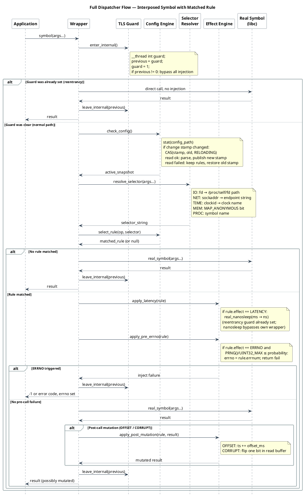
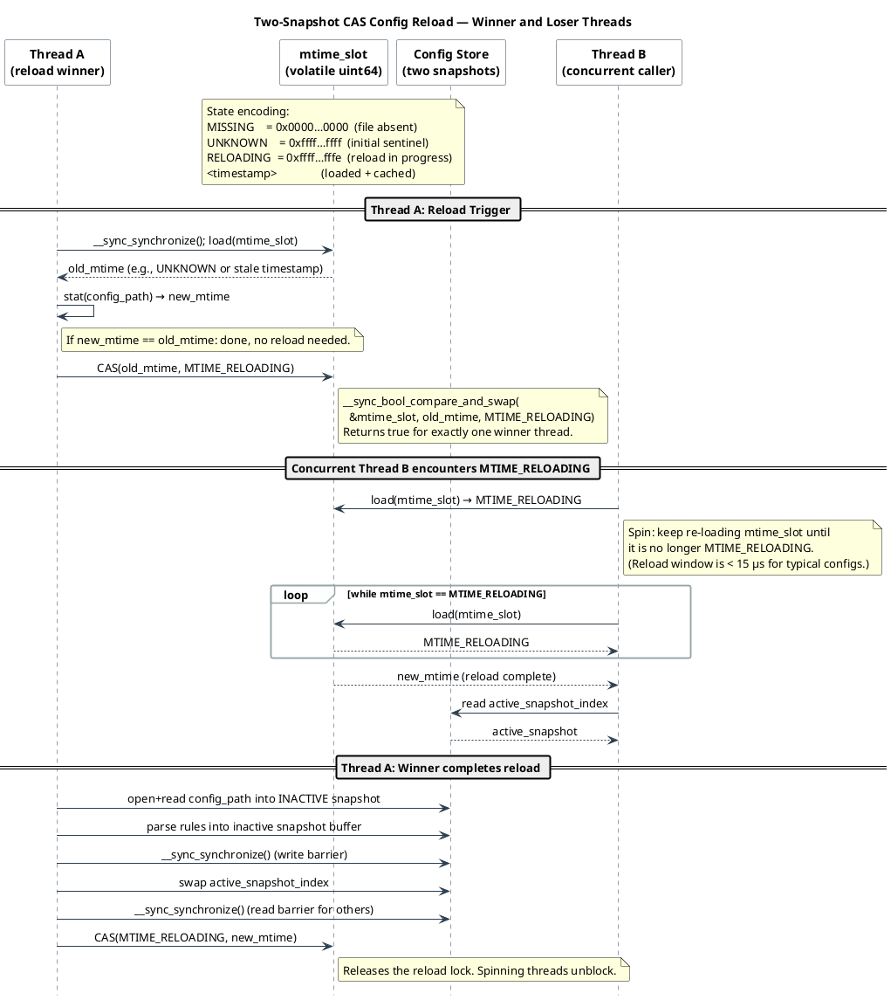
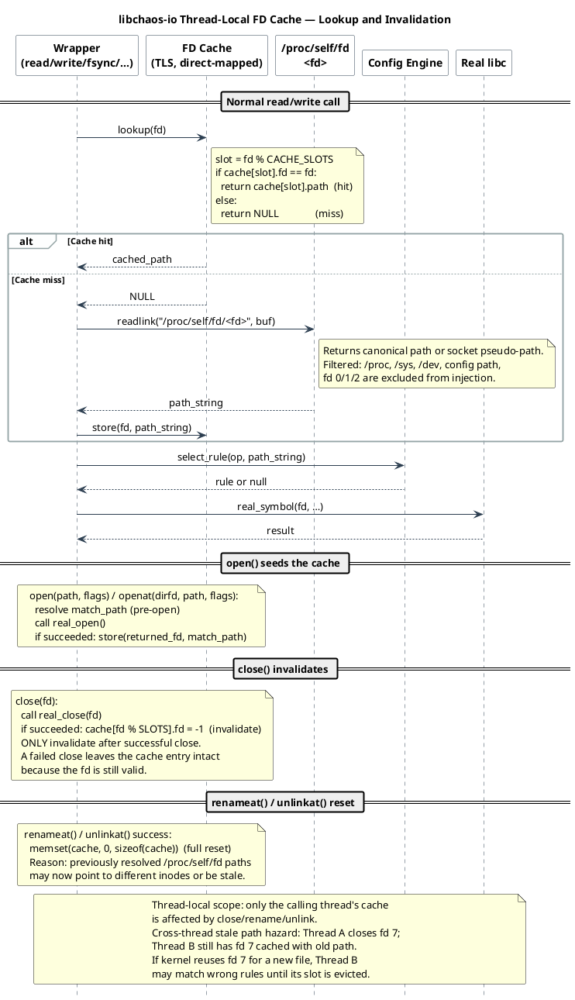

<!--
━━━━━━━━━━━━━━━━━━━━━━━━━━━━━━━━━━━━━━━━━━━━━━━━━━━━━━━━━━━━━
  Engineered by  Christian Schnapka
                 Embedded Principal+ Engineer
                 Macstab GmbH · Hamburg, Germany
                 https://macstab.com
━━━━━━━━━━━━━━━━━━━━━━━━━━━━━━━━━━━━━━━━━━━━━━━━━━━━━━━━━━━━━
-->

# Architecture

> *Engineered by* **[Christian Schnapka](https://macstab.com)** — Embedded Principal+ Engineer · [Macstab GmbH](https://macstab.com) · Hamburg, Germany

---

This document describes the repository-wide preload architecture and uses
`libchaos-io` as the reference implementation for the common execution model.
The repository also ships implemented `libchaos-net`, `libchaos-dns`,
`libchaos-time`, `libchaos-memory`, and `libchaos-process` libraries.
Each of those libraries has its own current-state technical reference:

- `libchaos-net` in
[`docs/NETWORK.md`](NETWORK.md)
- `libchaos-dns` in
[`docs/DNS.md`](DNS.md),
- `libchaos-time` in
[`docs/TIME.md`](TIME.md),
- `libchaos-memory` in
[`docs/MEMORY.md`](MEMORY.md),
- `libchaos-process` in
[`docs/PROCESS.md`](PROCESS.md).

## Table of Contents

- [Purpose](#purpose)
- [Execution Model](#execution-model)
- [Config Reloading](#config-reloading)
- [FD Path Resolution](#fd-path-resolution)
- [Fault Effects](#fault-effects)
- [Testing Strategy](#testing-strategy)
- [Platform Internals and Symbol Resolution](#platform-internals-and-symbol-resolution)
- [Formal Symbol-Ownership Theorem](#formal-symbol-ownership-theorem)
- [Maintenance Rules](#maintenance-rules)

## Purpose

Repository-wide, these libraries exist to inject controlled Linux libc-boundary
failures through small `LD_PRELOAD` shared objects. The sections below describe
that shared architecture through the `libchaos-io` implementation, because it
is still the clearest example of the common preload model.

The code stays intentionally narrow:

- no public SDK
- no config daemon
- no background thread
- no allocator-heavy data structures

## Execution Model

### Library initialization

[`src/core/chaos_io.c`](../src/core/chaos_io.c)

- Resolves the real libc symbols with `dlsym(RTLD_NEXT, ...)`.
- Seeds process entropy from `/dev/urandom`, with a deterministic fallback when that read fails.
- Seeds the current thread PRNG.
- Resets config and fd-cache state, then loads the rule file once, so a
  rejected rule file is reported when the program starts (see
  [Status file](#status-file)).
- Shares common fd-rule matching used by the wrapper translation units.

### Request flow

For each intercepted operation:

1. If the thread is already inside library internals, call straight through.
2. Ignore excluded paths and excluded fds.
3. Refresh config if the config file's change stamp (mtime, size, inode, device) changed.
4. Match the path and operation against the active rules.
5. Apply latency, errno injection, torn writes, or read corruption.
6. Call the real libc symbol.
7. Update the fd cache when needed.

Config refresh guarantees, identical in every library:

- **Writes within one mtime tick are seen.** File systems stamp mtime from a coarse clock, so the
  change stamp also covers size (an append) and inode (a rewrite through rename, e.g. `sed -i`).
- **A failed read keeps the rules.** If the file cannot be opened or read, the active snapshot stays
  and the claim is released with the previous stamp, so the next call retries; `EINTR` is retried
  inside the read loop. Only a missing file or a file that fails to parse changes the rules.
- **A file that changes while it is read is not used.** After reading, the library compares the
  open descriptor's stamp (`fstat`) with the one that started the reload. A writer that appended
  or rewrote the file in between leaves a different stamp; the copy may be half old, half new, so
  the active rules stay and the next call reloads the finished file. Writers should still replace
  the file atomically (write a temporary file in the same directory, then `rename` it over the
  rule file), as the Java framework does: a writer that pauses between two `write` calls can
  otherwise be read with a stable stamp in between.
- **A fork during a reload does not freeze the child.** The reload claim records the claiming
  process id; a child that inherits a claim from its parent releases it and reloads itself.
- **errno is the caller's.** The library's own `stat`/`open`/`read`, socket lookups, `/proc` reads,
  seeding and latency sleeps restore errno, so a successful interposed call never reports an
  errno the library caused. `test/runtime/test_errno_glibc.sh` checks this for every library.

Wrapper families are split by responsibility:

- [`src/wrappers/chaos_io_fsops.c`](../src/wrappers/chaos_io_fsops.c)
  owns `ftruncate()`, Linux `fallocate()`, `unlinkat()`, and `renameat()`.
- [`src/wrappers/chaos_io_open.c`](../src/wrappers/chaos_io_open.c)
  owns `open()` and `openat()`.
- [`src/wrappers/chaos_io_rw.c`](../src/wrappers/chaos_io_rw.c)
  owns `read()`, `readv()`, `write()`, `writev()`, `pread()`, `preadv()`,
  `pwrite()`, `pwritev()`, and Linux `sendfile()` plus `copy_file_range()`.
- [`src/wrappers/chaos_io_sync.c`](../src/wrappers/chaos_io_sync.c)
  owns `close()`, `fsync()`, and `fdatasync()`.

Diagram — full dispatcher call flow ([source](diagrams/dispatch.puml)):



## Config Reloading

[`src/config/chaos_io_config.c`](../src/config/chaos_io_config.c)

- The config cache uses two snapshots.
- Reload writes into the inactive snapshot, then atomically flips the active index.
- Missing config means empty passthrough state.
- Invalid config means empty passthrough state.
- Matching uses longest-prefix wins with path-boundary checks.

That boundary rule is important:

- `/data` matches `/data/file`
- `/data` does not match `/database`

Diagram — two-snapshot CAS config reload ([source](diagrams/config_reload.puml)):



### Change check

[`src/common/chaos_clock.h`](../src/common/chaos_clock.h)

A `stat()` of the rule file on every intercepted call was the largest part of a
wrapper's cost. Once rules are loaded, each library looks at the file at most
every millisecond; the first load, and any call while no rules are loaded,
always looks. A change therefore takes effect within about 1 ms instead of on
the very next call. Tests that write rules and call at once must wait a few
milliseconds (the runtime probes sleep 2 ms after each write); the Java side's
`docker exec` round trip is far longer.

The time comes from the kernel's vDSO `clock_gettime`, found once through
`getauxval(AT_SYSINFO_EHDR)` and called directly: no system call, and not the C
library's `clock_gettime`, which libchaos-time interposes (a time rule must not
change how often the other libraries see their rules). Without a vDSO clock the
file is looked at on every call, as before.

Per-call cost with a rule file whose rules do not match (glibc, arm64 Docker,
best of 5 × 200 000 calls):

| library | operation | native | every call | throttled |
|---|---|---:|---:|---:|
| time | `clock_gettime` | 21 ns | 974 ns | 86 ns |
| process | `waitpid(WNOHANG)` | 177 ns | 1140 ns | 240 ns |
| memory | `mmap` + `munmap` | 973 ns | 2312 ns | 1079 ns |
| dns | `getaddrinfo` | 9237 ns | 12044 ns | 9698 ns |
| io | `write` | 161 ns | 1069 ns | 769 ns |
| net | `send` + `recv` | 462 ns | 875 ns | 831 ns |

### Status file

[`src/common/chaos_status.h`](../src/common/chaos_status.h)

Parsing is all-or-nothing, so a single bad line leaves a library with no
rules, which looks exactly like a rule that never fires. Every library
(io, net, dns, time, memory, process) therefore reports the outcome of each
load in `/tmp/.chaos-<lib>.status`:

```text
state=error
rules=0
line=3
reason=invalid rule
text=bogus-rule # typo
pid=4711
```

- `state=ok` with `rules=<n>` after a successful load; `state=error` with
  the 1-based `line`, the `reason` (`invalid rule` or `too many rules`) and
  the line as written (`text`, at most 200 bytes) after a rejected one.
- `pid` is the process that loaded the rules. Every process with the library
  loaded writes the same report for the same rule file; a writer that wants
  the report for its own change runs one program under `LD_PRELOAD` and
  checks that the `pid` is that program's.
- The library constructor loads the rules, so starting any program (even
  `/bin/true`) under `LD_PRELOAD` writes a fresh report.
- Without a rule file the status file is removed.
- The report is written to `<path>.<pid>` and renamed over the old one, with
  raw system calls: libchaos-io interposes `open`, `write` and `rename`, and
  a user's io rule must not be able to fail the report. Writing is best
  effort and leaves errno untouched.
- A read that sees the file change mid-read publishes nothing and writes no
  report; the next call retries.

### Hit counters

[`src/common/chaos_hits.h`](../src/common/chaos_hits.h)

A rule that parses but never matches what the program really does is the other
silent failure. Every library counts, per rule, how often the rule's effect was
applied, and each process reports its counts in
`/tmp/.chaos-<lib>.hits.<pid>`, one line per rule of the active rule file:

```text
3	tcp4://127.0.0.1:5432:connect:ECONNREFUSED:1.0 # net
0	tcp4://127.0.0.1:6379:recv:LATENCY:200 # redis
```

- A hit is counted where the library decides the effect fires
  (`chaos_<lib>_rule_should_trigger`, and FAIL_AFTER in libchaos-process): a
  call the probability gate lets through is not a hit.
- The counter lives in the snapshot; every rule copy a wrapper gets carries a
  pointer to it. A rule whose text is unchanged by a reload keeps its count.
- The file is rewritten on each of a process's first 64 hits, then at most
  every 100 ms on a hit, and at normal exit. A hit that is not due to be written
  makes no system call (the time comes from the vDSO). The writer flag holds the
  writer's pid, so one inherited by a child forked mid-write is released.
- A forked child starts from zero at its first write, so the parent's hits are
  not reported twice; hits the child made before that write are dropped with
  them. `@first` budgets are per process too: a child starts its own.
- A reader sums the files of all processes. Files of finished processes stay,
  so counts are cumulative until the files are removed (one file per process
  that ever hit a rule: remove them between test runs).

Known limits, kept on purpose:

- A rule is identified across reloads by its first 200 bytes of text; two
  rules that share them share a count and an `@first` budget.
- A wrapper holds its rule copy across a blocking call. If the rule file is
  reloaded twice during that call, a post-call effect (CORRUPT on `read`)
  counts its hit against whatever rule then sits at that index.
- `@size` compares the byte count the call asked for, also for effects
  applied after the call (CORRUPT, TRICKLE, DUP).
- In a sticky `/tmp`, a process may not replace a status file another user
  created; the Java side then sees a pid that is not its own and skips the
  check rather than reporting a stale result. A rule file at or over the size
  limit is reported (`reason=file too large`) and not re-read until it changes.
- Writes use the same raw-syscall rename as the status file.

## FD Path Resolution

[`src/config/chaos_io_fdcache.c`](../src/config/chaos_io_fdcache.c)

- `read`, `readv`, `write`, `writev`, `fsync`, `fdatasync`, `pread`, `preadv`, `pwrite`, `pwritev`, `ftruncate`, and Linux `fallocate` operate on fds, not paths.
- The library resolves each fd through `/proc/self/fd/<fd>`.
- Resolved paths are cached in thread-local direct-mapped slots.
- Successful `close` invalidates the cache entry.
- Successful `unlinkat` and `renameat` reset the current thread cache because
  previously resolved path identities may now be stale.

Diagram — thread-local FD cache lookup and invalidation ([source](diagrams/fdcache.puml)):



## Fault Effects

[`src/effects/chaos_io_actions.c`](../src/effects/chaos_io_actions.c)

- `ERRNO`: fail before calling libc.
- `LATENCY`: sleep before calling libc.
- `TORN`: reduce the write length to a positive partial write.
- `CORRUPT`: call libc, then flip one bit in the returned buffer.

## Testing Strategy

### Unit tests

The unit tests include the implementation files directly where it improves reach:

- static helpers are exercised directly
- wrapper branches are tested without needing a real preload environment
- the production library remains unchanged apart from small testability hooks

That is why coverage can stay strict without adding exported test-only symbols.

### Coverage gate

[`test/runtime/check_coverage.sh`](../test/runtime/check_coverage.sh)

- Builds an instrumented tree in `build-coverage/`
- Runs all unit binaries
- Verifies `100.00%` line coverage for the shipped `libchaos-io`,
  `libchaos-net`, `libchaos-time`, `libchaos-memory`, and
  `libchaos-process` sources
- Verifies an enforced source-line coverage floor for the shipped
  `libchaos-dns` sources

### Style gate

[`test/runtime/check_format.sh`](../test/runtime/check_format.sh)

- Resolves `clang-format` from `PATH`, `CLANG_FORMAT`, or `xcrun`
- Checks or rewrites all shipped C sources and tests against the repository
  `.clang-format`

### Integration checks

[`test/runtime/test_integration.sh`](../test/runtime/test_integration.sh)

- Linux-only
- Builds the real shared object
- Verifies passthrough, injected errno failure, measured latency, and
  `openat()`, `readv()`, `writev()`, `preadv()`, `pwritev()`, `ftruncate()`,
  Linux `fallocate()`, `unlinkat()`, `renameat()`, and Linux `sendfile()` plus
  `copy_file_range()` runtime interposition on Linux hosts

[`test/runtime/test_glibc.sh`](../test/runtime/test_glibc.sh)

- Verifies the glibc Debian Docker build and runtime path, including direct
  `openat()`, `readv()`, `writev()`, `preadv()`, `pwritev()`, `ftruncate()`,
  Linux `fallocate()`, `unlinkat()`, `renameat()`, and Linux `sendfile()` plus
  `copy_file_range()` probes
- Accepts `linux/amd64` or `linux/arm64` as an optional explicit Docker target

[`test/runtime/test_alpine.sh`](../test/runtime/test_alpine.sh)

- Verifies the musl Alpine Docker build and runtime path, including direct
  `openat()`, `readv()`, `writev()`, `preadv()`, `pwritev()`, `ftruncate()`,
  Linux `fallocate()`, `unlinkat()`, `renameat()`, and Linux `sendfile()` plus
  `copy_file_range()` probes
- Accepts `linux/amd64` or `linux/arm64` as an optional explicit Docker target

[`test/runtime/test_net_glibc.sh`](../test/runtime/test_net_glibc.sh)
and [`test/runtime/test_net_alpine.sh`](../test/runtime/test_net_alpine.sh)

- Build and run the real `libchaos-net` shared object under glibc and musl
- Exercise `socket`, `bind`, `listen`, `connect`, `accept`, `shutdown`,
  `send`, `recv`, and readiness waits with endpoint-based rules
- Accept `linux/amd64` or `linux/arm64` as explicit Docker targets

[`test/runtime/test_dns_glibc.sh`](../test/runtime/test_dns_glibc.sh)
and [`test/runtime/test_dns_alpine.sh`](../test/runtime/test_dns_alpine.sh)

- Build and run the real `libchaos-dns` shared object under glibc and musl
- Exercise `getaddrinfo` failure injection, rewrite, service rewrite, latency,
  and synthetic answer manipulation
- Accept `linux/amd64` or `linux/arm64` as explicit Docker targets

[`test/runtime/test_time_glibc.sh`](../test/runtime/test_time_glibc.sh),
[`test/runtime/test_time_alpine.sh`](../test/runtime/test_time_alpine.sh),
[`test/runtime/test_memory_glibc.sh`](../test/runtime/test_memory_glibc.sh),
[`test/runtime/test_memory_alpine.sh`](../test/runtime/test_memory_alpine.sh),
[`test/runtime/test_process_glibc.sh`](../test/runtime/test_process_glibc.sh),
and [`test/runtime/test_process_alpine.sh`](../test/runtime/test_process_alpine.sh)

- Build and run the real `libchaos-time`, `libchaos-memory`, and
  `libchaos-process` shared objects under glibc and musl
- Exercise their dedicated runtime probes on both supported architectures
- Accept `linux/amd64` or `linux/arm64` as explicit Docker targets

[`test/runtime/test_status.sh`](../test/runtime/test_status.sh)

- Builds all six libraries for glibc and musl
- For each, starts `/bin/true` under `LD_PRELOAD` with a rule file whose third
  line is invalid (`state=error`, line 3 and its text), with one valid rule
  (`state=ok`, `rules=1`) and without a rule file (no status file); each report
  must carry the pid of the program that loaded it
- Accepts `linux/amd64` or `linux/arm64` as an optional explicit Docker target

[`test/runtime/test_hits.sh`](../test/runtime/test_hits.sh)

- Builds all six libraries for glibc and musl
- For each, runs `hits_probe` twice, which applies one rule's effect twice; the
  hits files of the two processes must add up to 4 for that rule and 0 for a
  rule that never matches
- Accepts `linux/amd64` or `linux/arm64` as an optional explicit Docker target

## Platform Internals and Symbol Resolution

The detailed mechanics of ELF link-map ordering, PLT/GOT lazy binding, vDSO
dispatch, `AT_SECURE` stripping, `STT_GNU_IFUNC` resolver phases, and the
glibc/musl divergence matrix are documented in [`docs/PLATFORM.md`](PLATFORM.md).

Key facts that affect every wrapper in this repository:

**Link-map order and RTLD_NEXT:** `dlsym(RTLD_NEXT, name)` walks the link-map
starting from the DSO _after_ the caller. LD_PRELOAD libraries appear before
`DT_NEEDED` entries in the link-map. Therefore `RTLD_NEXT` from any chaos library
reaches the next definition in the chain: another chaos library that shares the
symbol, or glibc/musl. See the ownership rule below for why that is safe.

**PLT hot path cost:** After the first call (cold resolver dance), the GOT slot
for an interposed symbol points directly to the chaos library wrapper. The hot
path overhead is one indirect branch into the wrapper. See `docs/diagrams/linkmap.puml`.

**IFUNC and dlsym:** glibc uses `STT_GNU_IFUNC` (indirect function resolver) for
`clock_gettime`, `memcpy`, `strlen`, and similar. The IFUNC resolver fires at
`dl_open` time and resolves the function pointer to an architecture-optimal
implementation. `dlsym(RTLD_NEXT, "clock_gettime")` returns the post-IFUNC
resolved address, which is the vDSO-backed or syscall implementation. This is
correct. The chaos wrapper caches this resolved pointer.

## Formal Symbol-Ownership Theorem

See §17 of [`docs/SYSTEM.md`](SYSTEM.md) for the full statement. Short form:

> **Every fault decision has exactly one owner, and every wrapper forwards along the
> chain.** A symbol may be exported by more than one chaos library only when their
> domains are disjoint by descriptor kind -- `read`, `write`, `readv`, `writev` and
> `close` belong to `libchaos-io` for files and to `libchaos-net` for sockets. Each
> wrapper acts only on its own kind and always calls the next definition
> (`dlsym(RTLD_NEXT, ...)`), never libc directly. Whatever the `LD_PRELOAD` order,
> a call is faulted by at most one library, and every library sees every call (so
> `libchaos-io` keeps its fd cache right for sockets too).

The original rule was stricter -- "one symbol, one owner" -- and it is still what
prevents double injection when two libraries would fault the same call. It left
socket `read`/`write` unreachable, though: Redis and the JDK's NIO channels do
socket I/O with `read`/`write`, so `recv`/`send` rules never touched them, and a
socket `close` could not be faulted at all. Splitting the decision by descriptor
kind keeps the guarantee and closes that gap.

## Maintenance Rules

If you extend this library, keep these bars in place:

- preserve the no-public-API model
- preserve small output size
- keep new logic in C99
- extend unit coverage to 100% for any changed source file
- prefer boring, explicit code over generic abstractions

For the file-by-file maintenance map and wrapper-specific guidance, see
[`docs/ENGINEERING.md`](ENGINEERING.md).

---

<div align="center">

*Architecture, implementation, and documentation crafted with Love and Passion by*

**[Christian Schnapka](https://macstab.com)**  
Embedded Principal+ Engineer  
[Macstab GmbH](https://macstab.com) · Hamburg, Germany

*Building systems that operate correctly at the edges — including the ones you deliberately break.*

</div>
