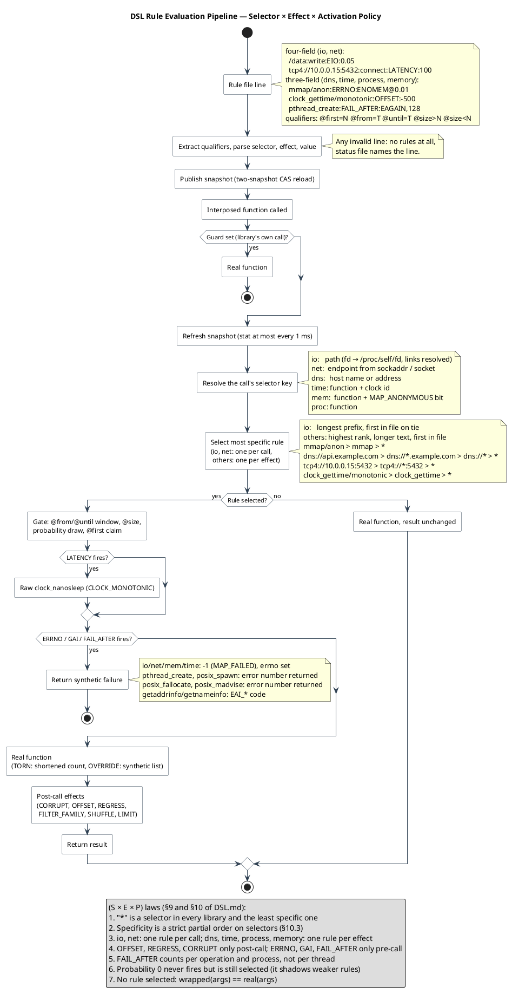

<!--
━━━━━━━━━━━━━━━━━━━━━━━━━━━━━━━━━━━━━━━━━━━━━━━━━━━━━━━━━━━━━
  Engineered by  Christian Schnapka
                 Embedded Principal+ Engineer
                 Macstab GmbH · Hamburg, Germany
                 https://macstab.com
━━━━━━━━━━━━━━━━━━━━━━━━━━━━━━━━━━━━━━━━━━━━━━━━━━━━━━━━━━━━━
-->

# Cross-Layer DSL — Identity, Grammar, and Composition Algebra

> *Engineered by* **[Christian Schnapka](https://macstab.com)** — Embedded Principal+ Engineer · [Macstab GmbH](https://macstab.com) · Hamburg, Germany

---

> The README states that one *selector × effect × policy* model spans the libc layer
> (this repository), the JVM layer and the orchestration layer. This document makes
> that statement precise, gives the exact rule grammar of all six `libchaos-<lib>`
> libraries, and lists where the layers do not translate.
>
> Audience: engineers mapping a JVM-layer scenario onto libc rules or back, and
> anyone who needs the exact grammar, selection order and composition order of the
> rule files.
>
> Scope of verification: every statement about the libc layer is taken from the
> parsers (`src/config/chaos_io_config.c`, `src/<lib>/chaos_<lib>_config.c`,
> `src/common/chaos_policy.h`) and the wrappers. The JVM and orchestration columns
> describe the `chaos-testing-java-agent` and `chaos-testing` repositories and are
> sketches of their surface, not verified here.

---

## Table of contents

1. [The identity claim, stated precisely](#1-the-identity-claim-stated-precisely)
2. [Formal grammar (ABNF, RFC 5234)](#2-formal-grammar-abnf-rfc-5234)
3. [Per-layer mapping table](#3-per-layer-mapping-table)
4. [Selector taxonomy across layers](#4-selector-taxonomy-across-layers)
5. [Effect taxonomy across layers](#5-effect-taxonomy-across-layers)
6. [Probability semantics and PRNG model](#6-probability-semantics-and-prng-model)
7. [Activation policy semantics](#7-activation-policy-semantics)
8. [Composition algebra](#8-composition-algebra)
9. [Identity laws](#9-identity-laws)
10. [Formal proof of the specificity partial order](#10-formal-proof-of-the-specificity-partial-order)
11. [Asymmetries — what does *not* translate](#11-asymmetries--what-does-not-translate)
12. [Worked translation examples](#12-worked-translation-examples)
13. [References](#13-references)

---

## 1. The identity claim, stated precisely

"The same selector × effect × policy DSL spans every layer" is too loose to test.
The precise claim:

> Every scenario in the stack is a set of triples **(S, E, P)**:
> - **S**, a *selector*: a predicate over an interception event
>   `{call site, arguments, context}`;
> - **E**, an *effect*: a transformation of the call's outcome (pre-call failure,
>   pre-call delay, argument change, result change, result-set transform);
> - **P**, an *activation policy*: a predicate over call and scenario state.
>
> A triple fires iff it is *selected* for the event, `S(event)` holds and
> `P(state)` holds; the observable behaviour is `E` applied around the real call.

Identity claim: **the algebra of (S, E, P) is the same on every layer; the
vocabularies differ.** §11 lists the vocabulary gaps; none breaks the structure.

How the libc layer instantiates the triple:

| Part | libc layer |
|---|---|
| S | a path prefix (io), an endpoint (net), a host name or address (dns), a function or function/argument class (time, process, memory), always with `*` as catch-all |
| E | ERRNO (spelled as the errno name in io and net), GAI (`EAI_*`, dns), LATENCY, TIMEOUT, CORRUPT, TORN, TRICKLE, DUP, RESET, OFFSET, REGRESS, REWRITE, OVERRIDE, SERVICE, FILTER_FAMILY, SHUFFLE, LIMIT, FAIL_AFTER |
| P | probability ∧ `@from`/`@until` window ∧ `@size` gate ∧ `@first` budget; for FAIL_AFTER additionally a per-operation call counter |
| selection | io, net: **one rule per call**, the most specific for the call's operation. dns, time, process, memory: **one rule per effect**, the most specific for each effect, so several effects compose on one call (§8) |

---

## 2. Formal grammar (ABNF, RFC 5234)

### 2.1. Common rule envelope

All six libraries share the line structure, the probability and qualifier syntax,
the limits and the failure behaviour; they differ in field layout and vocabulary.

```abnf
file          = *( line LF ) [ line ]
line          = [ rule *( 1*WSP qualifier ) ] *WSP [ comment ]
comment       = "#" *( VCHAR / WSP )         ; "#" starts a comment anywhere

;; Two field layouts (whitespace around each field is trimmed):
four-field    = selector ":" operation ":" effect-or-errno ":" value     ; io, net
three-field   = selector ":" effect ":" value                            ; dns, time, process, memory
payload-prob  = payload [ "@" probability ]   ; three-field values: split at the LAST "@",
                                              ; no blank before or after "@"

;; Probability: identical parser in every library (chaos_policy_parse_probability)
probability   = ( "0" [ "." 1*DIGIT ] ) / ( "1" [ "." 1*"0" ] )   ; [0, 1], locale-independent

;; Qualifiers: trailing words that start with "@" (chaos_policy.h)
qualifier     = "@first=" number              ; number > 0
              / "@from="  number              ; Unix milliseconds
              / "@until=" number              ; Unix milliseconds; > @from when both are set
              / "@size>"  number
              / "@size<"  number
number        = 1*18DIGIT
```

Rules common to all libraries:

- One rule per line. A `#` anywhere starts a comment, so no selector or value can
  contain `#`.
- Parsing is all-or-nothing: one invalid line (unknown selector, effect, errno,
  illegal effect/selector pair, malformed qualifier, qualifier without a rule)
  leaves the library with **no rules**. The status file
  `/tmp/.chaos-<lib>.status` names the line (`state=error`, `line=`,
  `reason=invalid rule`, `text=`).
- Limits per library: 256 rules (`too many rules`), a rule file smaller than
  262 144 bytes (`file too large`), no NUL byte (`file contains a NUL byte`).
- The probability parser accepts only the forms above, independent of
  `LC_NUMERIC` (a JVM calls `setlocale(LC_ALL, "")`; under a German locale `strtod`
  stops at the `.` of `0.5`). `nan`, `inf`, exponents and hexadecimal are rejected.
- In three-field libraries an omitted probability is 1.0. In io and net the
  probability is the `value` field itself and is mandatory for every effect except
  LATENCY and TRICKLE, which have none.

The grammar is checked by the property-based parser test suite. Run it to confirm
all six parsers accept valid inputs and reject malformed ones:

```sh verified
make unit 2>&1 | grep -E 'PROPTEST|test_config|OK|Assertion|Abort|Error'
```

### 2.2. libc layer (this repo)

```abnf
;; ---------------------------------------------------------------- libchaos-io
;; /tmp/.chaos-io.conf      selector ends at the first ":"
io-rule       = io-selector ":" io-op ":" io-effect
io-selector   = "*" / 1*1023( %x21-22 / %x24-39 / %x3B-7E )  ; no ":" or "#"; absolute
                                                            ; paths are prefixes
io-op         = "read" / "write" / "open" / "close" / "fsync" / "fdatasync"
              / "pread" / "pwrite" / "truncate" / "allocate"
              / "unlink" / "rename_from" / "rename_to"
io-effect     = io-errno ":" probability
              / "LATENCY" ":" ms
              / "TORN" ":" probability                      ; write, pwrite only
              / "CORRUPT" ":" probability                   ; read, pread only
io-errno      = "EIO" / "ENOSPC" / "EDQUOT" / "EROFS" / "EACCES"
              / "EMFILE" / "ENFILE" / "ENOENT"
ms            = 1*DIGIT                                     ; 0 .. 4294967295

;; --------------------------------------------------------------- libchaos-net
;; /tmp/.chaos-net.conf     fields are split from the RIGHT, so the endpoint
;; may contain ":"
net-rule      = endpoint ":" net-op ":" net-effect
endpoint      = "*"
              / ( "tcp4" / "udp4" ) "://" ( ipv4 / "*" ) ":" port
              / ( "tcp6" / "udp6" ) "://" ( "[" ipv6 "]" / "*" ) ":" port
              / "unix://" unix-path                         ; exact path, "@name" for
                                                            ; abstract sockets, or "*"
port          = 1*5DIGIT                                    ; 0 .. 65535, exact: no wildcard
net-op        = "socket" / "bind" / "listen" / "connect" / "accept"
              / "shutdown" / "poll" / "send" / "recv" / "close"
net-effect    = net-errno ":" probability                   ; every operation
              / "LATENCY" ":" ms                            ; every operation
              / "CORRUPT" ":" probability                   ; recv only
              / "TRICKLE" ":" bytes                         ; recv only; bytes >= 1
              / "DUP" ":" probability                       ; recv only
              / "TIMEOUT" ":" probability                   ; poll only
              / "RESET" ":" probability                     ; close only
net-errno     = "ECONNREFUSED" / "ETIMEDOUT" / "ECONNRESET" / "EHOSTUNREACH"
              / "ENETUNREACH" / "EADDRINUSE" / "EADDRNOTAVAIL" / "EAFNOSUPPORT"
              / "EPROTONOSUPPORT" / "EPIPE" / "ENOTCONN" / "EOPNOTSUPP" / "EINVAL"
              / "EINTR" / "ENOMEM" / "ENOBUFS" / "EMFILE" / "ENFILE" / "EAGAIN"
;; socket rules accept only "*", a wildcard host with port 0 ("tcp4://*:0"),
;; or "unix://*": a new socket has no address yet.

;; --------------------------------------------------------------- libchaos-dns
;; /tmp/.chaos-dns.conf
dns-rule      = dns-selector ":" dns-effect
dns-selector  = "*"                                         ; forward lookups only
              / "dns://*" / "dns://" hostname / "dns://*." hostname-suffix
              / "rdns://*" / "rdns://" ipv4 / "rdns://[" ipv6 "]"
dns-effect    = gai-name ":" probability                    ; GAI
              / "LATENCY" ":" ms [ "@" probability ]
              / "REWRITE" ":" hostname [ "@" probability ]
              / "SERVICE" ":" service [ "@" probability ]
              / "OVERRIDE" ":" ip-list [ "@" probability ]      ; dns:// and "*" only
              / "FILTER_FAMILY" ":" family [ "@" probability ]  ; dns:// and "*" only
              / "LIMIT" ":" count [ "@" probability ]           ; dns:// and "*" only; >= 1
              / "SHUFFLE" ":" probability                       ; dns:// and "*" only
gai-name      = "EAI_AGAIN" / "EAI_FAIL" / "EAI_NONAME" / "EAI_MEMORY" / "EAI_SYSTEM"
family        = "inet4" / "ipv4" / "inet6" / "ipv6" / "any"
ip-list       = ip *( "," ip )                              ; IPv4, IPv6 or [IPv6]
;; host names match case-insensitively; "*." matches at a "." boundary only.

;; -------------------------------------------------------------- libchaos-time
;; /tmp/.chaos-time.conf
time-rule     = time-selector ":" time-effect
time-selector = "*" / "clock_gettime" / "clock_gettime/" clock / "nanosleep" / "usleep"
clock         = "realtime" / "monotonic" / "monotonic_raw" / "realtime_coarse"
              / "monotonic_coarse" / "boottime" / "tai"
              / "process_cputime_id" / "thread_cputime_id"
              / [ "-" ] 1*DIGIT                             ; numeric clockid_t
time-effect   = "ERRNO" ":" time-errno [ "@" probability ]
              / "LATENCY" ":" ms [ "@" probability ]
              / "OFFSET" ":" offset [ "@" probability ]     ; clock_gettime[/clock] only
              / "REGRESS" ":" offset [ "@" probability ]    ; clock_gettime/clock only, > 0
time-errno    = "EINVAL" / "EFAULT" / "EINTR" / "EPERM" / "ENOSYS" / "EAGAIN"
              / 1*DIGIT                                     ; 1 .. 2147483647
offset        = [ "-" / "+" ] 1*DIGIT                       ; ms, |offset| <= 3155760000000

;; ----------------------------------------------------------- libchaos-process
;; /tmp/.chaos-process.conf
proc-rule     = proc-selector ":" proc-effect
proc-selector = "*" / "pthread_create" / "fork" / "posix_spawn" / "posix_spawnp"
              / "execve" / "execveat" / "waitpid"
proc-effect   = "ERRNO" ":" proc-errno [ "@" probability ]
              / "LATENCY" ":" ms [ "@" probability ]
              / "FAIL_AFTER" ":" proc-errno "," count [ "@" probability ]
proc-errno    = "EAGAIN" / "ENOMEM" / "EACCES" / "ENOENT" / "EINTR" / "ECHILD"
              / "EPERM" / "ESRCH" / "EBUSY" / "EINVAL" / "ENOSYS" / "EMFILE"
              / "ENFILE" / "E2BIG" / 1*DIGIT                ; 1 .. 2147483647
count         = 1*DIGIT                                     ; uint64

;; ------------------------------------------------------------ libchaos-memory
;; /tmp/.chaos-memory.conf
mem-rule      = mem-selector ":" mem-effect
mem-selector  = "*" / "mmap" / "mmap/anon" / "mmap/file"
              / "munmap" / "mprotect" / "madvise"
mem-effect    = "ERRNO" ":" mem-errno [ "@" probability ]
              / "LATENCY" ":" ms [ "@" probability ]
mem-errno     = "ENOMEM" / "EINVAL" / "EACCES" / "EPERM" / "EBADF" / "ENODEV"
              / "EAGAIN" / "EFAULT" / "ENOSYS" / "ENFILE" / "EMFILE"
              / 1*DIGIT                                     ; 1 .. 2147483647
```

Which functions each selector covers (the wrappers, not the grammar, decide this):

| Library | Mapping notes |
|---|---|
| io | Operation → function table in [IO.md §1](IO.md#1-overview); stdio, path forms and LFS/fortified names included. |
| net | `read`/`write`/`readv`/`writev` on sockets use the `recv`/`send` rules; details in [NETWORK.md](NETWORK.md). |
| dns | `getaddrinfo`, `getnameinfo`, `gethostbyname[2][_r]`, `gethostbyaddr[_r]`. |
| time | `gettimeofday`, `time` and `timespec_get(TIME_UTC)` read `CLOCK_REALTIME` and follow `clock_gettime`/`clock_gettime/realtime` rules; `sleep` and `clock_nanosleep` follow `nanosleep` rules. |
| process | the exec family (`execv`, `execvp`, `execvpe`, `execl`, `execlp`, `execle`) follows `execve` rules, `fexecve` follows `execveat`, `system`/`popen` follow `posix_spawn`, `wait`/`wait3`/`wait4`/`waitid` follow `waitpid`. |
| memory | `mmap64` (glibc) follows the `mmap` rules, `posix_madvise` the `madvise` rules. |

### 2.3. JVM layer (chaos-testing-java-agent) — sketch

The JVM layer expresses the same triple with a Java builder instead of text rules:

```abnf
;; Conceptual ABNF for the JVM-layer scenario builder
jvm-scenario  = "ChaosScenario.builder(" name ")"
                ".selector(" jvm-selector ")"
                ".effect(" jvm-effect ")"
                ".activationPolicy(" jvm-policy ")"
                ".build()"

jvm-selector  = "ChaosSelector." selector-class "(" *param ")"
selector-class = "network" / "dns" / "ssl" / "jdbc" / "http"
              / "thread" / "monitor" / "fileIO" / "classLoading"
              / ...

jvm-effect    = "ChaosEffect." effect-class "(" *param ")"
effect-class  = "delay" / "throwException" / "fail" / "stress"
              / "deadlock" / "spike" / "drop"

jvm-policy    = "ActivationPolicy." policy-class "(" *param ")"
policy-class  = "always" / "count" / "timeWindow" / "session"
```

The canonical reference is the JVM repository's `chaos-agent-api` module; this sketch
documents the shape for translation only.

### 2.4. Orchestration layer (chaos-testing) — sketch

The orchestration layer expresses scenarios as JUnit annotations or YAML on top of
Testcontainers:

```abnf
orch-scenario = "@Chaos" param-list / declarative-yaml
yaml          = "chaos:" CRLF *yaml-rule
yaml-rule     = "  - selector:" yaml-selector CRLF
                "    effect:" yaml-effect CRLF
                [ "    policy:" yaml-policy CRLF ]
                [ "    probability:" probability CRLF ]
```

Same caveat as §2.3: a sketch of the surface, not its source of truth.

---

## 3. Per-layer mapping table

| Concept | libc layer (this repo) | JVM layer (chaos-testing-java-agent) | Orchestration layer (chaos-testing) |
|---|---|---|---|
| **Selector** | Path prefix, endpoint, host name/address, or function selector parsed from a text rule | `ChaosSelector` typed builder — `network()`, `jdbc()`, `dns()`, etc. | `@Chaos(target=…)` annotation parameter; YAML `selector:` block |
| **Selector match site** | Inside the wrapper, against the call's arguments (descriptors resolved to paths or endpoints) | Inside the ByteBuddy-injected advice at the JDK call site | At the orchestration boundary (Toxiproxy / Testcontainers `withCommand` hook) |
| **Effect** | ERRNO, GAI, LATENCY, TIMEOUT, CORRUPT, TORN, TRICKLE, DUP, RESET, OFFSET, REGRESS, REWRITE, OVERRIDE, SERVICE, FILTER_FAMILY, SHUFFLE, LIMIT, FAIL_AFTER | `ChaosEffect.delay/throw/fail/stress/deadlock/spike/drop` | Toxiproxy toxics / `tc netem` rules / cgroup throttling |
| **Effect application phase** | Pre-call (ERRNO, GAI, LATENCY, FAIL_AFTER; TORN shortens the count), instead of the call (OVERRIDE), post-call (CORRUPT, OFFSET, REGRESS, result-set transforms) | Same conceptual phases at the bytecode advice level | At the network/cgroup boundary, always pre-effect from the application's perspective |
| **Activation policy** | Probability, `@first`, `@from`/`@until`, `@size`; FAIL_AFTER's call counter | `ActivationPolicy.always/count/timeWindow/session` | Annotation parameters + scenario lifecycle hooks |
| **Activation evaluation** | Per call: window, size gate, one draw from a per-thread PRNG, `@first` claim | Per-call dispatcher check + session-scoped state | Lifecycle-driven (apply on `@BeforeEach`, remove on `@AfterEach`) |
| **Configuration source** | Text file `/tmp/.chaos-<lib>.conf` | Java code (builder) + JSON startup config | YAML / annotations + dynamic Testcontainers calls |
| **Reload semantics** | `stat()` of the rule file at most every 1 ms, two-snapshot publication under a CAS-owned reload | Live registration / deregistration via dispatcher API | Lifecycle hooks; the boundary mutates between phases |
| **Failure mode on bad config** | Fail-open: no rules, status file names the line | Fail-fast at builder validation (`IllegalArgumentException`) | Fail-fast at YAML parse |
| **Detection by SUT** | `getenv("LD_PRELOAD")` / `/proc/self/maps` | `Thread.currentThread().getContextClassLoader().getResource("chaos-agent-marker")` | External — orchestration is outside the SUT |

---

## 4. Selector taxonomy across layers

Selectors are predicates over an interception event. The vocabulary is
layer-specific because the interception sites differ; the kinds of predicate are
shared.

### 4.1. Predicate taxonomy

| Predicate kind | libc layer | JVM layer | Orchestration layer |
|---|---|---|---|
| **Exact match** | `/data/wal.log:write:…` (a prefix that equals the path); `dns://redis-replica.local:…` | `ChaosSelector.dns(NamePattern.exact("redis-replica.local"))` | `@Chaos(host = "redis-replica.local")` |
| **Prefix match** | `/data:write:…` (paths only, at `/` boundaries) | `NamePattern.prefix("redis-replica.")` | `@Chaos(hostPrefix = "redis-replica.")` |
| **Suffix match** | `dns://*.example.internal:…` (host names, at `.` boundaries) | `NamePattern.suffix(".example.internal")` | YAML `hostSuffix:` |
| **Wildcard (catch-all)** | `*` in every library (`*:write:…`, `*:LATENCY:…`) | `ChaosSelector.any()` | `@Chaos(applyToAll = true)` |
| **Tuple match** | `tcp4://127.0.0.1:5432:connect:…` (family, host, port; host may be `*`, port is exact) | `ChaosSelector.network(Set.of(SOCKET_READ), NamePattern.prefix("redis-replica."))` | YAML `target: { family: tcp4, host:…, port:… }` |
| **Symbol-name match** | `pthread_create:…`, `clock_gettime:…`, `munmap:…` | Implicit in the `ChaosSelector.<class>` choice | N/A (the orchestration layer is below libc) |
| **Subkind match** | `mmap/anon`, `clock_gettime/monotonic` | Sub-selectors via builder-method choice | N/A |

Host names have no prefix match on the libc layer: dns selectors are exact, suffix
(`*.`) or any.

### 4.2. Match algebra

When several rules match, the more specific one wins. The libc implementations
realise "more specific" as a rank, then a tie-break:

| Library | Selected per | Rank (high wins) | Tie-break |
|---|---|---|---|
| io | call (operation) | length of the written, normalised prefix (`*` counts 1) | first in file |
| net | call (operation) | 4 exact `unix://` path; 3 exact address and port; 2 wildcard host with port, or `unix://*`; 1 `*` | longer selector text, then first in file |
| dns | effect | 3 exact name/address; 2 `*.` suffix; 1 `*`, `dns://*`, `rdns://*` | longer selector text, then first in file |
| time | effect | 3 `clock_gettime/<clock>`; 2 function; 1 `*` | longer selector text, then first in file |
| process | effect | 2 function; 1 `*` | longer selector text, then first in file |
| memory | effect | 3 `mmap/anon`, `mmap/file`; 2 function; 1 `*` | longer selector text, then first in file |

`*` is always the least specific selector. A net call that has two endpoints to
consider (local and peer) searches both in one pass, so a wildcard for the end
tried first cannot shadow a more specific rule for the other.

The JVM layer enforces specificity through its type system; the libc layer through
these ranks.

---

## 5. Effect taxonomy across layers

The effect vocabulary partitions by *what* it transforms in the call's lifecycle.
libc syntax is shown as written in the rule file.

### 5.1. Class A — pre-call failure (ERRNO, GAI)

Returns a synthetic failure; the real call does not run (exception: io `close`,
which closes first and then reports the error, see [IO.md §4](IO.md#4-end-to-end-behavior)).

| libc | JVM | Orchestration |
|---|---|---|
| `/data:write:EIO:1.0` (io) | `throwException(IOException.class)` | Toxiproxy `down` |
| `tcp4://10.0.0.5:5432:connect:ECONNREFUSED:1.0` (net) | `throwException(ConnectException.class)` | iptables DROP / Toxiproxy `down` |
| `tcp4://10.0.0.5:5432:recv:ETIMEDOUT:1.0` (net) | `throwException(SocketTimeoutException.class)` | Toxiproxy `timeout` |
| `dns://db.internal:EAI_AGAIN:1.0` (dns) | `throwException(UnknownHostException.class, retry=true)` | DNS server SERVFAIL |
| `pthread_create:ERRNO:EAGAIN` (process) | `throwException(OutOfMemoryError.class)` (native-thread analogue) | N/A |

### 5.2. Class B — pre-call latency (LATENCY)

Delays the call, then lets it run. Every library sleeps with a raw
`clock_nanosleep` system call on `CLOCK_MONOTONIC`, restarted on `EINTR`, so no
other preloaded library (libchaos-time in particular) can shorten or lengthen it.

| libc | JVM | Orchestration |
|---|---|---|
| `tcp4://10.0.0.5:6379:recv:LATENCY:200` (net), `*:LATENCY:200` (memory) | `delay(Duration.ofMillis(200))` | Toxiproxy `latency` toxic / `tc qdisc add netem delay` |

Observed time = added latency + real call cost. In dns, time, process and memory a
LATENCY rule and an ERRNO (or GAI) rule can both apply to one call: the delay runs
first, then the failure. In io and net one rule decides the call, so a LATENCY rule
and an ERRNO rule for the same operation and equally specific selector never both
apply (§8).

### 5.3. Class C — argument and result mutation (TORN, CORRUPT, OFFSET, REGRESS)

| libc | Phase | JVM | Orchestration |
|---|---|---|---|
| `clock_gettime/realtime:OFFSET:500` | after the call: the returned time is shifted | `clockSkew(Duration.ofMillis(500))` | N/A (clocks cannot be mutated at the orchestration boundary) |
| `clock_gettime/monotonic:REGRESS:1000` | after the call: the clock steps back once | N/A | N/A |
| `/data:read:CORRUPT:0.1` (io), `…:recv:CORRUPT:0.1` (net) | after a successful read: one bit of the returned bytes flips | `byteCorruption(probability=0.1)` | Toxiproxy `bandwidth` + custom byte mangler (rare) |
| `/data:write:TORN:0.1` | before the call: the byte count is shortened to `[1, n-1]` | `partialWrite(probability=0.1)` | N/A |

### 5.4. Class D — result-set transform (DNS)

Operates on the address list of `getaddrinfo` (and the hostent resolvers).

| libc | JVM | Orchestration |
|---|---|---|
| `dns://db.internal:OVERRIDE:127.0.0.1,[::1]` | `dnsRedirect(InetAddress[]…)` | DNS rewrite (CoreDNS / dnsmasq with custom zones) |
| `dns://db.internal:REWRITE:newhost.internal` | `dnsRewrite("newhost.internal")` | Same |
| `dns://db.internal:FILTER_FAMILY:inet6` | `filterAddressFamily(IPV6)` | DNS server returning AAAA-only or A-only |
| `dns://db.internal:LIMIT:1` | `limitResults(1)` | DNS server with `--max-answers` |
| `dns://db.internal:SHUFFLE:0.3` | `shuffleResults(probability=0.3)` | N/A (most DNS servers preserve answer order) |
| `dns://db.internal:SERVICE:15432` | `dnsPortRewrite(15432)` | N/A (the port is application-layer, not DNS) |

### 5.5. Class E — counter-driven failure (FAIL_AFTER)

The first N calls pass; later calls fail (each with the rule's probability).

| libc | JVM | Orchestration |
|---|---|---|
| `pthread_create:FAIL_AFTER:EAGAIN,128` | `ActivationPolicy.count(128)` + `throwException(...)` (inverted: JVM `count(N)` fires on the first N) | N/A |

The libc layer folds the counter into the effect, the JVM layer into the policy.
Both are the canonical triple with the counter state in P. The libc counter is per
operation and per process, shared by all threads, reset to zero at every rule-file
publication and in a forked child.

### 5.6. Network delivery effects (TRICKLE, DUP, TIMEOUT, RESET)

`recv` rules can deliver data in chunks of at most N bytes (TRICKLE) or duplicate
it (DUP); `poll` rules can time out (TIMEOUT); `close` rules can reset the
connection (RESET). Semantics: [NETWORK.md](NETWORK.md).

---

## 6. Probability semantics and PRNG model

### 6.1. Semantics

- `p = 0`: the rule never fires. It still matches and is still selected (§9.2).
- `p = 1`: the rule fires on every call that passes its qualifiers.
- `0 < p < 1`: a Bernoulli trial per call: one 32-bit draw `u`, fire iff
  `u < p × 2^32`.
- The probability is checked after the `@from`/`@until` window and the `@size`
  gate and before the `@first` claim; a rule filtered out earlier consumes no draw
  (FAIL_AFTER draws once its threshold is reached, before the other gates).
- LATENCY and TRICKLE in io and net have no probability. Omitted probability in
  three-field libraries means 1.0.

Identity across layers: same definition, same closed interval.

### 6.2. PRNG state

| Layer | State | Seeding | Quality |
|---|---|---|---|
| libc | `__thread uint64_t g_chaos_<lib>_tls_prng_state`, xorshift64* | Process seed: 8 bytes of `/dev/urandom` read with raw system calls in the constructor (fallback `0x6a09e667f3bcc909 ^ getpid()`). Per thread, on its first draw: SplitMix64(process seed ⊕ kernel thread id ⊕ stack address) with the low bit forced to 1 | xorshift64* (period 2^64 − 1); sufficient for fault injection |
| JVM | `SplittableRandom` per scenario / per session (per-thread split) | `Thread`-local split from a session seed | L'Ecuyer-class (`SplittableRandom` is well studied) |
| Orchestration | Server-side (Toxiproxy uses Go's `math/rand`) | Toxiproxy seeds from time at process start | Sufficient for chaos |

### 6.3. Why per-thread, lazily seeded

**Per thread.** No shared state and no contention in highly parallel processes;
each thread evolves its own sequence.

**Lazily seeded.** A thread that never evaluates a probability never pays for
seeding. The process seed itself is read once in the constructor.

**fork.** The child's atfork handler zeroes the forking thread's state, so the child
reseeds from its own thread id; pre-fork worker pools would otherwise make identical
decisions in every worker.

**Why `SplittableRandom` on the JVM.** Steele, Lea, Flood, "Fast splittable
pseudorandom number generators", OOPSLA 2014. The libc side shares the desiderata
(independent per-thread sequences, no shared state, cheap next value) and uses the
same paper's SplitMix64 finaliser to derive its per-thread seeds.

---

## 7. Activation policy semantics

### 7.1. Today's surface

Besides the probability, every library accepts the same **rule qualifiers**
(`src/common/chaos_policy.h`), written as separate words after the rule and before
any `# owner` comment:

| Qualifier | Meaning |
|---|---|
| `@first=N` | Fire at most N times per process (N ≥ 1), then go inert: start-up faults that clear by themselves. |
| `@from=T` | Active only once the wall clock reaches T (Unix milliseconds). |
| `@until=T` | Active only while the wall clock is before T. With `@from`, the window is `[from, until)`; `@until` must be later than `@from`. One rule file can hold a whole incident timeline. |
| `@size>N` / `@size<N` | Only calls moving more / fewer than N bytes. Both may be combined. A call without a byte count never matches a size-gated rule. |

```text
tcp4://127.0.0.1:5432:connect:ECONNREFUSED:1.0 @first=3 # net
/data:write:EIO:1.0 @from=1760000000000 @until=1760000005000 # disk
tcp4://127.0.0.1:9092:send:LATENCY:200 @size>65536
```

Calls that carry a byte count:

| Library | Calls with a byte count |
|---|---|
| io | `read`, `write`, `pread`, `pwrite`, their `v` forms (sum of `iov_len`), `sendfile`, `copy_file_range`, `fallocate`, `posix_fallocate` (length), stdio `fread`/`fwrite` (size × count), `fgets` (size), `fgetc`/`getc`/`fputc`/`putc` (1), `fputs` (length) |
| net | `send`, `sendto`, `sendmsg`, `sendmmsg`, `recv`, `recvfrom`, `recvmsg`, and `read`/`write`/`readv`/`writev` on sockets |
| memory | `mmap`, `munmap`, `mprotect`, `madvise`, `posix_madvise` (length) |
| dns, time, process | none |

Semantics:

- **Placement.** Qualifiers are the trailing whitespace-separated words that start
  with `@`; the line is cut before the first of them. A blank before a three-field
  `@probability` therefore turns it into a qualifier word and rejects the line.
- **Validation.** An unknown or malformed qualifier, a number of more than 18 digits,
  `@first=0`, `@until` not after `@from`, or qualifiers on a line without a rule
  reject the file like any invalid line.
- **Wall clock.** The window is checked against `CLOCK_REALTIME` read from the vDSO
  (or the raw system call), never through the interposed `clock_gettime`, so a
  libchaos-time OFFSET rule does not move another rule's window. Absolute times make
  every process of a container agree on the window; the JVM layer turns relative
  durations into absolute times.
- **Order of checks.** Window, size gate, probability, then the `@first` claim. Only
  a rule that passes all four fires and records a hit. FAIL_AFTER differs: its call
  counter advances on every matched call first, then the threshold and probability
  are checked, then window, size gate and `@first`.
- **`@first` scope.** Per process. The budget survives a reload that keeps the rule's
  text unchanged (the rule keeps its hit slot). A forked child starts from zero: the
  atfork handler clears the claims it inherited. A `vfork` child shares its parent's
  memory and therefore its budget.

Policy mapping:

- **`always`** ≡ probability 1 (`…:1.0` in io and net; omitted in three-field libraries).
- **`count`** ≡ `@first=N`.
- **`time_window`** ≡ `@from=` / `@until=`.
- **`session`** ≡ not applicable: the libc libraries are process-scoped; a session is
  a JVM-layer concept tied to the JUnit test lifecycle.

### 7.2. JVM-layer surface

| Policy | Semantics |
|---|---|
| `ActivationPolicy.always()` | Fire on every match. |
| `ActivationPolicy.count(N)` | Fire on the first N matches; pass through thereafter. |
| `ActivationPolicy.timeWindow(start, end)` | Fire only between `start` and `end`. |
| `ActivationPolicy.session(id)` | Fire only when the current thread's session context matches `id`. |

### 7.3. Cross-layer translation

| JVM `ActivationPolicy` | libc rule construction |
|---|---|
| `always()` | probability `1.0` (io, net: the value field; others: omit `@p`) |
| `count(N)` | `… @first=N` |
| `timeWindow(start, end)` | `… @from=<start ms> @until=<end ms>` |
| `session(id)` | *No clean translation.* Sessions do not exist in the libc layer. |

---

## 8. Composition algebra

When several rules could apply to one intercepted call, the libraries compose them
in a fixed order.

### 8.1. libc layer composition order

**io and net: one rule per call.** The wrapper selects the single most specific rule
for the call's operation (§4.2) and applies only its effect:

```text
select one rule
  LATENCY  → sleep, real call
  ERRNO    → fail (no real call; io close: real close, then fail)
  TORN     → real call with shortened count            (io write, pwrite)
  CORRUPT  → real call, then flip one returned bit     (io read, pread; net recv)
  other net effects: see NETWORK.md
```

**dns, time, process, memory: one rule per effect.** Each effect is looked up
independently; the order is fixed in the wrappers:

| Library / call | Order |
|---|---|
| memory (`mmap`, `munmap`, `mprotect`, `madvise`, `posix_madvise`) | LATENCY → ERRNO → real call |
| process (every operation) | LATENCY → ERRNO → FAIL_AFTER → real call |
| time, clock reads (`clock_gettime`, `gettimeofday`, `time`, `timespec_get`) | LATENCY → ERRNO → real call → OFFSET → REGRESS |
| time, sleeps (`nanosleep`, `sleep`, `clock_nanosleep`, `usleep`) | LATENCY → ERRNO → real call (`clock_nanosleep` with `TIMER_ABSTIME` maps the deadline back through OFFSET/REGRESS) |
| dns `getaddrinfo` | LATENCY → GAI → REWRITE → SERVICE → OVERRIDE *or* real call → FILTER_FAMILY → SHUFFLE → LIMIT |
| dns `getnameinfo` | LATENCY → GAI → real call → REWRITE → SERVICE (on the returned host and service) |

A failure (ERRNO, GAI, FAIL_AFTER) ends the call: no real call and no later effect.
In process, a fired ERRNO also means the FAIL_AFTER rule is not evaluated, so its
counter does not advance on that call.

### 8.2. JVM-layer composition order

Per the JVM dispatcher (conceptual; canonical reference is the chaos-testing-java-agent
README):

1. Selector match (8-check evaluation pipeline).
2. Activation policy check.
3. Inline effect (latency / exception throw).
4. Background stressor effects (long-running pressure that does not return on the
   calling thread).

Inline ordering inside step 3 mirrors libc: latency, then exception, then the real
call, then result mutation.

### 8.3. Identity across layers

The order has the same shape everywhere: **prelude (latency) → guard (failure) →
real call → postlude (mutation)**. The libc io and net libraries are the degenerate
case in which exactly one of those stages is populated per call. Result-set
transforms (dns) are libc-specific.

### 8.4. DSL Rule Evaluation Pipeline Diagram

Full pipeline from rule text to applied effect ([source](diagrams/dsl_pipeline.puml)):



---

## 9. Identity laws

Algebraic identities the libc layer satisfies, each falsifiable. `apply(R, e)` is
the observable outcome of event `e` under rule set `R`.

### 9.1. Empty-rule-set identity

```
∀ event:  apply(∅, event) ≡ real_call(event)
```

With no rules (no file, an empty file, or a rejected file) every wrapper forwards
its arguments unchanged and leaves `errno` as the real function set it; the only
difference from no preload is the per-call overhead (see `docs/BENCHMARKS.md`).

### 9.2. Probability-zero law

```
∀ rule r, event e:  r@0 never fires.
apply(R ∪ {r@0}, e) ≡ apply(R, e)   iff   r@0 is not selected for e
```

A zero-probability rule never applies its effect, but it is still a candidate:
when it is the most specific match it is selected and the rule it outranks does not
apply. In io and net that is any rule for the same operation with a shorter
selector; in the other libraries any rule of the same effect with a lower rank. A
`@0` rule is therefore a way to exempt a narrower selector from a broader rule, not
a no-op.

### 9.3. Probability-one identity

```
∀ rule, event:  apply(rule@1, event) ≡ apply(rule, event)
```

In three-field libraries an omitted probability parses as 1.0
(`chaos_<lib>_parse_payload_probability()`). In io and net the probability is a
required field; `1` and `1.0` are equivalent.

### 9.4. Idempotent reload

```
∀ rule file c:  load(c) ; load(c) ≡ load(c)
```

Reloading identical text yields the same rule set. Hit counts and `@first` budgets
survive, because a rule whose text is unchanged keeps its hit slot. Exception:
libchaos-process resets every FAIL_AFTER counter at each publication, so rewriting
an unchanged file restarts FAIL_AFTER's grace period. (A provisional re-read that
finds identical content does not publish and resets nothing.)

### 9.5. Wildcard precedence

```
∀ rule r with selector S ≠ "*", ∀ rule r_w with selector "*":
  S matches e  ⇒  r_w is not selected for e (for the same operation / effect)
```

`*` has the lowest rank in every library. Edge case in io: `*` counts as length 1,
like the selector `/`; between those two the first in the file wins.
`test/unit/test_config_parse.c` (`test_parse_buffer_and_selection`,
`test_matching_edges`) covers selection and the `*` file-only rule.

### 9.6. Non-commutativity of result-set transforms

```
FILTER_FAMILY ∘ SHUFFLE ∘ LIMIT  ≠  LIMIT ∘ SHUFFLE ∘ FILTER_FAMILY  (in general)
```

The `getaddrinfo` transforms are order-sensitive; `chaos_dns_resolve_with_rules()`
fixes `FILTER_FAMILY → SHUFFLE → LIMIT`, so LIMIT picks from the shuffled list of
the surviving family. An empty list after FILTER_FAMILY or LIMIT returns
`EAI_NONAME`.

### 9.7. Failure short-circuit

```
fires(ERRNO ∨ GAI ∨ FAIL_AFTER, e)  ⇒  ¬real_call(e) ∧ ¬post_call_effects(e)
```

A pre-call failure suppresses the real call and every later effect (sole exception:
io `close`, which runs the real close before reporting). LATENCY is orthogonal: in
dns, time, process and memory it may delay a call that then fails. In io and net
LATENCY, ERRNO, TORN and CORRUPT are mutually exclusive per call because only one
rule is selected.

---

## 10. Formal proof of the specificity partial order

The laws in §9 rest on selector specificity being a well-formed ordering.

### 10.1. Domain definitions

Let **E** be the set of interception events `(library, operation, key)`, e.g.:
- `(io, write, "/data/wal/segment-001")`
- `(time, clock_gettime, CLOCK_MONOTONIC)`
- `(net, connect, tcp4 10.0.0.15:5432)`

Let **S** be the set of selectors and `Match : S × E → {true, false}` the match
predicate of §4.

**Activation policy P has two kinds that must not be conflated:**

| Kind | Values | State | Semantics |
|---|---|---|---|
| **Stateless gates** | probability `p ∈ [0, 1]`, `@from`/`@until`, `@size` | none (one draw per call; the clock; the call's byte count) | evaluated independently per call |
| **Stateful budgets** | `@first=N`, FAIL_AFTER `N` | per-rule claim counter (`@first`), per-operation call counter (FAIL_AFTER), both per process | depend on the history of calls |

A `FAIL_AFTER:EAGAIN,128` rule is a counter threshold, not a probability; P =
`FAIL_AFTER(128)` is a valid policy and the algebra is unaffected. In the proofs
below `p` means the probability only.

### 10.2. The specificity relation ≺

**Definition.** `s₁ ≺ s₂` (*s₁ is strictly less specific than s₂*) iff:

```
(∀e ∈ E: Match(s₂, e) → Match(s₁, e))   [s₁ covers every event s₂ matches]
∧
(∃e ∈ E: Match(s₁, e) ∧ ¬Match(s₂, e))  [and at least one more]
```

In prose: `s₂` matches a strict subset of the events `s₁` matches.

### 10.3. Proof that (S, ≺) is a strict partial order

A strict partial order is irreflexive, asymmetric and transitive.

**Lemma 1 (Irreflexivity):** `¬(s ≺ s)`.

*Proof.* `s ≺ s` would require `∃e: Match(s, e) ∧ ¬Match(s, e)`, a contradiction. □

**Lemma 2 (Asymmetry):** `s₁ ≺ s₂ → ¬(s₂ ≺ s₁)`.

*Proof.* `s₁ ≺ s₂` gives `e₀` with `Match(s₁, e₀) ∧ ¬Match(s₂, e₀)`. `s₂ ≺ s₁` would
require `∀e: Match(s₁, e) → Match(s₂, e)`; at `e₀` this yields `Match(s₂, e₀)`, a
contradiction. □

**Lemma 3 (Transitivity):** `s₁ ≺ s₂ ∧ s₂ ≺ s₃ → s₁ ≺ s₃`.

*Proof.* Cover half: `Match(s₃, e) → Match(s₂, e) → Match(s₁, e)`. ✓
Strict half: `s₁ ≺ s₂` gives `e₁` with `Match(s₁, e₁) ∧ ¬Match(s₂, e₁)`; since
`Match(s₃, e₁) → Match(s₂, e₁)`, also `¬Match(s₃, e₁)`, so `e₁` witnesses
`Match(s₁, e₁) ∧ ¬Match(s₃, e₁)`. ✓ □

**Theorem:** `(S, ≺)` is a strict partial order. *Proof.* Lemmas 1–3. □

### 10.4. Why ≺ is NOT a total order

Selectors from disjoint domains, or overlapping without containment, are
incomparable:

| s₁ | s₂ | Relationship |
|---|---|---|
| `/data/wal` (io) | `clock_gettime/monotonic` (time) | Incomparable: disjoint event domains |
| `tcp4://*:5432` (net) | `/var/lib/pg` (io) | Incomparable: net vs io |
| `mmap` | `mmap/anon` | `mmap ≺ mmap/anon` |
| `*` | `/data` (io, same operation) | `* ≺ /data`; `*` is the minimum of each domain |
| `dns://*` | `*` (dns) | Not related by ≺: both match exactly the forward lookups; ordered only by the tie-break (§10.5) |

Within one library and operation (or effect) the rank of §4.2 is a linear extension
of ≺ on the selectors that can match the same event; across domains selectors never
compete for an event.

### 10.5. Winner selection and uniqueness

For event `e` and rule set `R`, the candidates are

```
C(R, e) = { r ∈ R : Match(r.selector, e) ∧ r.operation = e.operation }   (io, net)
C(R, e, E) = { r ∈ R : Match(r.selector, e) ∧ r.effect = E }              (dns, time, process, memory)
```

The winner maximises rank; ties are broken by the longer selector text (all but io)
and then by position in the file. The result is unique and deterministic for every
rule file: no two candidates can tie on all three keys. Ties on rank and length can
only arise between selectors that match the same events (identical text, or
`dns://*` vs `*`) or, in io, between equally long prefixes; file order resolves them.

### 10.6. Composition invariant — formal statement

**Theorem (Effect Sequencing Invariant):** for any event `e` and rule set `R`, the
effects applied to `e` occur in the order of §8.1 for its library, and no rule can
change that order.

*Proof.* By construction. The order is the statement order of each wrapper; no
rule field is read to decide it. For io and net, one rule is selected per call and
its `effect` field chooses a single branch:

```c
if (!match(fd, operation, &rule))  return real(args);
if (rule.effect == LATENCY)        apply_latency(&rule);
else if (apply_errno(&rule))       return -1;
else if (rule.effect == TORN && should_trigger(&rule))  count = torn(count);
rc = real(args);
if (rc > 0 && rule.effect == CORRUPT && should_trigger(&rule))  corrupt(buf, rc);
return rc;
```

For the other libraries each effect has its own lookup at a fixed position:

```c
if (match(LATENCY, op, &l))                      apply_latency(&l);
if (match(ERRNO, op, &f) && apply_errno(&f))     return failure;
rc = real(args);
if (match(OFFSET, op, &o))                       apply_offset(&o, &rc);   /* time */
return rc;
```

The rule's effect gates whether a stage fires, never where it sits. □

Snapshot consistency differs by family. io and net match once per call, so the call
sees one snapshot. In the per-effect libraries each lookup refreshes and reads the
active snapshot separately, so a reload published between two lookups of one call
can serve the stages from consecutive snapshots; each individual rule copy is still
whole (seqlock-validated).

### 10.7. Concrete instantiation — implementation ordering rules are valid instances of ≺

For each library's ranking we check that a higher rank never contradicts ≺, i.e.
whenever two selectors both match an event and one is strictly more specific by ≺,
the implementation prefers it.

**io — prefix length:**

- Two absolute prefixes that both cover a path are nested at a `/` boundary (one is
  a prefix of the other), so the longer one matches a subset of the shorter one's
  events. Example: every event matching `/data/wal` (`/data/wal/seg001`) matches
  `/data`; `/data/txn/001` matches `/data` only. So `/data ≺ /data/wal`, and the
  implementation prefers the longer prefix. □
- Caveats: specificity uses the written prefix's length even when a rule matches
  through its link-resolved form; and `*` (absolute non-memfd paths) and `/` tie at
  length 1 although `* ≺ /` (only `/` matches `/memfd:…`), so file order decides.

**time, memory, process — subkind depth:**

- `Match(*, e)` holds for every event of the domain; `clock_gettime` requires the
  operation; `clock_gettime/monotonic` additionally `CLOCK_MONOTONIC`. A
  `CLOCK_REALTIME` read matches `clock_gettime` but not `clock_gettime/monotonic`.
  So `* ≺ clock_gettime ≺ clock_gettime/monotonic`, matching ranks 1 < 2 < 3. The
  same holds for `* ≺ mmap ≺ mmap/anon` and `* ≺ pthread_create`. □

**net — endpoint rank:**

- `tcp4://*:5432` requires family tcp4 and port 5432; `tcp4://10.0.0.15:5432`
  additionally the host. `tcp4://10.0.0.2:5432` matches only the former. So
  `* ≺ tcp4://*:5432 ≺ tcp4://10.0.0.15:5432`, matching ranks 1 < 2 < 3. Exact
  `unix://` paths (4) are more specific than `unix://*` (2). □

**dns — name rank and suffix length:**

- `dns://api.example.com` (3) matches one name; `dns://*.example.com` (2) every name
  ending in `.example.com`; `dns://*` and `*` (1) every forward lookup. Between two
  suffix selectors that both match a name, the longer suffix is nested in the
  shorter one, and the longer text wins. □

**Corollary:** every implementation ranking is a linear extension of ≺ on the
selectors that compete for an event, so the abstract proof covers the
implementation; ties between ≺-equivalent selectors are resolved deterministically
by text length and file order.

---

## 11. Asymmetries — what does *not* translate

Where one layer's vocabulary has no clean equivalent in another. The structure
holds; the vocabulary is partial.

### 11.1. JVM-only vocabulary

| JVM concept | Why no libc equivalent |
|---|---|
| `ChaosSelector.thread(synchronizedBlock=true)` | Targets bytecode-level monitor entry. No libc symbol corresponds. |
| `ChaosSelector.classLoading(...)` | JVM-internal class-loader event. No libc symbol. |
| `ChaosSelector.gc(pause=200ms)` | GC pause injection. No libc analogue. |
| `safepointStorm` | Forces safepoint storms. No libc analogue. |
| `ActivationPolicy.session(id)` | Per-test-method scoping. The libc layer is process-scoped. |

`ActivationPolicy.timeWindow(...)` translates directly to `@from`/`@until` (§7.3).

### 11.2. libc-only vocabulary

| libc concept | Why no JVM equivalent |
|---|---|
| `OFFSET` / `REGRESS` on `clock_gettime` | `System.currentTimeMillis()` and `System.nanoTime()` are JIT intrinsics; once compiled, no bytecode remains for the agent to advise. The libc layer sees the C library time calls beneath the JVM. |
| `TORN` on `write` | Partial-write semantics are not exposed cleanly through Java's `OutputStream` API. |
| Path-prefix selector with filesystem boundary semantics and link resolution | The JVM's file abstractions do not expose kernel paths; selectors are typed differently. |
| `mmap/anon` vs `mmap/file` | The JVM does not expose `mmap` as a chaos target (direct ByteBuffers have a different scope). |
| `@size` gates | Byte counts of individual system-call-level transfers are not visible at the Java API level. |

### 11.3. Orchestration-only vocabulary

| Orchestration concept | Why no libc/JVM equivalent |
|---|---|
| Toxiproxy `bandwidth` toxic | Rate shaping over time is a network-layer concept; the closest libc effect, TRICKLE, limits chunk size per `recv`, not throughput. |
| `tc qdisc netem` packet drop | Packet-level effect; the libc layer acts per call. |
| Cgroup memory throttle | Container-level pressure; the libc layer fails individual calls. |
| Pre-built multi-step scenarios (*replication lag during pod drainage*) | Multi-process recipes; each libc rule file is per container. |

### 11.4. Summary

Every scenario on every layer is a set of `(S, E, P)` triples: *the algebra is
shared*. The vocabularies overlap on the central failure modes
(failure/latency/corruption/result mutation) and diverge on layer-specific concerns
(JVM internals; libc post-call and argument mutations; orchestration-level shaping).
Translation is correct *within the overlap* and undefined *outside it*, which is the
right answer for three independently adoptable layers.

---

## 12. Worked translation examples

### 12.1. Replica latency under retry policy

**JVM source:**

```java
@ChaosTest
void retryLogicSurvivesReplicationLag(ChaosControlPlane chaos) {
    chaos.activate(ChaosScenario.builder("replica-lag-300ms")
        .selector(ChaosSelector.network(
            Set.of(OperationType.SOCKET_READ),
            NamePattern.prefix("redis-replica.")))
        .effect(ChaosEffect.delay(Duration.ofMillis(300)))
        .activationPolicy(ActivationPolicy.always())
        .build());

    assertThat(service.read1000Keys().latencyP99()).isLessThan(BUDGET);
}
```

**libc translation:** libchaos-net matches endpoints (address and port after
resolution), not host names, and dns selectors have no prefix form. Pin each replica
name to a known address with libchaos-dns, then delay reads from that endpoint:

```text
# /tmp/.chaos-dns.conf — one rule per replica name (exact or *. suffix only)
dns://redis-replica.local:OVERRIDE:127.0.0.1

# /tmp/.chaos-net.conf — 300 ms on every recv from that endpoint
tcp4://127.0.0.1:6379:recv:LATENCY:300
```

**Asymmetry note.** The JVM matches the *host name* it holds in its socket
abstraction; libc matches the *endpoint*. A faithful translation composes
libchaos-dns (address pinning) and libchaos-net (delay), not a single rule.

### 12.2. fsync EIO storm

**JVM source:**

```java
chaos.activate(ChaosScenario.builder("fsync-eio-5pct")
    .selector(ChaosSelector.fileIO(OperationType.FSYNC, PathPattern.prefix("/var/lib/postgresql/")))
    .effect(ChaosEffect.throwException(IOException.class).withMessage("EIO"))
    .activationPolicy(ActivationPolicy.always())
    .effect(ChaosEffect.probability(0.05))
    .build());
```

**libc translation** (`/tmp/.chaos-io.conf`):

```text
/var/lib/postgresql:fsync:EIO:0.05
```

**Symmetry note.** One line. The probability is the io rule's value field rather
than a separate effect; semantics are identical.

### 12.3. Clock skew (libc-only — no JVM equivalent)

**libc source** (`/tmp/.chaos-time.conf`):

```text
clock_gettime/realtime:OFFSET:200
```

`gettimeofday`, `time` and `timespec_get` read the same clock and see the same
offset.

**JVM translation.** None: the JVM time methods are intrinsics the agent cannot
advise once compiled (§11.2). This is the canonical case for adopting both layers
together: the libc layer covers what the JVM layer cannot.

### 12.4. fork EAGAIN under burst (libc → JVM)

**libc source** (`/tmp/.chaos-process.conf`):

```text
fork:ERRNO:EAGAIN@0.2
```

**JVM translation.** No clean equivalent. Java code does not call `fork()`. JVM
platform threads are created with `pthread_create`, so
`pthread_create:ERRNO:EAGAIN` is the libc rule behind
`OutOfMemoryError: unable to create native thread`. Child processes started with
`Runtime.exec()`/`ProcessBuilder` use the launch mechanism selected by
`jdk.lang.Process.launchMechanism`: `POSIX_SPAWN` reaches `posix_spawn` rules,
`FORK` reaches `fork` rules, and `VFORK` reaches neither (`vfork` is not
interposed).

---

## 13. References

- IETF RFC 5234 — Augmented BNF for Syntax Specifications (ABNF), https://www.rfc-editor.org/rfc/rfc5234
- Steele, Lea, Flood. *Fast splittable pseudorandom number generators*, OOPSLA 2014, https://dl.acm.org/doi/10.1145/2660193.2660195
- Marsaglia, George. *Xorshift RNGs*. Journal of Statistical Software 8(14), 2003
- Vigna, Sebastiano. *An experimental exploration of Marsaglia's xorshift generators, scrambled*. ACM TOMS 42(4), 2016
- McKenney, Paul E. *Read-Copy-Update*, Linux kernel `Documentation/RCU/whatisRCU.rst`
- Gamma, Helm, Johnson, Vlissides. *Design Patterns*, 1994 (Decorator, Strategy, Adapter)
- POSIX.1-2017 / IEEE Std 1003.1-2017 §`getaddrinfo`, §`fork`, §`pthread_create`
- This repo: [IO.md](IO.md), [NETWORK.md](NETWORK.md), [DNS.md](DNS.md), [TIME.md](TIME.md),
  [PROCESS.md](PROCESS.md), [MEMORY.md](MEMORY.md), [PLATFORM.md](PLATFORM.md),
  [SECCOMP.md](SECCOMP.md)
- `chaos-testing-java-agent` repo's `chaos-agent-api` module — canonical JVM-layer DSL surface
- `chaos-testing` repo's annotation surface — canonical orchestration-layer DSL surface

---

<div align="center">

*Architecture, implementation, and documentation crafted with Love and Passion by*

**[Christian Schnapka](https://macstab.com)**  
Embedded Principal+ Engineer  
[Macstab GmbH](https://macstab.com) · Hamburg, Germany

*Building systems that operate correctly at the edges — including the ones you deliberately break.*

</div>
