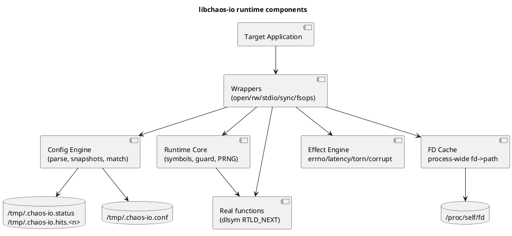
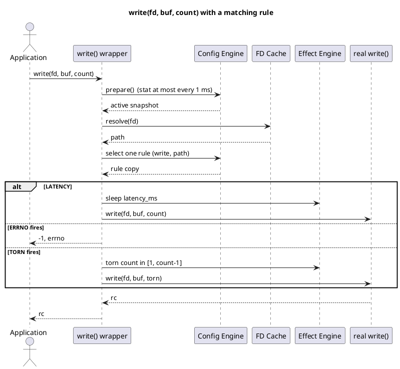
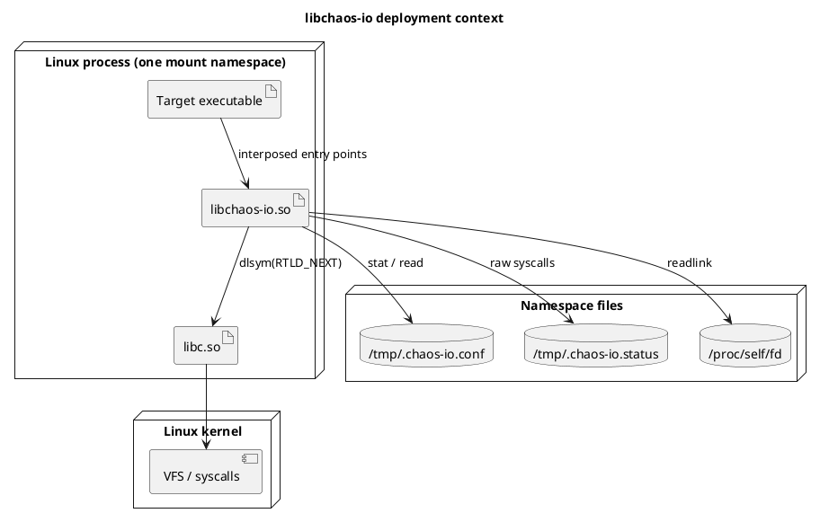
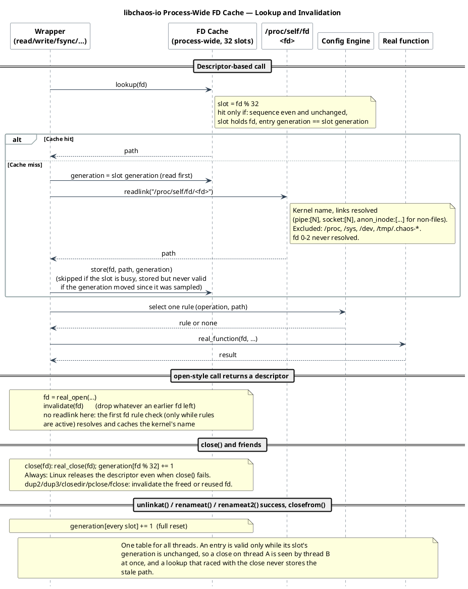

<!--
━━━━━━━━━━━━━━━━━━━━━━━━━━━━━━━━━━━━━━━━━━━━━━━━━━━━━━━━━━━━━
  Engineered by  Christian Schnapka
                 Embedded Principal+ Engineer
                 Macstab GmbH · Hamburg, Germany
                 https://macstab.com
━━━━━━━━━━━━━━━━━━━━━━━━━━━━━━━━━━━━━━━━━━━━━━━━━━━━━━━━━━━━━
-->

# libchaos-io Technical Reference

> *Engineered by* **[Christian Schnapka](https://macstab.com)** — Embedded Principal+ Engineer · [Macstab GmbH](https://macstab.com) · Hamburg, Germany

---

This is the engineering reference for `libchaos-io` as implemented in `src/core`,
`src/config`, `src/effects` and `src/wrappers`. It describes the code, not a design
intent. Every function name, errno, limit and ordering below is taken from the
source; where behaviour depends on Linux, glibc, musl or the dynamic linker, the
dependency is stated.

## Table of Contents

- [1. Overview](#1-overview)
- [2. Architectural Context](#2-architectural-context)
- [3. Key Concepts and Terminology](#3-key-concepts-and-terminology)
- [4. End-to-End Behavior](#4-end-to-end-behavior)
- [5. Architecture Diagrams](#5-architecture-diagrams)
- [6. Component Breakdown](#6-component-breakdown)
- [7. Data Model and State](#7-data-model-and-state)
- [8. Concurrency and Threading Model](#8-concurrency-and-threading-model)
- [9. Error Handling and Failure Modes](#9-error-handling-and-failure-modes)
- [10. Security Model](#10-security-model)
- [11. Performance Model](#11-performance-model)
- [12. Observability and Operations](#12-observability-and-operations)
- [13. Configuration Reference](#13-configuration-reference)
- [14. Extension Points and Compatibility Guarantees](#14-extension-points-and-compatibility-guarantees)
- [15. Stack Walkdown](#15-stack-walkdown)
- [16a. glibc Alternate Entry Points: LFS Names and _FORTIFY_SOURCE](#16a-glibc-alternate-entry-points-lfs-names-and-_fortify_source)
- [16b. Non-Coverage: splice, tee, vmsplice](#16b-non-coverage-splice-tee-vmsplice)
- [16c. O_DIRECT and Kernel Bypass Implications](#16c-o_direct-and-kernel-bypass-implications)
- [16. References](#16-references)

## 1. Overview

### Purpose

`libchaos-io` makes a dynamically linked Linux process observe storage failures on
the files you name. It interposes the C library's file and descriptor functions
through `LD_PRELOAD`, matches each call against the rule file
`/tmp/.chaos-io.conf` by path, and applies one of four effects:

| Effect | When | What the caller sees |
|---|---|---|
| ERRNO | before the real call | `-1` (or the function's error value) with one of 8 errno values; the real call does not run (except `close`, §4) |
| LATENCY | before the real call | the call completes normally, N ms later |
| TORN | before the real call | a successful short write: the real call runs with a byte count in `[1, n-1]` |
| CORRUPT | after a successful read | the bytes returned, with exactly one bit flipped |

The library is a fault injector for storage paths, not a filesystem simulator: it
does not model page cache, write-back, inode identity or crash consistency. It
changes what one interposed call returns.

### Scope: interposed functions

Every logical operation in a rule maps to one or more C library entry points:

| Operation | Functions (all libcs) | glibc 64-bit alternate names (§16a) |
|---|---|---|
| `open` | `open`, `openat`, `creat`, `fopen`, `freopen` | `open64`, `openat64`, `creat64`, `fopen64`, `freopen64`, `__open_2`, `__openat_2`, `__open64_2`, `__openat64_2` |
| `read` | `read`, `readv`; stdio: `fread`, `fgets`, `fgetc`, `getc`, `getline`, `getdelim`, `__getdelim`, `__fread_chk`, `__fgets_chk` | `__read_chk` |
| `write` | `write`, `writev`, `sendfile` (on `out_fd`), `copy_file_range` (on `out_fd`); stdio: `fwrite`, `fputs`, `fputc`, `putc`, `fprintf`, `vfprintf`, `fflush`, `__fprintf_chk`, `__vfprintf_chk` | `sendfile64` |
| `close` | `close` | — |
| `fsync` | `fsync` | — |
| `fdatasync` | `fdatasync` | — |
| `pread` | `pread`, `preadv` | `pread64`, `preadv64`, `__pread_chk`, `__pread64_chk` |
| `pwrite` | `pwrite`, `pwritev` | `pwrite64`, `pwritev64` |
| `truncate` | `ftruncate` (by descriptor), `truncate` (by path) | `ftruncate64`, `truncate64` |
| `allocate` | `fallocate`, `posix_fallocate` | `fallocate64`, `posix_fallocate64` |
| `unlink` | `unlinkat`, `unlink`, `rmdir`, `remove` | — |
| `rename_from` / `rename_to` | `renameat`, `renameat2`, `rename` (source / destination path) | — |

Interposed only to keep the fd-to-path cache correct (no rule applies):
`dup2`, `dup3`, `close_range`, `closedir`, `pclose`, `closefrom`, `fclose`.

**Why the path forms and stdio have their own wrappers.** glibc and musl implement
`unlink`, `rmdir`, `remove`, `rename`, `renameat2`, `truncate`, `creat`,
`posix_fallocate`, `fopen`, `freopen` and every buffered stdio read and write with
their own internal system calls, never through the interposed `*at`, descriptor or
`read`/`write` symbols. Without a wrapper each would bypass every rule. These are
the forms most programs use: the JDK deletes with `unlink()` and moves with
`rename()`; C programs read configuration with `fgets()` and write logs with
`fprintf()`.

- `unlink(p)`, `rmdir(p)`, `rename(a, b)` and `creat(p, m)` forward to
  `unlinkat(AT_FDCWD, p, 0)`, `unlinkat(AT_FDCWD, p, AT_REMOVEDIR)`,
  `renameat(AT_FDCWD, a, AT_FDCWD, b)` and `open(p, O_CREAT|O_WRONLY|O_TRUNC, m)`,
  which is how Linux defines them, so kernel semantics are unchanged.
- `remove(p)` does what glibc and musl do: `unlinkat(p, 0)`, then
  `unlinkat(p, AT_REMOVEDIR)` only when the first step failed with `EISDIR`. An
  injected error on the first step ends the call.
- `truncate(path)` matches `truncate` rules by path; `ftruncate(fd)` by descriptor.
- `posix_fallocate` reports an injected error as its return value and leaves
  `errno` unchanged, as POSIX specifies.
- `renameat2` is exported on every libc. Where the C library lacks it (musl, glibc
  before 2.28) the wrapper issues `SYS_renameat2` itself; only a build without that
  syscall number returns `ENOSYS`.
- `fopen`/`freopen`: an injected error returns `NULL` with `errno` set and no stream
  is created. `freopen` first calls the real `freopen("", mode, stream)`, which
  never opens, so the passed stream ends exactly as after a real failure: closed and,
  on glibc, still allocated (callers that `fclose()` it anyway stay correct). A
  `NULL` path (mode change only) is forwarded unchanged.

**stdio semantics** (`src/wrappers/chaos_io_stdio.c`):

- Rules match the stream's descriptor (`fileno()`), so `read`/`write` rules apply.
  A stream without a descriptor (`fmemopen`, cookie streams) never matches, and the
  lookup leaves `errno` unchanged.
- ERRNO fails the call the way the C library reports an I/O error (`0` items,
  `NULL`, `EOF` or `-1`), sets `errno`, and raises the stream's error indicator so
  `ferror()` is true. There is no API for that indicator; glibc (`_IO_ERR_SEEN`) and
  musl (`F_ERR`) both keep it as bit `0x20` of the first word of `FILE`, which the
  wrapper sets under `flockfile()` because the C library updates the same word
  under that lock (Linux builds only).
- LATENCY delays the call. CORRUPT flips one bit in the bytes the read returned
  (`items * size` for `fread`, `strlen(line)` for `fgets`, the returned length for
  `getdelim`, one byte for `fgetc`/`getc`).
- TORN never applies: a short `fwrite` signals an error in stdio, not a partial
  success. A TORN rule matched on a stream does nothing and counts no hit.
- A rule fires once per stdio call, not once per system call the C library makes
  while filling or flushing its buffer.
- Descriptors 0-2 are never faulted, so `printf`, `puts`, `putchar` and `getchar`,
  which use only the standard streams, are not wrapped.
- Not covered: the scanf family (glibc redirects it to `__isoc99_*`/`__isoc23_*`
  names) and the `*_unlocked` variants.
- `test/runtime/test_stdio.sh` checks glibc (also with `_FORTIFY_SOURCE=2`) and musl;
  `test/runtime/test_path_forms.sh` checks the path forms on both.

### Assumptions

- The target is dynamically linked and the loader honours `LD_PRELOAD` (not a
  set-user-ID start, see [PLATFORM.md §6](PLATFORM.md#6-at_secure-and-the-ld_preload-strip)).
- The target reaches the kernel through the interposed C library symbols. Raw
  `syscall()`, io_uring and statically linked binaries bypass the library;
  `chaos-init` (SECCOMP mode, [SECCOMP.md](SECCOMP.md)) covers those with ERRNO and
  LATENCY.
- `/proc/self/fd` is readable; descriptor-based calls are matched by the path the
  kernel reports there.

### Non-Goals

- Static binaries in LD_PRELOAD mode (use SECCOMP mode).
- Inode-identity matching: matching is by path string.
- Writes through `mmap()` mappings, io_uring, POSIX AIO, `splice`/`tee`/`vmsplice`
  (§16b).
- Network, DNS, time, process or memory faults (the other `libchaos-<lib>` libraries).
- A public API: the only interface is the rule file and the files it produces.

## 2. Architectural Context

### System boundaries

`libchaos-io` runs inside the target's address space, between the application and
the next definition of each symbol:

- Upstream: the application, or another library, calls `write()`, `openat()`,
  `fread()` and so on.
- Inside: the wrapper refreshes the rule snapshot, resolves the call's path,
  selects one rule and applies its effect.
- Downstream: the real function, obtained with `dlsym(RTLD_NEXT, name)`. That is
  the C library, or another `libchaos-<lib>` that comes later in `LD_PRELOAD`.
- Kernel: the real function issues the system call.

### Symbol resolution is lazy, not constructor-only

The constructor cannot be relied on to fill the real-function table before the first
wrapper runs. `LD_PRELOAD` maps the library before the executable's `DT_NEEDED`
libraries, but ELF initialisers run in dependency order, so another library's
constructor can call an interposed function before `chaos_io_init()` has run.
`libcap-ng` is the case that was hit: its initialiser does file I/O, and every
`setpriv`, `su` and `runuser` under the preload called through a NULL pointer and
died with SIGSEGV.

Every wrapper therefore calls `chaos_io_ensure_symbols()` first. It runs
`chaos_io_resolve_all_symbols()` exactly once per process through `chaos_once()`
(`src/common/chaos_once.h`):

- **Once, from whichever thread arrives first.** The others yield
  (`sched_yield()`) until the table is complete.
- **Release/acquire publication.** The table is complete before any thread sees it
  as done. A plain `volatile` flag would order nothing; on aarch64 a second thread
  could see the flag before the pointer stores and call through NULL.
- **Cost after the first call:** one acquire load and a predictable branch.
- **Not `pthread_once()`.** Before glibc 2.34 it lives in libpthread, and a library
  built against glibc 2.31 that references it cannot be loaded into programs that
  do not link libpthread: `cat`, `sh` and most tools failed with
  `undefined symbol: pthread_once`.
- **Re-entry on the resolving thread** returns at once instead of deadlocking (an
  allocator inside `dlsym` may do I/O). While a pointer is still NULL each
  trampoline issues the system call itself (`SYS_read`, `SYS_openat`, ...); stdio,
  `closedir` and `pclose`, which have no system call equivalent, fail with
  `ENOSYS`.
- **Failure:** a missing mandatory symbol (`dlsym` returns NULL and `dlerror()` is
  set) calls `abort()`. Six symbols are optional and stay NULL when the C library
  lacks them: `close_range`, `closefrom`, `renameat2`, `__vfprintf_chk`,
  `__fread_chk`, `__fgets_chk`.

All six libraries resolve their real functions this way.
`test/runtime/test_baseline_glibc.sh` builds the release configuration (gcc:10,
glibc 2.31) and preloads every library, alone and together, into `cat`, `sh` and a
threaded program.

### Dependencies

- libc and `libdl` (`dlsym`, `dlerror`).
- Linux `/proc/self/fd` for descriptor-to-path resolution.
- The kernel vDSO `clock_gettime` (found through `getauxval(AT_SYSINFO_EHDR)`) for
  the rule-file check throttle and `@from`/`@until`; without it the file is checked on
  every call and windows use the raw `clock_gettime` system call.

No daemon, thread, socket or IPC channel is involved.

### Trust boundaries

The library is not a security boundary and runs with the target's privileges. The
rule file is fully trusted input. The guarantee for invalid input is narrow: a file
that does not parse as a whole yields no rules (passthrough) and a status report,
never a partial rule set.

### Deployment and runtime context

```sh
LD_PRELOAD=/path/to/libchaos-io-glibc-amd64.so my-process
```

In a container the library sees the container's mount namespace: its paths, its
`/tmp/.chaos-io.conf`, its `/proc/self/fd`. Rules are written against that view, not
the host's.

### Stable versus internal contracts

Stable: the preload model, the rule file path, the rule grammar, the operation
names, the effect semantics, the status and hits file formats.

Internal: file layout under `src/`, helper names, cache size (32 slots), PRNG
algorithm, constructor ordering.

## 3. Key Concepts and Terminology

| Term | Meaning |
|---|---|
| rule | One parsed line of `/tmp/.chaos-io.conf`. |
| selector | The path part of a rule: an absolute path prefix, a literal name such as `pipe:[1234]`, or `*`. |
| operation | The logical operation (`write`, `truncate`, ...); several functions map to one (§1). |
| effect | ERRNO, LATENCY, TORN or CORRUPT. |
| probability | Chance in [0, 1] that a matched ERRNO, TORN or CORRUPT rule fires. LATENCY has none. |
| qualifier | `@first`, `@from`, `@until`, `@size` written after the rule ([DSL.md §7.1](DSL.md#71-todays-surface)). |
| hit | One application of a rule's effect; counted per rule in the hits file. |
| active snapshot | The published rule array readers match against. |
| inactive snapshot | The second array, rewritten by the thread that owns a reload. |
| internal mode | The thread-local guard `g_chaos_io_tls_guard`; while set, every wrapper forwards to the real function untouched. |
| fd cache | Process-wide, 32-slot, direct-mapped map from descriptor number to path. |
| excluded path | Never faulted: any `/tmp/.chaos-*` control file of any library, anything under `/proc`, `/sys`, `/dev`, an empty or unresolvable path; also descriptors 0-2. |
| torn write | A successful write of fewer bytes than requested. Not an error, not corruption. |
| corrupt read | A successful read whose returned bytes have one bit flipped after the real call. |

## 4. End-to-End Behavior

### Descriptor-based calls

For `write(fd, buf, count)` and every other descriptor-based wrapper:

1. `chaos_io_ensure_symbols()`.
2. If the thread is in internal mode, forward to the real function and return.
3. `chaos_io_match_fd_rule()`:
   - `fd <= 2`: no match.
   - `chaos_io_config_prepare()`: reload the rule file if it changed (at most one
     look per millisecond once rules are loaded, §11); `errno` is preserved.
     No rules loaded: no match.
   - Resolve `fd` to a path: fd cache, else `readlink("/proc/self/fd/<fd>")`.
     Excluded paths: no match.
   - Select **one** rule: the longest matching prefix for this operation, the
     first in the file on a tie.
4. No rule: forward unchanged.
5. Apply the selected rule's effect. Only that rule's effect can fire on this call:
   - LATENCY: sleep, then call the real function.
   - ERRNO: if the qualifiers pass and the probability fires, set `errno` and
     return `-1` without calling the real function.
   - TORN (write class): if it fires, call the real function with a shorter count.
   - CORRUPT (read class): call the real function; if it returned `> 0` bytes and
     the rule fires, flip one bit in the returned bytes.
6. Return the real function's result.

Consequence: `/data:write:LATENCY:200` and `/data:write:EIO:0.5` have equal prefix
length, so the first one in the file wins every `write` under `/data`; the second
never fires. Combine effects with different prefix lengths or different operations.

**`close` is the exception to "ERRNO skips the real call".** Linux releases the
descriptor even when `close()` fails (EIO from NFS write-back, EINTR), and correct
programs never retry it. The wrapper keeps that contract: LATENCY runs first, the
real `close` always runs, the cache entry is invalidated whatever it returned, and
an injected error is reported after it. An injected error that left the descriptor
open would leak it in exactly the programs that handle `close` correctly.

### Path-based calls: `open`, `openat`, `fopen`, `truncate`, `unlinkat`

`open`-style calls start from a path, not a descriptor:

1. Read the `mode_t` vararg (as `int`, the promoted type) when `flags` contains
   `O_CREAT` or all bits of `O_TMPFILE`; the real call is made with two or three
   arguments to match.
2. In internal mode, forward.
3. Build the match path (`chaos_io_resolve_at_path()`):
   - absolute path: as written;
   - relative with `AT_FDCWD`: joined to `getcwd()` (in internal mode, `errno`
     preserved);
   - relative to a directory descriptor: joined to that descriptor's path (fd cache
     or `/proc/self/fd`);
   - then normalised lexically: repeated `/` collapse, `.` is dropped, `..` removes
     the previous component (never above `/`), a trailing `/` is dropped.
   If any step fails (path too long, unknown dirfd, `getcwd` failure), no pre-call
   effect applies and the call proceeds.
4. Excluded paths: no match. Otherwise select one `open` rule and apply LATENCY or
   ERRNO.
5. Call the real function.
6. On success, invalidate the cache slot of the returned descriptor and resolve it
   through `/proc/self/fd`, so the cache holds the kernel's name for the file (links
   resolved), never a path an earlier descriptor with the same number left behind.

**Symbolic links.** A call's path is matched as written (normalised, links
unresolved: resolving each component would cost a system call each). A descriptor
is matched by the kernel's name for its file (links resolved). A rule covers both:
at load time each absolute rule path is normalised and also resolved with
`realpath()`; when the result differs, the rule matches either form. A rule for
`/lib` (a link to `/usr/lib`) or for a Kubernetes ConfigMap mount (the `..data`
link) therefore reaches its files however they were opened. chaos-init matches the
same way.

A rule may name a file that does not exist yet: its longest existing ancestor is
resolved and the rest appended. When any rule's path went through a link or did not
exist in full, the rule paths are resolved again every 1000 ms
(`CHAOS_IO_LINKS_RECHECK_MS`) and the rules reloaded if a resolution changed. That
is how a ConfigMap update, which moves `..data` to a new directory without touching
the rule file, is picked up.

**Deleted files.** After `unlink`, Linux reports an open descriptor's path as
`<path> (deleted)`. A rule naming exactly `<path>` no longer matches that descriptor
(the byte after the prefix is a space, not a boundary); a rule for its directory
still does.

### Rename: two paths, one rule

`renameat`, `renameat2` and `rename` carry a source and a destination:

1. Resolve both paths as in step 3 above. If neither resolves, forward.
2. Prepare the snapshot once.
3. Match `rename_from` against the source and `rename_to` against the destination
   (excluded paths never match).
4. If both match, the longer prefix wins; on equal length `rename_to` wins.

The destination preference serves the atomic-replace pattern (write a temporary
file, rename it over the final name), where the final path is the one tests target.

### Cache maintenance after the call

- `close`: invalidate `fd` (always). `closedir`, `pclose`, `fclose`: invalidate the
  stream's descriptor after the real close (the C library closes it with its own
  system call).
- `dup2` (result `>= 0`, `oldfd != newfd`), `dup3` (result `>= 0`): invalidate `newfd`.
- `close_range` (result `0`, without `CLOSE_RANGE_CLOEXEC`): invalidate each
  descriptor in range, or the whole cache when the range spans 32 or more numbers.
  Without `close_range` in the C library it returns `ENOSYS`, as that libc would.
- `closefrom`: invalidate everything. Exported also where the C library lacks it
  (musl, glibc before 2.34); it then uses the `close_range` system call (Linux 5.9)
  and falls back to closing every descriptor up to `sysconf(_SC_OPEN_MAX)`.
- Successful `unlinkat`, `renameat`, `renameat2`: invalidate everything. An injected
  ERRNO leaves the cache alone (nothing changed on disk).

## 5. Architecture Diagrams

### Component Diagram

Question answered: which runtime components exist and how do they depend on each
other?



Main takeaway: wrappers translate calls; rule parsing, path recovery, effect
mechanics and recursion control live in separate units with their own tests.

### Sequence Diagram

Question answered: what happens for a matched descriptor-based write?



Main takeaway: every decision is made before the real call except CORRUPT, which
needs the bytes the read returned.

### Deployment Diagram

Question answered: where does the library live at runtime and what does it touch?



Main takeaway: everything is process-local and namespace-scoped.

## 6. Component Breakdown

### Runtime core

Files: `src/core/chaos_io.c`, `src/core/chaos_io_internal.h`,
`src/core/chaos_io_wrappers.h`.

- Owns the real-function pointers, the thread-local guard and PRNG state, and the
  process seed.
- `chaos_io_init()` (constructor) resolves symbols, reads 8 bytes from
  `/dev/urandom` with raw `SYS_openat`/`SYS_read`/`SYS_close` (no interposed call
  during construction; fallback `0x6a09e667f3bcc909 ^ getpid()`), seeds the main
  thread's PRNG, resets the config, **loads the rule file at once so a bad file is
  reported at start-up**, and resets the fd cache.
- `chaos_io_match_fd_rule()` is the single lookup path for every descriptor-based
  wrapper; `chaos_io_match_fd_rule_sized()` also records the byte count for `@size`.
- `chaos_io_resolve_at_path()` (in `chaos_io_open.c`) is the single path builder for
  open-, truncate-, unlink- and rename-style calls.

### Config engine

Files: `src/config/chaos_io_config.c`, `src/config/chaos_io_config.h`.

- Parses the rule file into `chaos_io_rule_t` (all-or-nothing, §9).
- Keeps two statically allocated snapshots and publishes a reload without locks
  (§8).
- Resolves rule paths through links and re-checks them (§4).
- Selects the longest-prefix rule; writes the status file and the hits file.

Trade-off: a call never sees a half-parsed rule set, but a rule file change becomes
visible only at the next look (at most 1 ms later), and each look costs a `stat()`.

### FD cache

Files: `src/config/chaos_io_fdcache.c`, `src/config/chaos_io_fdcache.h`.

Descriptor-based calls must be matched by path, and `readlink("/proc/self/fd/<fd>")`
on every call would dominate the wrapper cost. The cache maps descriptor numbers to
the kernel's path for them.

Design and why:

- **Process-wide, not per thread.** A descriptor belongs to the process. The former
  per-thread table had two defects: every thread carried 32 × `PATH_MAX` bytes of
  static TLS from its first instruction (the static-TLS budget that crashed the
  Erlang VM under libchaos-net), and a `close()` on one thread left other threads'
  entries stale, so a reused descriptor number could be matched against the old
  file.
- **Mapped lazily, with a raw `SYS_mmap`.** The table (32 slots of a 4 096-byte path
  plus 12 bytes of header, 131 456 bytes) is mapped on the first store. A raw system
  call: no allocator (wrappers may run in a signal handler), and libchaos-memory
  cannot fault it. Two threads may map concurrently; the CAS loser unmaps its copy.
  If mapping fails the cache stays disabled for that call and every lookup reads
  `/proc/self/fd`: slower, still correct.
- **Direct-mapped, `fd % 32`.** Descriptors 32 apart share a slot; the later store
  evicts the earlier entry.
- **Seqlock per slot.** A writer makes the slot's sequence odd while it fills it.
  A reader copies the path and accepts it only if the sequence was even and
  unchanged; a concurrent write makes the lookup miss, never return a torn path. A
  store that finds the slot busy is skipped; lookups never block.
- **Generation per slot, outside the table.** Invalidation is one atomic increment
  of the slot's generation (no lock, no wait, works before the table exists). An
  entry records the generation it was resolved under and is valid only while that
  is current. `chaos_io_fdcache_resolve()` reads the generation *before* `readlink`,
  so a `close()` racing with the lookup makes the stale path unstorable.
- **Excluded paths are never stored or returned.** `readlink` runs in internal mode
  and preserves `errno`.

Limits:

- A descriptor closed by a call the library does not see (raw `syscall(SYS_close)`)
  keeps its entry until an open-style wrapper returns that number again (it
  invalidates the slot first) or something invalidates the slot. `closedir`,
  `pclose`, `fclose` and `closefrom` are covered.
- Collisions only cost a `readlink`.

Lookup and invalidation flow ([source](diagrams/fdcache.puml)):



### Effect engine

Files: `src/effects/chaos_io_actions.c`, `src/effects/chaos_io_actions.h`.

- `chaos_io_rule_should_trigger()`: `@from`/`@until` window open, `@size` gate
  passed, then (except LATENCY) one probability draw, then `chaos_policy_fire()`
  claims an `@first` slot and records the hit. A rule that is filtered out at any
  step counts nothing.
- `chaos_io_probability_hit_sample()`: fires when `sample < p × 2^32`; `p <= 0`
  never, `p >= 1` always, no floating point at the extremes.
- `chaos_io_torn_count_sample()`: `sample % (n - 1) + 1`, i.e. `[1, n-1]`; `n == 1`
  returns 1 (the write is complete but the hit is counted); `n == 0` returns 0.
- `chaos_io_corrupt_buffer()`: draws byte index and bit position into locals
  before use (C leaves argument evaluation order unspecified), then XORs one bit.
- `chaos_io_rule_apply_latency()`: `chaos_sleep_ms()`, a raw `clock_nanosleep`
  system call on `CLOCK_MONOTONIC`, restarted with the remaining time on `EINTR`,
  `errno` preserved. A raw call because the exported `nanosleep`/`usleep` may be
  libchaos-time's wrappers, and a time rule must not end or lengthen an io delay.

### Wrapper families

| File | Functions |
|---|---|
| `src/wrappers/chaos_io_open.c` | `open`, `openat`, `creat`, `fopen`, `freopen`, fortified and LFS aliases, `chaos_io_resolve_at_path()` |
| `src/wrappers/chaos_io_rw.c` | `read`, `readv`, `write`, `writev`, `pread`, `preadv`, `pwrite`, `pwritev`, `sendfile`, `copy_file_range`, aliases |
| `src/wrappers/chaos_io_stdio.c` | stdio reads and writes, `fclose` |
| `src/wrappers/chaos_io_sync.c` | `close`, `fsync`, `fdatasync`, `dup2`, `dup3`, `close_range`, `closedir`, `pclose`, `closefrom` |
| `src/wrappers/chaos_io_fsops.c` | `ftruncate`, `truncate`, `fallocate`, `posix_fallocate`, `unlinkat`, `unlink`, `rmdir`, `remove`, `renameat`, `renameat2`, `rename`, aliases |

**Vectored calls.** The caller's `iovec` array is read only after a rule matched,
never past `IOV_MAX` entries, and through a checked copy (`process_vm_readv` on the
own pid; a direct copy where that call returns `ENOSYS` or `EPERM`). An invalid
array therefore fails in the kernel with `EINVAL`/`EFAULT` instead of crashing the
wrapper.

- `@size` for `readv`/`writev`/`preadv`/`pwritev` is the sum of `iov_len`, computed
  in chunks of 64; an unreadable or oversized array has no size (size-gated rules do
  not match).
- TORN on `writev`/`pwritev` applies only to arrays of at most 64 entries
  (`CHAOS_IO_TORN_MAX_IOV`); the shortened array is built on the stack from the
  checked copy. A longer or unreadable array is written whole and counts no hit.
- CORRUPT on `readv`/`preadv` picks one byte across the returned bytes as one
  logical stream and maps it back to its segment.

## 7. Data Model and State

### Rule structure (`chaos_io_rule_t`)

| Field | Meaning |
|---|---|
| `path_prefix`, `path_len` | Selector as written, normalised for absolute paths; at most 1 023 bytes. `path_len` decides specificity. |
| `resolved_prefix`, `resolved_len` | The prefix with links resolved, when different; NULL otherwise. Points into the owning snapshot. |
| `operation`, `effect` | Parsed enums; never `INVALID` in a published rule. |
| `errnum` | ERRNO only. |
| `probability` | ERRNO, TORN, CORRUPT. |
| `latency_ms` | LATENCY only; 0 to 4 294 967 295. |
| `policy` | Qualifiers (`@first`, `@from`, `@until`, `@size`). |
| `call_size` | Byte count of the call being decided; set on the caller's copy. |
| `hit`, `hit_generation` | The rule's hit slot and the slot generation it was published with. |

Wrappers always work on a stack copy of the rule; nothing points into a snapshot
after the match returns except `resolved_prefix`, which is used only during
matching.

### Global state

Process-wide: real-function pointers (written once), process seed, two snapshots
(256 rules each, with rule texts and resolved paths), active index, cached change
stamp, the 256 KiB read buffer, hit slot pool (512 slots), fd cache table and slot
generations.

Thread-local: recursion guard (`int`), PRNG state (`uint64_t`). Nothing else: the
read buffer and fd cache were moved out of TLS because large static TLS objects are
reserved in every thread and broke runtimes that create threads with small stacks.

### State transitions

Rule state:

1. `UNKNOWN` at start: the first prepare always reads the file.
2. Missing file: empty snapshot, status file removed.
3. Parsed file: snapshot with its rules, `state=ok`.
4. Invalid, too large, unreadable or NUL-containing file: empty snapshot,
   `state=error`.
5. Transient read failure, or a file that changed while it was read: the previous
   snapshot stays and the next look retries.

FD cache entry: empty → stored on first resolution → invalid once its slot
generation moves (§4) → overwritten by the next store.

### Consistency model

- One call matches against one snapshot. A rule copied while a reload rewrote that
  snapshot is detected by the snapshot's sequence and discarded (the call then
  passes through).
- Threads may switch to a new snapshot at slightly different moments, never to a
  half-written one.
- The fd cache is an optimisation with exact invalidation for every close the
  library sees; `/proc/self/fd` is the source of truth.

## 8. Concurrency and Threading Model

### Execution model

All wrapper work runs synchronously on the caller's thread. The library creates no
threads and installs no signal handlers.

### Reload protocol

The cached change stamp (`g_chaos_io_cached_mtime`) is both the freshness token and
the reload lock. Sentinels: `MISSING` (0), `RELOADING` (`0xff…fe`), `UNKNOWN`
(`0xff…ff`); a real stamp that hits one is XORed with `0x9e3779b97f4a7c15`.

1. `stat()` the rule file (in internal mode) and hash mtime seconds, mtime
   nanoseconds, size, inode and device (FNV-1a multiply-XOR). Mtime alone misses two
   writes within one filesystem clock tick; size catches an append, inode catches
   `sed -i`-style rename-over.
2. Equal to the cached stamp and not provisional and no link re-check due: done.
3. Cached stamp is `RELOADING`: another thread owns the reload; use the current
   snapshot without waiting.
4. CAS cached stamp → `RELOADING`. The winner rewrites the inactive snapshot (its
   sequence is odd meanwhile), reads the file, parses, resolves paths, attaches hit
   slots, writes the status file, and publishes: sequence even, full barrier,
   active index, full barrier, cached stamp.
5. The read is validated with `fstat()` against the stamp that triggered it; a
   writer that changed the file mid-read leaves a different stamp and the copy is
   discarded (retry on the next look).
6. A file whose mtime is within 20 ms of now (`CHAOS_RACY_WINDOW_MS`) is loaded
   provisionally and read again on the next look until it is older: a same-size
   rewrite within one tick leaves every stat field unchanged. A re-read with the same
   content keeps the snapshot, its hit counts and its `@first` claims.

The GCC `__sync_*` builtins and full barriers are used rather than C11 atomics for
portability across the toolchains in the build matrix.

### Signals, fork, vfork

- Wrappers allocate nothing and take no locks on the match path. The vDSO clock is
  looked up in the constructor, not first inside a wrapper a signal handler may
  re-enter. A lookup interrupted by a signal returns NULL to the nested caller, which
  falls back for that call.
- `pthread_atfork` child handler (`chaos_io_config_after_fork()`): releases a reload
  claim held by a thread that does not exist in the child, clears the hits writer
  state, resets hit counts and `@first` claims, gives the child its own hits file
  number, and zeroes the forking thread's PRNG state so the child reseeds from its
  own thread id (pre-fork workers would otherwise draw identical sequences).
- `vfork` children and `posix_spawn` run no atfork handler. They share the parent's
  memory, see its reload claim as busy, may count into its slots, and never write a
  hits file (the writer checks `getpid()`).

## 9. Error Handling and Failure Modes

### Failure behaviour (fail-open)

| Condition | Behaviour | Status file |
|---|---|---|
| No rule file | No rules, every call forwarded | removed |
| Any invalid line (grammar, unknown operation, effect, errno, illegal effect/operation pair, malformed qualifier, qualifier without rule) | No rules | `state=error`, `reason=invalid rule`, `line=`, `text=` |
| More than 256 rules | No rules | `reason=too many rules` |
| File of 262 144 bytes or more | No rules | `reason=file too large`, `line=0` |
| `open` fails with `EACCES`/`EPERM`, or `read` with `EISDIR` | No rules, not re-read until the file changes | `reason=file unreadable`, `line=0` |
| NUL byte in the file | No rules | `reason=file contains a NUL byte` |
| Other read failure, or file changed mid-read | Previous snapshot kept, retried on the next look | unchanged |
| Path of a call cannot be built | That call is not faulted | — |
| Mandatory real symbol missing | `abort()` | — |
| `/dev/urandom` unreadable | Seed `0x6a09e667f3bcc909 ^ getpid()` | — |
| fd cache cannot be mapped | Every lookup reads `/proc/self/fd` | — |

An invalid file drops the previous rules: a typo never leaves a stale rule set
active.

### errno discipline

The library never leaks its own `errno`: rule-file checks, `getcwd`, `readlink`,
`fileno` on descriptor-less streams, seed reads and sleeps all save and restore it.
`errno` changes only when an ERRNO rule fires (or the real function sets it).

### Retry and idempotency

The library never retries a real call; retries would hide the failure it exists to
expose. Idempotency is the application's concern.

### Misuse examples

```text
/data:read:TORN:1.0
```

TORN is legal only for `write` and `pwrite`. The whole file is rejected and the
status file names this line.

```text
/database:write:EIO:0.5
```

Matching is by path prefix at a `/` boundary, not substring: this does not match
`/data/database/file`, and `/data` does not match `/database`.

```text
/data:write:LATENCY:200
/data:write:EIO:0.5
```

Both rules have the same prefix length; the first wins every `write` under `/data`
and the second never fires (§4). Write the second as, for example,
`/data/wal:write:EIO:0.5`.

## 10. Security Model

The library raises the ability to fail calls inside a process; it hardens nothing.
Its security-relevant properties are self-protection and predictable control-plane
behaviour:

- Never faulted: every `/tmp/.chaos-*` file (rule, status and hits files of all six
  libraries, so a shell redirecting into a rule file under the same preload still
  works), anything under `/proc`, `/sys`, `/dev` (boundary-aware: `/process` is not
  excluded), descriptors 0-2.
- The status and hits files are written with raw system calls (`SYS_openat`,
  `SYS_write`, `SYS_renameat`/`SYS_renameat2`), so no io rule can fail a report.
- No network exposure, no logging, no authentication surface; the library inherits
  the process's privileges.
- Input validation is the parser: a fixed four-field grammar, bounded file size and
  rule count, an operation whitelist, an effect/operation matrix and an 8-name errno
  whitelist (no numeric errno values).

## 11. Performance Model

### Hot path (descriptor-based call)

1. `chaos_once` check (one acquire load).
2. Guard check.
3. Rule-file check: skipped if the file was looked at less than 1 ms ago
   (`CHAOS_CHECK_INTERVAL_NS`, vDSO `CLOCK_MONOTONIC`); otherwise one `stat()`.
4. No rules loaded: return (passthrough).
5. fd cache lookup, `readlink` on miss.
6. Linear scan of at most 256 rules.
7. Effect, real call.

The throttle means a rule-file change takes effect within about 1 ms rather than on
the next call; the first load, and every call while no rules are loaded, always
looks. Measured for io `write` with a non-matching rule file (glibc, arm64 Docker,
best of 5 × 200 000 calls): 161 ns native, 1 069 ns with a `stat()` per call, 769 ns
throttled ([ARCHITECTURE.md, Change check](ARCHITECTURE.md#change-check)).

### Complexity and allocation

- Rule selection: O(rules), at most 256.
- fd cache lookup: O(1); a miss costs one `readlink`.
- No heap allocation anywhere in the library. The fd cache table is one anonymous
  mapping per process; everything else is static storage or stack.

### Memory footprint

Static: two snapshots of 256 rules (each rule carries a 1 024-byte prefix, the
snapshot a 201-byte text and a 1 024-byte resolved path per rule), the 256 KiB read
buffer, the hits buffer. Mapped on demand: the 131 456-byte fd cache. Per thread:
an `int` and a `uint64_t` of TLS.

## 12. Observability and Operations

### Signals the library produces

- **Status file** `/tmp/.chaos-io.status`, rewritten after every load (atomically:
  written to `<path>.<pid>`, then renamed):

  ```text
  state=ok|error
  rules=<active rules>
  line=<1-based line of the first rejected rule>   (error only)
  reason=<invalid rule|too many rules|file too large|file unreadable|file contains a NUL byte>
  text=<that line as written, at most 200 bytes>   (error only)
  pid=<process that wrote it>
  ```

- **Hits file** `/tmp/.chaos-io.hits.<n>`, one per process (`<n>` is the pid, or a
  derived number when that name is taken, e.g. after `execve`): one line per rule,
  `<count><TAB><rule as written>`. Rewritten on each of the first 64 hits, then at
  most every 100 ms, and at normal exit; a hit not due for a write makes no system
  call. Sum the files of all processes.

The application-visible outcomes are the injected errno values, the added latency,
short write counts and corrupted read bytes.

### Debugging workflow

1. Check `/tmp/.chaos-io.status`: `state=error` names the rejected line.
2. Check the hits file: a rule with count 0 parsed but never matched.
3. Confirm the process is dynamically linked and loaded the right tuple
   (`/proc/<pid>/maps`).
4. Confirm the rule file exists inside the target's mount namespace.
5. Use `strace -f` to see which functions and system calls the program actually
   uses. `cp`, for example, copies with `copy_file_range` or `sendfile` (covered,
   as `write` on the output) rather than `read`/`write`; a program using `mmap()`,
   `splice()` or io_uring is not reachable in LD_PRELOAD mode.

### Runbook notes

- One invalid line disables the whole file; the status file says which.
- A rule that never fires: compare its prefix with the path the kernel reports
  (`ls -l /proc/<pid>/fd`), check it is not shadowed by an equally long rule for the
  same operation earlier in the file, and check its qualifiers.
- Changes take effect within about 1 ms; a test that writes rules and calls at once
  must wait a few milliseconds.

## 13. Configuration Reference

### Rule file

`/tmp/.chaos-io.conf`

### Grammar

```text
<selector>:<operation>:<ERRNO-name|LATENCY|TORN|CORRUPT>:<value> [qualifier ...] [# comment]
```

- Exactly four `:`-separated fields; whitespace around each field is trimmed. The
  selector cannot contain `:` (the first `:` ends it) or `#` (it starts a comment).
- ERRNO is written as the errno name itself (`EIO`, not `ERRNO:EIO`).
- `<value>`: a probability for an errno name, TORN and CORRUPT; milliseconds
  (decimal, 0 to 4 294 967 295) for LATENCY.
- Probability: `0`, `1`, `0.` followed by digits, or `1.` followed by zeros, parsed
  independently of `LC_NUMERIC` (a JVM sets it from the environment; `strtod` would
  stop at the `.` under a German locale). No `nan`, `inf`, exponents or hex.
- Qualifiers: separate words starting with `@` after the rule, before `#`
  ([DSL.md §7.1](DSL.md#71-todays-surface)).
- Limits: 256 rules, selector at most 1 023 bytes, file smaller than 262 144 bytes,
  no NUL byte.

Examples:

```text
/data:write:EIO:0.3
/data/wal.log:fsync:EIO:0.1
/data:pwrite:LATENCY:200
/data/seg:write:TORN:0.1
/data:read:CORRUPT:0.5
*:open:EMFILE:0.05
/data:write:ENOSPC:1.0 @first=3 # disk fills, then recovers
```

Verify that the parser accepts and rejects the expected inputs:

```sh verified
make unit 2>&1 | grep -E 'PROPTEST|test_config|OK'
```

### Operations and legal effects

| Operation | ERRNO | LATENCY | TORN | CORRUPT |
|---|---|---|---|---|
| `read`, `pread` | yes | yes | — | yes |
| `write`, `pwrite` | yes | yes | yes | — |
| `open`, `close`, `fsync`, `fdatasync`, `truncate`, `allocate`, `unlink`, `rename_from`, `rename_to` | yes | yes | — | — |

### Matching rules

- One rule per call: the longest matching selector for the call's operation; the
  first in the file on equal length. The selected rule's effect is the only one
  that can fire.
- Absolute selectors match at a path boundary: the path equals the selector, or
  continues with `/`, or the selector ends with `/`. `/data` matches `/data` and
  `/data/x`, not `/database`.
- Absolute selectors are normalised (`.`, `..`, `//`, trailing `/`) and also match
  through their link-resolved form (§4).
- `*` matches every file: an absolute path that is not a memfd (`/memfd:...`). It
  never matches pipes (`pipe:[N]`), sockets (`socket:[N]`) or anonymous inodes
  (`anon_inode:[eventfd]`, timerfd, ...): a TORN or CORRUPT meant for files would
  break their protocols (an 8-byte eventfd write). A selector that names them
  literally still reaches them.
- `*` counts as length 1 for specificity, so it loses to every longer selector and
  ties with `/` (first in file wins).
- No globbing, no regular expressions.

### Effect semantics

| Effect | Probability | Applied | Notes |
|---|---|---|---|
| ERRNO | yes | before the call; the real call is skipped | `close`: after the real close. `posix_fallocate`: returned, `errno` untouched. stdio: error value plus `ferror()`. |
| LATENCY | no | before the call | Always fires when matched and the qualifiers pass; raw `clock_nanosleep`, restarted on `EINTR`. |
| TORN | yes | before the call | Count in `[1, n-1]`; `writev`/`pwritev` only up to 64 entries; no effect on stdio. |
| CORRUPT | yes, drawn after the call | after a call that returned `> 0` bytes | One bit of one returned byte. |

### Supported errno names

`EIO`, `ENOSPC`, `EDQUOT`, `EROFS`, `EACCES`, `EMFILE`, `ENFILE`, `ENOENT`. No other
name and no numeric value is accepted.

### `@size` byte counts

| Call | Size |
|---|---|
| `read`, `write`, `pread`, `pwrite`, `sendfile`, `copy_file_range` | `count` |
| `readv`, `writev`, `preadv`, `pwritev` | sum of `iov_len` (§6) |
| `fallocate`, `posix_fallocate` | `length` |
| `fread`, `fwrite` | `size × count` |
| `fgets` | `size` (if positive) |
| `fgetc`, `getc`, `fputc`, `putc` | 1 |
| `fputs` | `strlen(text)` |
| all others (`getline`, `getdelim`, `fflush`, printf family, `open`, `close`, sync, truncate, unlink, rename) | none: a size-gated rule never matches |

### SECCOMP mode

`chaos-init` applies io rules to system calls of any process, including static
binaries, with ERRNO and LATENCY. A rule file containing TORN, CORRUPT or ERRNO on
`close` is rejected as a whole with `reason=unsupported in seccomp mode`. See
[SECCOMP.md](SECCOMP.md).

### Operational guidance

Safe: low probabilities, narrow selectors, `@first` or `@from`/`@until` to bound a
fault in time.

Risky: `*:open:EMFILE:1.0` (every interposed file open fails), high LATENCY on hot write paths, broad `*` rules with high
probabilities.

Typical WAL test:

```text
/srv/app/wal:write:TORN:0.10
/srv/app/wal:fdatasync:EIO:0.05
/srv/app/wal/segment-0001:fdatasync:LATENCY:250
```

Anti-pattern:

```text
*:write:EIO:0.5
```

It puts every file the process writes (logs, temporary files, caches) into one
fault domain, makes failures hard to attribute, and can break the process before
the scenario of interest is reached.

## 14. Extension Points and Compatibility Guarantees

### Adding a wrapper

- Call `chaos_io_ensure_symbols()` first and give every real call a trampoline that
  enters internal mode and falls back to a raw system call (or `ENOSYS`) while the
  pointer is NULL.
- Use `chaos_io_match_fd_rule[_sized]()` or `chaos_io_resolve_at_path()` plus
  `chaos_io_config_match_path()`; never reimplement matching.
- Preserve `errno` on every path the library owns; invalidate the fd cache for every
  descriptor the call frees or reuses.
- Add the glibc LFS or fortified alias where glibc exports one (§16a).

### Compatibility gate

glibc amd64, glibc arm64, musl amd64, musl arm64. A wrapper is complete only when its
runtime behaviour is validated across all four.

### What callers must not assume

- inode-identity matching;
- coverage of raw system calls, io_uring, `mmap()` writes or static binaries in
  LD_PRELOAD mode;
- that two rules for the same operation and prefix length both apply.

### What maintainers must preserve

- all-or-nothing parsing with a status report;
- one rule per call, longest prefix, file order on ties;
- exclusion of control files, `/proc`, `/sys`, `/dev` and descriptors 0-2;
- no heap allocation, no static TLS beyond the guard and PRNG state.

## 15. Stack Walkdown

### API and framework level

The library intercepts C library functions, not frameworks. A framework is
affected only through the functions it ends up calling (the JDK through `open64`,
`pread64`, `unlink`, `rename` and friends).

### Application and runtime level

Every interposed call enters a wrapper first, which decides between injecting and
forwarding and so becomes part of the application's control flow.

### JVM level

The library is C99 and sits below the JVM. A JVM is affected exactly where its
native code calls interposed functions; there is no Java-specific contract.

### Memory and concurrency level

Thread-local: the guard and the PRNG state. Process-wide, lock-free: snapshots
(CAS-owned reload, seqlock-validated reads), the fd cache (seqlock plus
generations) and hit slots.

### OS, kernel and container level

- The dynamic linker binds the interposed symbols; `dlsym(RTLD_NEXT)` finds the
  real ones.
- `stat()` decides rule freshness; `readlink("/proc/self/fd/<fd>")` recovers
  descriptor paths; `realpath()` resolves rule paths.
- Everything is scoped to the target's mount namespace.

### Infrastructure level

Runtime behaviour is validated in Docker on glibc and musl, amd64 and arm64.
Preload behaviour differs across libcs and architectures (symbol sets, missing
system calls such as `open` and `dup2` on aarch64), so the matrix is part
of the contract.

## 16a. glibc Alternate Entry Points: LFS Names and _FORTIFY_SOURCE

On 64-bit glibc the large-file names are separate exported symbols with the same
signatures as the base functions, and binaries built with
`_FILE_OFFSET_BITS=64` or by the JDK bind to them. Without them every such call
would bypass the library. They are defined as aliases of the base wrappers, under
`#if defined(__GLIBC__) && defined(__LP64__)`:

`open64`, `openat64`, `creat64`, `fopen64`, `freopen64`, `pread64`, `pwrite64`,
`preadv64`, `pwritev64`, `sendfile64`, `ftruncate64`, `truncate64`, `fallocate64`,
`posix_fallocate64`.

`_FORTIFY_SOURCE` builds (Debian and Ubuntu packages) call checking variants instead
of the base functions. The library exports them, performs glibc's check, and then
runs the normal wrapper:

| Variant | Check (failure calls `__chk_fail()`, which aborts) |
|---|---|
| `__open_2`, `__open64_2`, `__openat_2`, `__openat64_2` | `flags` that need a mode (`O_CREAT`, `O_TMPFILE`) must not arrive without one |
| `__read_chk`, `__pread_chk`, `__pread64_chk` | `count` must not exceed the destination buffer size |
| `__fread_chk`, `__fgets_chk`, `__fprintf_chk`, `__vfprintf_chk` | delegated to the C library's own checking function when it exports it, else the plain function |

musl has neither LFS names nor fortified variants; on 64-bit Linux `off_t` is 64
bits everywhere, so the aliases carry no ABI difference. The release tuples are
64-bit only (amd64, arm64); 32-bit `off_t` variants are not built.

## 16b. Non-Coverage: splice, tee, vmsplice

`splice(2)`, `tee(2)` and `vmsplice(2)` (Linux 2.6.17) move data between
descriptors and kernel pipe buffers without passing through a user-space buffer.
They are not interposed:

- There is no user-space buffer for CORRUPT, and TORN would require partial
  pipe-buffer semantics the kernel owns.
- `tee` only duplicates between pipes; `*` never matches pipes anyway.
- `vmsplice` with `SPLICE_F_GIFT` transfers page ownership; a short or failed
  transfer cannot be faked without knowing whether the pages were consumed.

The zero-copy paths file-copy tools actually take, `sendfile()` and
`copy_file_range()`, are interposed as `write` on the output descriptor.

## 16c. O_DIRECT and Kernel Bypass Implications

`O_DIRECT` (Linux, not POSIX) transfers data between the user buffer and the device,
bypassing the page cache, and requires buffer, length and offset alignment
(typically 512 or 4 096 bytes, filesystem dependent).

- **open:** an `open`/`openat` with `O_DIRECT` is matched like any other. The
  injectable errors are the 8 names in §13; `EINVAL`, the usual `O_DIRECT`
  rejection, is not among them.
- **read/write:** descriptors opened with `O_DIRECT` are matched like any other;
  `EIO` on a direct write models a device error reaching user space.
- **TORN:** the shortened count is not aligned in general, and the kernel then fails
  the real write (typically `EINVAL`) instead of performing a short write. The
  library does not special-case this; use TORN on `O_DIRECT` files only if that
  outcome is what you want to test.
- **CORRUPT:** the bit is flipped in user space after the DMA-filled buffer is
  returned: corruption at the system-call boundary, not on the medium.

## 16. References

- POSIX.1-2017 (IEEE Std 1003.1-2017)
- Linux man-pages: `ld.so(8)`, `dlsym(3)`, `open(2)`, `openat(2)`, `read(2)`,
  `readv(2)`, `write(2)`, `writev(2)`, `pread(2)`, `preadv(2)`, `pwrite(2)`,
  `pwritev(2)`, `close(2)`, `close_range(2)`, `fsync(2)`, `fdatasync(2)`,
  `sendfile(2)`, `copy_file_range(2)`, `ftruncate(2)`, `fallocate(2)`,
  `posix_fallocate(3)`, `unlinkat(2)`, `renameat(2)`, `readlink(2)`, `stat(2)`,
  `realpath(3)`, `process_vm_readv(2)`, `clock_nanosleep(2)`, `proc(5)`
- [ARCHITECTURE.md](ARCHITECTURE.md): reload, status file, hit counters shared by all
  libraries
- [PLATFORM.md](PLATFORM.md): ELF symbol resolution, `RTLD_NEXT`, vDSO, `AT_SECURE`
- [SECCOMP.md](SECCOMP.md): io rules under `chaos-init`

---

<div align="center">

*Architecture, implementation, and documentation crafted with Love and Passion by*

**[Christian Schnapka](https://macstab.com)**  
Embedded Principal+ Engineer  
[Macstab GmbH](https://macstab.com) · Hamburg, Germany

*Building systems that operate correctly at the edges — including the ones you deliberately break.*

</div>
