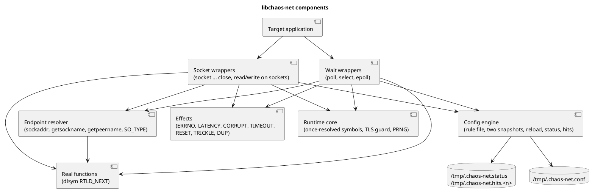
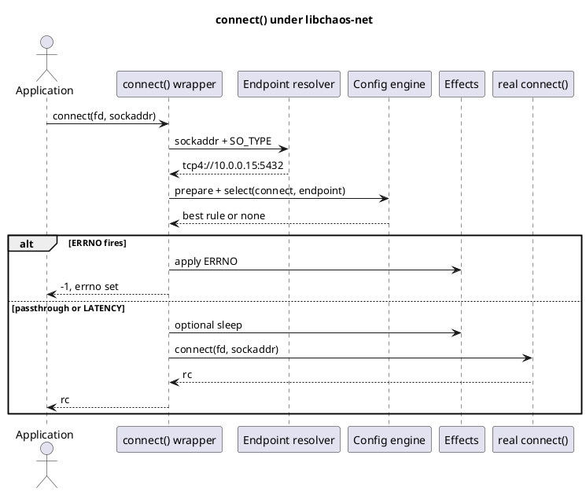
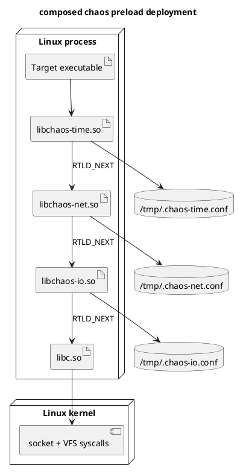

<!--
━━━━━━━━━━━━━━━━━━━━━━━━━━━━━━━━━━━━━━━━━━━━━━━━━━━━━━━━━━━━━
  Engineered by  Christian Schnapka
                 Embedded Principal+ Engineer
                 Macstab GmbH · Hamburg, Germany
                 https://macstab.com
━━━━━━━━━━━━━━━━━━━━━━━━━━━━━━━━━━━━━━━━━━━━━━━━━━━━━━━━━━━━━
-->

# libchaos-net Technical Reference

> *Engineered by* **[Christian Schnapka](https://macstab.com)** — Embedded Principal+ Engineer · [Macstab GmbH](https://macstab.com) · Hamburg, Germany

---

`libchaos-net` is an `LD_PRELOAD` library that injects socket faults into a Linux
process at the libc boundary: synthetic errors, delays, flipped bits, short and
duplicated receives, aborted connections and fake readiness timeouts, selected by
the endpoint a call talks to. It runs inside the target process, needs no
privilege, and passes every call through unchanged when it has no matching rule
or cannot tell which endpoint a call belongs to. Repository-wide ownership,
loader, libc and kernel rules are defined in [`docs/SYSTEM.md`](SYSTEM.md); that
document wins where the two would disagree.

## Table of Contents

- [1. Overview](#1-overview)
- [2. Architectural Context](#2-architectural-context)
- [3. Key Concepts and Terminology](#3-key-concepts-and-terminology)
- [4. End-to-End Behaviour](#4-end-to-end-behaviour)
- [5. Architecture Diagrams](#5-architecture-diagrams)
- [6. Component Breakdown](#6-component-breakdown)
- [7. Data Model and State](#7-data-model-and-state)
- [8. Concurrency and Threading Model](#8-concurrency-and-threading-model)
- [9. Error Handling and Failure Modes](#9-error-handling-and-failure-modes)
- [10. Security Model](#10-security-model)
- [11. Performance Model](#11-performance-model)
- [12. Observability and Operations](#12-observability-and-operations)
- [13. Configuration Reference](#13-configuration-reference)
- [14. Extension Points and Compatibility Guarantees](#14-extension-points-and-compatibility-guarantees)
- [15. Stack Walkdown](#15-stack-walkdown)
- [16a. SCM_RIGHTS and fd Passing — Non-Coverage](#16a-scm_rights-and-fd-passing--non-coverage)
- [16b. SO_REUSEPORT — Injection Consideration](#16b-so_reuseport--injection-consideration)
- [16c. TCP Fast Open — Non-Coverage](#16c-tcp-fast-open--non-coverage)
- [16d. io_uring — Non-Coverage](#16d-io_uring--non-coverage)
- [16. References](#16-references)

### At a glance

| Item | Value |
|------|-------|
| Rule file | `/tmp/.chaos-net.conf` |
| Status file | `/tmp/.chaos-net.status` |
| Hits file | `/tmp/.chaos-net.hits.<n>` |
| Rule grammar | `<selector>:<operation>:<effect>:<value> [qualifier ...]` |
| Operations | `socket`, `bind`, `listen`, `connect`, `accept`, `shutdown`, `send`, `recv`, `close`, `poll` |
| Effects | ERRNO, LATENCY, CORRUPT, TIMEOUT, RESET, TRICKLE, DUP |
| Qualifiers | `@first=N`, `@from=T`, `@until=T`, `@size>N`, `@size<N` |
| Limits | 256 rules; rule file under 256 KiB (262 144 bytes) |
| Failure mode | fail-open: no rule, bad rule file or unresolvable endpoint means passthrough |
| SECCOMP mode | ERRNO (not on `close`), LATENCY and TIMEOUT only; see [`docs/SECCOMP.md`](SECCOMP.md) |

## 1. Overview

### Purpose

`libchaos-net` makes user-space code observe the network failures it must survive,
at the function it actually calls: refused and timed-out connects, failing binds,
slow or failing sends and receives, corrupted payloads, receives split into tiny
chunks, duplicated deliveries, connections reset by the peer, and waits that time
out with data pending. It is not a packet shaper and not a traffic-control
replacement: nothing below the libc call is modified.

### Interposed functions

Every function below is exported by the library and resolved ahead of libc. Each
wrapper forwards to the real function (the next definition found by
`dlsym(RTLD_NEXT)`), never straight to libc, so other preload libraries that
export the same symbol still see every call.

| Operation | Functions | Endpoint the rule is matched against |
|-----------|-----------|--------------------------------------|
| `socket` | `socket`, `socketpair` | a wildcard endpoint built from `(domain, type)` |
| `bind` | `bind` | the address argument |
| `connect` | `connect` | the address argument |
| `listen` | `listen` | the local address (`getsockname`) |
| `accept` | `accept`, `accept4` | the local address of the listening socket |
| `shutdown` | `shutdown` | the local address; the peer only when the local address cannot be resolved |
| `send` | `send`, `sendto`, `sendmsg`, `sendmmsg`, and `write`, `writev` on sockets | explicit destination if given, else both ends, peer preferred |
| `recv` | `recv`, `recvfrom`, `recvmsg`, `recvmmsg`, and `read`, `readv` on sockets | both ends, local end preferred |
| `close` | `close` on sockets | the local address; the peer only when the local address cannot be resolved |
| `poll` | `poll`, `ppoll`, `select`, `pselect`, `epoll_wait`, `epoll_pwait` | each watched descriptor, local address first |

`accept4`, `sendmmsg`, `recvmmsg`, `epoll_wait` and `epoll_pwait` are compiled on
Linux only. On glibc the fortified entry points `__recv_chk`, `__recvfrom_chk`,
`__read_chk`, `__poll_chk` and `__ppoll_chk` are exported as well: each checks the
buffer size the way glibc does (calling `__chk_fail()` on overflow) and then runs
the corresponding wrapper. musl has no fortified variants.

`getsockname`, `getpeername`, `getsockopt` and `setsockopt` are resolved for
internal use only; they are not interposed.

### Ownership with libchaos-io and libchaos-dns

- **Sockets only.** `read`, `readv`, `write`, `writev` and `close` are exported
  by both `libchaos-net` and `libchaos-io`. Each library decides only for its own
  descriptor kind: `libchaos-net` acts when the descriptor is a socket (its
  endpoint lookup fails with `ENOTSOCK` otherwise), `libchaos-io` when it is a
  file. Both forward along the chain, so either preload order works and every
  library sees every call. Without any loaded net rule these wrappers forward
  without a socket lookup.
- **No resolver symbols.** Name resolution (`getaddrinfo`, `getnameinfo`,
  `gethostbyname*`, `gethostbyaddr*`) belongs to `libchaos-dns`; see
  [`docs/DNS.md`](DNS.md). `libchaos-net` selectors are addresses, never names:
  `dns://` selectors are rejected by this library's parser.
- **Layering with stack-level DNS chaos is independent.** A resolver proxy or
  packet-level DNS fault injector below the process composes with both
  libraries; `libchaos-net` only sees the connect that follows a lookup.

### Scope and non-goals

In scope: the libc socket API, the readiness-wait API, and generic descriptor
calls on sockets.

Out of scope, by design:

- raw-packet injection, traffic control, TLS-aware mutation, TCP reassembly;
- `io_uring`, `sendfile`, `splice` and any socket I/O that does not pass through
  one of the functions above (see [16d](#16d-io_uring--non-coverage));
- statically linked programs and runtimes that issue socket system calls
  directly; use SECCOMP mode (`chaos-init`) for those;
- descriptors that are not sockets.

### Source files

| File | Responsibility |
|------|----------------|
| `src/net/chaos_net.c` | constructor, real-symbol table, PRNG seeding |
| `src/net/chaos_net_config.c` | rule file loading, parsing, reload, status and hits reporting, rule selection |
| `src/net/chaos_net_endpoint.c` | selector parsing, `sockaddr` and descriptor to endpoint conversion, matching rank |
| `src/net/chaos_net_actions.c` | probability decision, LATENCY sleep, bit flip, ERRNO |
| `src/net/chaos_net_socket.c` | `bind` … `recvmsg`, `read`/`write`/`readv`/`writev`/`close`, fortified variants, DUP and TRICKLE |
| `src/net/chaos_net_extra.c` | `socket`, `socketpair`, `shutdown`, `sendmmsg`, `recvmmsg` |
| `src/net/chaos_net_wait.c` | `poll`, `ppoll`, `select`, `pselect`, `epoll_wait`, `epoll_pwait`, TIMEOUT |

## 2. Architectural Context

### System boundaries

The library lives in the address space of the target process, between the
application (or its runtime) and libc. Its inputs are the call arguments, the
descriptor's own addresses (`getsockname`, `getpeername`, `SO_TYPE`) and the rule
file. Its outputs are the call's return value, `errno`, and for receive-side
effects the bytes in the caller's buffer.

### Dependencies

- libc and `libdl` (`dlsym(RTLD_NEXT)`);
- Linux socket, `epoll` and `/proc/self/fdinfo` interfaces;
- the rule file `/tmp/.chaos-net.conf` (optional; absent means no rules);
- shared headers in `src/common/`: `chaos_policy.h` (qualifiers, probability
  grammar), `chaos_status.h`, `chaos_hits.h`, `chaos_clock.h`, `chaos_sleep.h`,
  `chaos_once.h`.

There is no runtime dependency on any other library of this repository.

### Trust boundaries

`libchaos-net` is not a security boundary. It runs with the privileges of the
target process. The rule file is trusted input: whoever can write
`/tmp/.chaos-net.conf` can make the process fail. Socket addresses and received
payloads are treated as data to match or mutate, never as instructions.

### Deployment

```sh
LD_PRELOAD="/path/libchaos-time.so /path/libchaos-net.so /path/libchaos-io.so" my-process
```

Order in `LD_PRELOAD` decides which wrapper runs first, not which rules apply:
because every wrapper forwards along the chain, a socket reaches the net rules and
a file reaches the io rules in any order.

## 3. Key Concepts and Terminology

- **Rule**: one line of the rule file: selector, operation, effect, value, and
  optional qualifiers.
- **Selector**: the endpoint pattern a rule applies to, such as
  `tcp4://10.0.0.15:5432`, `unix:///run/app.sock` or `*`.
- **Endpoint**: what a call resolves to at run time: kind (TCP4, TCP6, UDP4,
  UDP6, UNIX), address and port, or a UNIX path.
- **Local end / peer end**: the socket's own address (`getsockname`) and the
  address of the other side (`getpeername`).
- **Operation**: the rule-level name of a group of functions (`recv` covers
  seven functions), not a libc symbol.
- **Effect**: what a firing rule does to the call.
- **Probability**: the chance, in `[0, 1]`, that a matching rule fires on one
  call.
- **Qualifier**: a gate after the rule (`@first`, `@from`, `@until`, `@size`)
  that every effect must also pass.
- **Hit**: one firing of a rule, counted in the hits file.
- **Real function**: the next definition of the symbol, found by
  `dlsym(RTLD_NEXT)`.

## 4. End-to-End Behaviour

### Call lifecycle

Every wrapper runs the same sequence:

1. Resolve the real-symbol table once (`chaos_net_ensure_symbols()`, a
   `chaos_once` that any wrapper or the constructor may run first).
2. If the calling thread is already inside the library (the thread-local
   reentrancy guard is set), call the real function and return.
3. Reload the rule file if it changed (at most one look every 1 ms per process,
   see [12](#12-observability-and-operations)) and resolve the endpoint for the
   operation (table in [1](#interposed-functions)). The `send`, `recv`, `close`
   and `poll` paths check for loaded rules first, so without rules they make no
   socket lookup; the others resolve the address argument or local address first.
   With no rules, or no resolvable endpoint, call the real function.
4. Select the single best rule for `(operation, endpoint)`. If none, call the
   real function.
5. Apply the effect: pre-call (ERRNO, LATENCY, TIMEOUT, RESET, TRICKLE, DUP
   replay) or post-call (CORRUPT, DUP store, ERRNO on `close`).

Exactly one rule applies to a call. Two rules for the same operation and endpoint
do not compose; the more specific one wins (see below). To combine, for example,
latency and errors on one endpoint, give the rules different selectors or use
probability on a single rule.

### Rule selection

Among the rules whose operation matches, each selector that matches the endpoint
gets a rank:

| Rank | Selector |
|------|----------|
| 4 | `unix://<path>`, exact path |
| 3 | `tcp4://`, `tcp6://`, `udp4://`, `udp6://` with exact address and port |
| 2 | `<scheme>://*:<port>` (any host, exact port) or `unix://*` |
| 1 | `*` |

The highest rank wins. A tie goes to the longer selector text, then to the rule
that comes first in the file.

For `send` and `recv` on a connected socket both ends are searched in one pass,
so a wildcard for one end never shadows a more specific rule for the other. A
rule names an address: a client writes its server's address (its peer), a server
writes its own port (its local end), and both work for sends and receives. On a
tie between the two ends, `send` takes the peer's rule and `recv` the local
end's. `sendto` and `sendmsg` with an explicit destination match that destination
only.

`shutdown`, `close` and the `poll` family resolve one endpoint: the local address,
and the peer only when `getsockname` fails. A connected TCP socket and an unbound
UNIX client always have a local address (for the latter an empty name), so on the
client side these operations are matched by the client's own address, `unix://*`
or `*`, not by the server's address.

### Endpoint derivation

- The kind comes from the address family plus `getsockopt(SO_TYPE)`:
  `SOCK_STREAM` gives TCP, `SOCK_DGRAM` gives UDP, any type on `AF_UNIX` gives
  UNIX. Other families (`AF_PACKET`, `AF_NETLINK`, …) and other types
  (`SOCK_RAW`, `SOCK_SEQPACKET` on IP) are not resolved: the call passes through.
- An `AF_INET6` address of the form `::ffff:a.b.c.d` (dual-stack sockets of Java,
  Go and most servers carrying IPv4 traffic) resolves to TCP4/UDP4 with the IPv4
  address: `tcp4://` and `udp4://` selectors match it, `tcp6://[::ffff:…]` does
  not. `sin6_flowinfo` and `sin6_scope_id` are ignored.
- A UNIX path is read only as far as the address length covers, because
  `sun_path` need not be NUL-terminated or present. An abstract name
  (`sun_path[0] == '\0'`) is written as Linux shows it in `/proc/net/unix`: each
  NUL byte within the address length becomes `@`, so `unix://@name` selects it.
  An unnamed socket (`socketpair()`, a client that never bound) resolves to an
  empty name, which only `unix://*` and `*` match.
- At `socket()` time there is no address: the endpoint is the wildcard host with
  port 0 for IP families, `*` for `AF_UNIX`.

### Example: `connect()`

1. The wrapper builds the endpoint from the address argument and `SO_TYPE`, for
   example `tcp4://10.0.0.15:5432`.
2. It selects the best `connect` rule for that endpoint.
3. LATENCY sleeps, then the real `connect()` runs. ERRNO, if it fires, returns -1
   with the configured `errno` and the real call never happens.
4. Otherwise the real result is returned unchanged. A non-blocking connect keeps
   its real `EINPROGRESS` semantics; the library does not fabricate asynchronous
   completion or a `SO_ERROR` value.

### Example: `recvmsg()` with CORRUPT

1. The wrapper resolves both ends and selects the best `recv` rule.
2. The real `recvmsg()` runs.
3. If it returned bytes, the rule's probability and qualifiers are evaluated, and
   on firing one uniformly chosen bit within the received bytes of `msg_iov` is
   inverted. The return value is unchanged; ancillary data is not touched.

## 5. Architecture Diagrams

### Component Diagram



Endpoint resolution is a first-class subsystem: unlike file paths, socket
identity cannot be read back from `/proc` cheaply, so it is derived per call from
the arguments and the descriptor's own addresses.

### Sequence Diagram



### Deployment Diagram



Shared symbols (`read`, `write`, `close`, …) travel the whole chain; each library
acts only on its own descriptor kind and forwards the rest.

## 6. Component Breakdown

### Runtime core (`chaos_net.c`, `chaos_net_internal.h`)

- Resolves 31 real symbols on Linux (26 elsewhere) with `dlsym(RTLD_NEXT)`
  exactly once, through `chaos_once`. The constructor is not enough on its own:
  ELF initialisers run in dependency order, so another object's constructor can
  reach a wrapper first.
- A lookup failure (`dlsym` returns NULL and `dlerror()` reports an error) calls
  `abort()`: a wrapper without a real function cannot work.
- A call that arrives while the table is still being filled (a signal handler,
  or an allocator doing I/O inside `dlsym`) finds the pointer NULL and issues
  the system call directly (`sendto` for `send`, `recvfrom` for `recv`, `ppoll`
  for `poll`, `pselect6` for `select`, `epoll_pwait` for `epoll_wait`, since
  arm64 lacks the older system calls).
- The constructor seeds the PRNG from 8 bytes of `/dev/urandom`, read with raw
  `openat`/`read`/`close` system calls (fallback `0x6a09e667f3bcc909 ^ getpid()`),
  initialises the config engine and loads the rule file once, so a bad rule file
  is reported in the status file at start-up.

### Config engine (`chaos_net_config.c`)

Parses the rule file into one of two static snapshots and publishes it; selects
the best rule; writes the status and hits files. Details in
[7](#7-data-model-and-state) and [8](#8-concurrency-and-threading-model).

### Endpoint resolver (`chaos_net_endpoint.c`)

Converts selector text and run-time `sockaddr`s into the same endpoint
representation and computes the match rank. Every `getsockname`, `getpeername`
and `getsockopt` it issues runs under the reentrancy guard and preserves `errno`.

### Effects (`chaos_net_actions.c` and the wrappers)

ERRNO, LATENCY and the probability decision are shared. CORRUPT, TIMEOUT, RESET,
TRICKLE and DUP are implemented where the call's buffers are, in the wrappers.

### Why there is no socket cache

A cache of descriptor → endpoint would need `close()`, `dup2()`, `fork()` and
`exec` invalidation to stay correct, and descriptor numbers are reused within
microseconds. The library resolves endpoints per call instead and keeps only one
piece of per-descriptor state, the DUP payload table, which tags each payload
with the socket's inode and device and is cleared on `close()`.

## 7. Data Model and State

### Selector grammar

| Selector | Matches |
|----------|---------|
| `tcp4://10.0.0.15:5432` | TCP over IPv4 to/from that address and port (also IPv4-mapped IPv6) |
| `tcp4://*:5432` | TCP over IPv4, any address, port 5432 |
| `tcp6://[::1]:443` | TCP over IPv6, that address and port; brackets are required |
| `tcp6://*:443` | TCP over IPv6, any address, port 443 |
| `udp4://8.8.8.8:53`, `udp6://[2001:db8::1]:53` | the UDP equivalents |
| `unix:///var/run/docker.sock` | a UNIX socket with exactly that path |
| `unix://@name` | an abstract UNIX socket, `@` for each NUL byte of the name |
| `unix://*` | every UNIX socket, including unnamed ones |
| `*` | every endpoint of every kind |

- The port is always compared exactly; `*` in the host position does not
  wildcard the port. `tcp4://*:0` therefore matches only endpoints with port 0
  (unbound sockets, and the endpoint built at `socket()` time).
- The kind must match: `tcp4://` never matches UDP or IPv6 traffic.
- A UNIX path may be up to 255 bytes. It cannot contain `#` (comment start).
- `socket` rules accept only selectors that describe no address: `*`,
  `<scheme>://*:0` and `unix://*`. Anything else rejects the rule file.

### Rule grammar

```text
<selector>:<operation>:<effect>:<value> [@qualifier ...]  [# comment]
```

The line is split on its last three `:` characters, so IPv6 addresses and UNIX
paths may contain colons. Fields are trimmed of blanks. `#` starts a comment
anywhere on the line. Effect names and operation names are case-sensitive.

```text
tcp4://10.0.0.15:5432:connect:ECONNREFUSED:0.2
tcp4://*:5432:accept:LATENCY:150
unix:///var/run/docker.sock:recv:CORRUPT:0.01
*:poll:TIMEOUT:0.1
tcp4://127.0.0.1:5432:connect:ECONNREFUSED:1.0 @first=3
```

### Effects

| Effect | Value | Operations | When it acts |
|--------|-------|------------|--------------|
| ERRNO (`<errno name>`) | probability | all ten | before the call; on `close` after it |
| LATENCY | milliseconds, 0–4294967295 | all ten | before the call |
| CORRUPT | probability | `recv` | after a receive that returned bytes |
| TIMEOUT | probability | `poll` | instead of the wait |
| RESET | probability | `close` | before the close |
| TRICKLE | bytes per receive, 1–4294967295 | `recv` | before the receive |
| DUP | probability | `recv` | instead of the next receive |

An effect/operation pair outside this table rejects the rule file. LATENCY has no
probability: it fires on every matching call that passes its qualifiers. TRICKLE
takes a byte count, not a probability, and fires whenever it applies.

### Probability

A probability is written `0`, `1`, `0.` followed by digits, or `1.` followed by
zeros; trailing blanks are allowed. Parsing is independent of `LC_NUMERIC` (the
JVM calls `setlocale(LC_ALL, "")`, and under a German locale `strtod` would stop
at the `.`), and rejects `nan`, `inf`, hexadecimal and exponents. The first 15
decimals are exact. A rule fires when a 32-bit sample from the per-thread PRNG is
below `probability × 2^32`; 0 never fires and 1 always does.

### ERRNO values

The errno names accepted in the effect field, with no per-operation filtering:

| | | | |
|---|---|---|---|
| `ECONNREFUSED` | `ETIMEDOUT` | `ECONNRESET` | `EHOSTUNREACH` |
| `ENETUNREACH` | `EADDRINUSE` | `EADDRNOTAVAIL` | `EAFNOSUPPORT` |
| `EPROTONOSUPPORT` | `EPIPE` | `ENOTCONN` | `EOPNOTSUPP` |
| `EINVAL` | `EINTR` | `ENOMEM` | `ENOBUFS` |
| `EMFILE` | `ENFILE` | `EAGAIN` | |

The set is a whitelist: `EFAULT`, `EBADF` and similar values that would make a
correct program look buggy are not accepted. Pick a value the real function can
return for the operation (`EADDRINUSE` on `bind`, `ECONNREFUSED` on `connect`,
`EAGAIN` on a non-blocking `recv`); the library does not check.

### Effect semantics

**ERRNO.** The real call is skipped and the wrapper returns -1 with `errno` set.
`sendmmsg` and `recvmmsg` return -1 for the whole batch. On `close` the real
`close()` runs first and the error is reported afterwards: Linux releases the
descriptor even when `close` fails and programs never retry it, so an error that
kept the descriptor open would leak it.

**LATENCY.** The calling thread sleeps with a direct `clock_nanosleep` system
call on `CLOCK_MONOTONIC`, restarted with the remaining time on `EINTR`, then the
real call runs. The direct system call keeps `libchaos-time` (which interposes
`usleep` and `nanosleep`) from shortening or lengthening the delay; `errno` is
preserved. The sleep also happens on non-blocking sockets (`O_NONBLOCK`,
`MSG_DONTWAIT`): in an event loop it stalls every connection the loop serves,
which is exactly what a slow system call does to such a loop.

**CORRUPT.** After a receive that returned bytes, one bit of the received data is
inverted: byte index and bit index come from two independent PRNG draws. The
target stays within what the call wrote: for `recv`, `recvfrom` and `recvmsg` the
smaller of the return value and the buffer size, and nothing at all for a
`MSG_TRUNC` receive on a stream socket (the kernel discards the data without
writing the buffer); for `read` and `readv` the return value. `recvmmsg` picks one
returned message at random and flips a bit in the first non-empty segment of its
`msg_iov`. Probability and qualifiers are evaluated only after a receive that
returned bytes, so EOF and errors are never counted as hits. Ancillary data
(`msg_control`) and the sender address are never modified.

**TIMEOUT.** The real wait is not issued. The wrapper waits out the caller's own
timeout as if nothing became ready, with a direct `ppoll` system call on no
descriptors, then returns 0:

- `poll`, `ppoll`: every `revents` is cleared;
- `select`, `pselect`: every non-NULL `fd_set` is cleared; `select` leaves 0 in
  its timeout, as Linux does, `ppoll` and `pselect` leave theirs untouched;
- `epoll_wait`, `epoll_pwait`: no events.

`ppoll`, `pselect` and `epoll_pwait` wait under the signal mask the caller passed,
the others under the thread's own, so a signal ends the synthetic wait with -1 and
`EINTR` exactly as it would end the real one, and a handler that only runs during
the wait (a shutdown signal) still runs. A wait without a timeout (`-1`, or NULL
for the `timespec`/`timeval` forms), or with a `timespec` the kernel would reject
(`EINVAL`), never times out, so TIMEOUT leaves it alone and counts no hit:
returning 0 at once would be a result the kernel never gives, and a caller that
retries on it would spin. Timeouts are rounded up to whole milliseconds and
capped at 2³¹−1 ms.

**RESET.** Before the close, `SO_LINGER` is set to `{l_onoff = 1, l_linger = 0}`
through the real `setsockopt`, so the close aborts the connection: the peer sees
an RST (`ECONNRESET`) instead of an orderly end of stream. This is what a crashed
or killed process, or a load balancer dropping a connection, looks like from the
other side. `errno` is preserved across the `setsockopt`; the close itself always
runs, so `libchaos-io`'s descriptor cache still sees it.

**TRICKLE:N.** A receive asks the kernel for at most N bytes. `recv`, `recvfrom`
and `read` pass N as the length; `recvmsg` and `readv` pass a copy of the iovec
array cut to N bytes (arrays of more than 64 entries are left alone), and
`recvmsg` copies `msg_namelen`, `msg_controllen` and `msg_flags` back from the
shortened header. TRICKLE applies only when all of these hold, and only then
counts a hit:

- the socket is a stream socket (`SO_TYPE`, asked with a raw `getsockopt`);
- the request is larger than N bytes;
- `MSG_WAITALL` is not set (the caller asked for the whole count, which the
  kernel delivers short only on a signal, an error or end of stream).

On a datagram socket a shorter buffer would cut the datagram and the kernel would
drop the rest, so datagrams are never shortened. Nothing is lost or reordered;
TRICKLE tests message reassembly: length-prefixed framing, header parsers and
`readLine` loops that assume one read returns one message. `recvmmsg` is not
affected.

**DUP:p.** Duplicate delivery, the normal case in at-least-once messaging and
rarely tested (double charges, double writes, repeated side effects).

- While a DUP rule matches a socket, every eligible receive keeps a copy of what
  it returned: up to 4096 bytes, plus the sender address for datagrams. A
  datagram longer than 4096 bytes is not kept (kept cut, it would replay as a
  different message); for a stream the first 4096 bytes are kept.
- When a copy exists and the rule fires, the next receive returns the copy
  instead of reading the socket, once; the receive after that reads the socket
  again. A replay into a buffer smaller than the copy returns its first bytes;
  for a datagram `recvmsg` reports `MSG_TRUNC`, as the kernel does. A replay sets
  `msg_controllen` to 0 (no ancillary data is replayed).
- Not eligible, and received normally: flags containing `MSG_PEEK`, `MSG_TRUNC`,
  `MSG_OOB`, `MSG_WAITALL` or `MSG_ERRQUEUE`; an empty buffer (a replay into it
  would read as EOF); an iovec array longer than `IOV_MAX`; `recvmmsg`.
- A copy is replayed only on the socket it came from: each copy is tagged with
  the descriptor and the socket's inode and device (`fstat`), so a descriptor
  number reused after `dup2()`, `fclose()` of an `fdopen()` stream or a raw
  `close` never sees another socket's payload.
- Storage: a table of 64 slots indexed by `fd % 64`, about 267 KiB
  (64 × 4264 bytes on LP64), mapped with a raw `mmap` system call on the first
  DUP-matched receive, so `libchaos-memory` rules on `mmap` cannot decide whether
  net keeps a payload. If the mapping fails, nothing is kept and DUP never fires.
  Descriptors that share a slot drop each other's copy rather than replay the
  wrong one.
- Concurrency: each slot has a try-lock. A slot that is busy (another thread, or
  a signal handler that interrupted this one) skips DUP for that call instead of
  waiting. `close()` drops the copy without the lock: it bumps the slot's close
  counter and clears the tag with a CAS, and a receive that stored a copy for the
  closing descriptor at that moment sees the counter change and drops it. A sender
  address the kernel cut to fit the caller's buffer is kept only as far as that
  buffer reached. A `fork()` child releases slot locks that other threads held at
  the fork.

### Qualifiers

Qualifiers are whitespace-separated words starting with `@` at the end of the
rule, before any comment. An unknown or malformed qualifier, or `@until` not after
`@from`, rejects the rule file.

| Qualifier | Meaning |
|-----------|---------|
| `@first=N` | fire at most N times in this process (N ≥ 1, at most 18 digits), then go inert |
| `@from=T` | active only when the wall clock is at or after T (Unix milliseconds) |
| `@until=T` | active only before T (Unix milliseconds) |
| `@size>N`, `@size<N` | apply only to calls that move more (fewer) than N bytes |

Only data-moving calls carry a byte count: `send`, `sendto`, `recv`, `recvfrom`,
`read`, `write` (the length argument), `sendmsg`, `recvmsg`, `readv`, `writev`
(the iovec total), `sendmmsg` and `recvmmsg` (the total of the first 1024
messages). Every other call, including `connect`, `close` and the `poll` family,
has no byte count, and a size-gated rule never fires on it. `@first` claims are
per process: a `fork()` child starts from zero.

### Limits

| Limit | Value | Exceeded |
|-------|-------|----------|
| Rules per file | 256 | rule file rejected, `reason=too many rules` |
| Rule file size | under 262 144 bytes | rejected, `reason=file too large` |
| UNIX path in a selector | 255 bytes | rule rejected |
| Rule text in status and hits files | 200 bytes | truncated |
| DUP payload per socket | 4096 bytes | see DUP |
| DUP slots | 64 (`fd % 64`) | colliding descriptors drop each other's copy |
| TRICKLE vectored receive | 64 iovec entries | longer arrays left alone |
| `sendmmsg` scan | 1024 messages | later messages not inspected |
| `epoll` membership scan | 256 KiB of `/proc/self/fdinfo/<epfd>` (about 4000 watched descriptors) | later descriptors not inspected |

## 8. Concurrency and Threading Model

### Execution model

All work happens on the calling thread. There is no background thread; a reload
runs inside whichever wrapper call notices the change.

### State ownership

| State | Scope | Synchronisation |
|-------|-------|-----------------|
| Rule snapshots (two) | process | single-writer reload claim, sequence counter per snapshot |
| Reentrancy guard | thread (`__thread int`) | none needed |
| PRNG state | thread (`__thread uint64_t`) | none needed |
| Endpoints | stack, per call | none needed |
| DUP slot table | process | per-slot try-lock, lock-free close path |
| Hit counters | process | atomic increments; one writer of the hits file at a time |

Thread-local variables are small scalars only. The 256 KiB rule file buffer is a
plain static, not `__thread`: a TLS object that large becomes static TLS, which
glibc reserves in every thread and adds to its minimum stack size, and runtimes
that create threads with small explicit stacks (the Erlang VM) then fail
`pthread_create()` with `EINVAL`.

### Reload protocol

1. A wrapper finds that 1 ms has passed since the last look and calls `stat()` on
   the rule file. The change stamp is an FNV-1a style hash of mtime seconds,
   mtime nanoseconds, size, inode and device: the mtime alone misses two writes
   within one coarse file-system tick, the size catches an append, and the inode
   catches a rewrite through a temporary file and `rename()` (`sed -i`).
2. If the stamp differs from the cached one, the thread claims the reload by
   CAS-ing the cached stamp to a `RELOADING` sentinel. A thread that loses the
   CAS, or sees `RELOADING`, uses the current snapshot and does not wait.
3. The winner reads the file into the inactive snapshot with raw system calls,
   then `fstat`s the open descriptor: if the stamp changed while reading (a
   concurrent writer), the copy is discarded, the claim is released with the old
   stamp, and the next call retries.
4. A file whose mtime lies within 20 ms of the current time is loaded but marked
   provisional and read again on the next look, because a same-size rewrite
   within one tick leaves the stamp unchanged. If the content hash is unchanged
   on that second read, the snapshot stays as it is (hit counts and `@first`
   claims included).
5. The winner writes the status file, then publishes: full barrier, store the new
   active index, full barrier, store the new stamp (which releases the claim).

Readers fence before loading the active index. Each snapshot carries a sequence
counter that is odd while the snapshot is being rewritten; a match that overlaps
a rewrite of the snapshot it read reports no match rather than a rule from a
half-written array. A rule copy handed to a wrapper carries its hit slot and the
slot's generation; if its rule left the file in a later reload, the copy neither
fires nor counts.

### fork, vfork and exec

- `pthread_atfork` child handlers release a reload claim and the hits-writer flag
  held by threads that do not exist in the child, reset hit counts and `@first`
  claims, give the child its own hits file, reset the forking thread's PRNG state
  (it reseeds from its own thread id on the next draw, so pre-fork workers do not
  all decide alike), and release DUP slot locks.
- A `vfork()` child and `posix_spawn()` run no atfork handler. They share the
  parent's memory, see its claims as busy, and never write a hits file.
- After `exec` the new image loads the library afresh if `LD_PRELOAD` is still
  set.

### Signal handlers

A wrapper called from a signal handler that interrupted the same thread inside
the library sees the guard set and calls the real function. The DUP slot
try-lock never waits, so a handler that receives or closes cannot deadlock on a
lock its own thread holds. The `epoll` scan reads `/proc/self/fdinfo` in 512-byte
pieces so it fits on a small alternate signal stack.

### Memory ordering

The library is C99 with GCC `__sync` builtins; it does not use C11 atomics.
Publication uses `__sync_synchronize()` full barriers and
`__sync_bool_compare_and_swap`; DUP slot locks use `__sync_lock_test_and_set` and
`__sync_lock_release`.

## 9. Error Handling and Failure Modes

### Failure behaviour

The library fails open: whenever it cannot decide correctly it calls the real
function unchanged.

| Situation | Behaviour |
|-----------|-----------|
| No rule file | no rules; status file removed |
| Invalid line, unknown qualifier, too many rules | whole file rejected: no rules; status `state=error` naming the first bad line |
| File too large, unreadable (`EACCES`, `EPERM`, `EISDIR`), contains a NUL byte | no rules, `state=error`; not re-read until the file changes |
| Transient read failure, concurrent writer | previous snapshot stays; retried on the next look |
| Endpoint not resolvable (family, type, `getsockname` failure, unconnected socket for `send`) | passthrough |
| Descriptor is not a socket (`read`/`write`/`close`) | passthrough to the next library (`libchaos-io`) |
| `/proc/self/fdinfo/<epfd>` unreadable | `epoll` passthrough |
| DUP table cannot be mapped | DUP inert |
| Real symbol missing at start-up | `abort()` |

`errno` discipline: the library's own `stat`, `open`, `read`, `getsockname`,
`getpeername`, `getsockopt`, `setsockopt`, `fstat` and `mmap` calls never leak
into the caller's `errno`. Only an injected ERRNO, or a real call, sets it.

### Operation-specific notes

- `connect`: a non-blocking connect keeps the kernel's `EINPROGRESS` semantics.
  Inject at `connect` with ERRNO or LATENCY; the library does not model
  `getsockopt(SO_ERROR)` results.
- `accept`, `accept4`: the address argument is an output, so the rule is matched
  against the listening socket's local address. Errors the kernel already
  reports on `accept` are passed through unchanged.
- `recvfrom`, `recvmsg` on unconnected datagram sockets: the sender is unknown
  before the call, so only the local end can match (`getpeername` fails).
- `sendmmsg`: the first message (of at most 1024) whose destination matches a
  `send` rule decides for the whole batch; messages without `msg_name` are matched
  against the connection, looked up once.
- `poll` family: the first watched descriptor (in array, bit or `fdinfo` order)
  whose endpoint has any matching `poll` rule decides; its best rule applies to
  the whole wait. `epoll` membership is read from `/proc/self/fdinfo/<epfd>`
  (`tfd:` lines); membership changes concurrent with the scan are not
  synchronised.

## 10. Security Model

The library injects failures; it does not filter or authenticate traffic. It can
make connections fail and corrupt received bytes, so it belongs in test and
staging environments unless an operator deliberately wants chaos in production.

- The rule file is trusted; protect `/tmp/.chaos-net.conf` accordingly. The
  library opens it read-only and never follows instructions from received data.
- The parser validates scheme, address syntax (`inet_pton`), IPv6 brackets, port
  range (0–65535), UNIX path length, operation names, the errno whitelist,
  effect/operation pairs, selectors allowed for `socket`, value ranges and
  qualifiers. Anything else rejects the whole file.
- Status and hits files are written with direct system calls so a
  `libchaos-io` rule cannot fail the report.

## 11. Performance Model

### Hot path

With no rule file the cost per wrapper call is the guard check, the once-check
and a throttled `stat()` (at most one per millisecond per process). With rules
loaded, a matching call additionally pays:

- `getsockopt(SO_TYPE)` plus `getsockname()` and/or `getpeername()` (one or two
  system calls each, per call; nothing is cached);
- a linear scan over at most 256 rules, once per end;
- for `epoll_wait`/`epoll_pwait`, an `open`/`read`/`close` of
  `/proc/self/fdinfo/<epfd>` per call, plus an endpoint lookup per watched
  descriptor until one matches;
- for DUP, an `fstat` per receive and up to 4096 bytes copied;
- the configured delay for LATENCY.

Measured and estimated per-call costs are in
[`docs/BENCHMARKS.md`](BENCHMARKS.md#6-libchaos-net-hot-path-profile).

### Memory

No heap allocation on any path. Two snapshots of 256 rules plus their texts and a
256 KiB read buffer are static; the DUP table (about 267 KiB) is mapped only when
a DUP rule first matches a receive. Endpoints live on the stack.

### Narrow scope as a correctness choice

The library deliberately does not model asynchronous connect completion, `epoll`
membership graphs, partial success inside batches or per-packet datagram peers.
Each of these would need cached state with invalidation hooks that collide with
other libraries' symbol ownership.

## 12. Observability and Operations

### Status file

After every load the library replaces `/tmp/.chaos-net.status`:

```text
state=ok|error
rules=<active rules>
line=<first rejected line>        (error only)
reason=<why>                      (error only)
text=<that line, up to 200 bytes> (error only)
pid=<writer>
```

Reasons: `invalid rule`, `too many rules`, `file too large`, `file unreadable`,
`file contains a NUL byte`, and under `chaos-init` `unsupported in seccomp mode`.
See [`docs/ARCHITECTURE.md`](ARCHITECTURE.md#status-file).

### Hits file

Each process writes `/tmp/.chaos-net.hits.<n>`: one line per rule, `count<TAB>rule
as written`. The file is rewritten on each of the process's first 64 hits, then
at most every 100 ms, and at normal exit. A rule with count 0 parses but never
matched what the program really does. See
[`docs/ARCHITECTURE.md`](ARCHITECTURE.md#hit-counters).

### Reload latency

A rule file change takes effect within about 1 ms of activity in the process
(the `stat` throttle), on the next wrapper call. A process that makes no
interposed call does not reload.

### Debugging a rule that does not fire

1. `state=ok` in the status file? If not, fix the named line.
2. Hit count 0? Find the function the program actually calls (`strace -f`):
   `send` versus `write`, `poll` versus `epoll_wait`, `connect` versus
   `sendto(MSG_FASTOPEN)`.
3. Which endpoint does that call resolve to? Remember: `shutdown`, `close` and
   `poll` match the local address; `recvfrom` on unconnected UDP matches only the
   local address; IPv4-mapped IPv6 is `tcp4://`/`udp4://`; ports are exact.
4. Is the effect legal for the operation, and does the call carry a byte count
   if the rule has `@size`?
5. Is a more specific rule for the same operation shadowing it?

## 13. Configuration Reference

### Rule file

`/tmp/.chaos-net.conf`, one rule per line, `#` comments, blank lines ignored.
A separate file per library keeps rollout, blast radius and troubleshooting
independent: endpoint selectors are not path selectors, and net has effects
(TIMEOUT, RESET, TRICKLE, DUP) that do not exist in the io grammar.

### Minimal example

Occasional connect failure to one PostgreSQL server:

```text
tcp4://10.0.0.15:5432:connect:ECONNREFUSED:0.05
```

### Typical examples

```text
# Slow listener: every accept on port 8443 waits 200 ms.
tcp4://*:8443:accept:LATENCY:200

# Redis replies arrive one byte at a time (client side: the server is the peer).
tcp4://10.0.0.5:6379:recv:TRICKLE:1

# 5 % of Kafka fetch responses are delivered twice.
tcp4://10.0.0.9:9092:recv:DUP:0.05

# The server aborts its client connections: clients see ECONNRESET.
tcp4://*:8080:close:RESET:1

# Start-up: the first three connects to the database are refused.
tcp4://127.0.0.1:5432:connect:ECONNREFUSED:1.0 @first=3

# Large produce requests are delayed during a fixed window.
tcp4://10.0.0.9:9092:send:LATENCY:200 @size>65536 @from=1760000000000 @until=1760000060000

# Descriptor exhaustion when creating any socket.
*:socket:EMFILE:0.01
```

### Combining with libchaos-dns

Name-based faults go into `/tmp/.chaos-dns.conf`; the connect that follows is
matched here by address:

```text
# /tmp/.chaos-dns.conf
dns://api.internal.example:EAI_AGAIN:0.10
# /tmp/.chaos-net.conf
tcp4://10.0.0.20:443:connect:ETIMEDOUT:0.10
```

10 % of `getaddrinfo("api.internal.example", …)` calls fail with `EAI_AGAIN`
inside the process; the rest resolve normally (and may still meet a stack-level
DNS fault injector below the process), and 10 % of the connects to the resolved
address time out.

### Anti-pattern

```text
*:send:EPIPE:0.5
*:recv:CORRUPT:0.5
```

Bare wildcards destroy fault locality: the failure can no longer be attributed to
one dependency, and the rules also hit the test harness, the metrics exporter and
any service-mesh sidecar connection in the process.

## 14. Extension Points and Compatibility Guarantees

### Stable contracts

- rule file, status file and hits file paths;
- the selector grammar, operation names, effect names, value formats and the
  effect/operation table;
- the qualifier grammar, shared with every library (`src/common/chaos_policy.h`);
- fail-open behaviour;
- the glibc/musl × amd64/arm64 build and test matrix.

### Private

- helper names and file layout, endpoint representation, snapshot layout;
- the DUP table geometry (64 slots, 4096 bytes);
- the reload throttle (1 ms) and racy window (20 ms).

### Adding an effect

1. Add the enum value in `chaos_net_config.h` and the keyword in
   `chaos_net_config_parse_line()`.
2. Allow it for its operations in `chaos_net_effect_allowed()`.
3. Apply it in the wrappers that serve those operations; keep the real call on
   the chain and preserve `errno`.
4. Decide whether `chaos-init` can apply it from outside the process
   (`chaos_init_net_supported()` in `src/init/chaos_init_net.c`); if not, it is
   rejected in SECCOMP mode with `unsupported in seccomp mode`.

## 15. Stack Walkdown

- **Application and runtime.** What is covered depends on which libc functions
  the runtime calls: `send*`/`recv*` versus `read`/`write` (both covered on
  sockets), `poll`/`select` versus `epoll_*` (all covered, except
  `epoll_pwait2`), libc sockets versus `io_uring` (not covered). A JVM is covered
  as far as its native networking goes through these symbols; there is no
  Java-specific contract here.
- **Dynamic linker.** Interposition requires a dynamically linked target that
  honours `LD_PRELOAD` (not set-uid under `AT_SECURE`). Statically linked
  programs and runtimes with their own system-call layer bypass the library;
  SECCOMP mode covers them for ERRNO, LATENCY and TIMEOUT.
- **Kernel.** Endpoint identity comes from `getsockname`, `getpeername` and
  `SO_TYPE`; `epoll` membership from `/proc/self/fdinfo`. TIMEOUT waits with
  `ppoll` and the kernel's 8-byte signal set.
- **Containers.** Selectors see the target's network namespace: addresses,
  loopback and UNIX paths are namespace-local, and `/tmp/.chaos-net.conf` is the
  container's `/tmp`.
- **Infrastructure.** glibc and musl differ in symbol exposure (fortified
  variants, `msg_iovlen` type, `sendmmsg` flags type), so every change is built
  and tested on glibc and musl for amd64 and arm64.

## 16a. SCM_RIGHTS and fd Passing — Non-Coverage

`SCM_RIGHTS` passes open descriptors over a UNIX socket as ancillary data of
`sendmsg()`/`recvmsg()`. The kernel installs the received descriptors during the
system call.

What the library does with such calls:

- ERRNO and LATENCY on `sendmsg` act before the real call; on a synthetic failure
  no descriptor is transferred.
- CORRUPT on `recvmsg` flips a bit in the payload (`msg_iov`) only; `msg_control`
  and the received descriptors are untouched.
- TRICKLE on `recvmsg` passes the caller's control buffer through unchanged.
- A DUP replay returns `msg_controllen = 0`: the replayed copy carries no
  descriptors. The original receive already installed them.
- No selector distinguishes a `sendmsg` that carries `SCM_RIGHTS`.

Not covered: injecting a bad descriptor into a received control message, partial
descriptor delivery, `MSG_CTRUNC` handling. These need post-call mutation of
`msg_control`, which no effect performs. Reference: `unix(7)`, `cmsg(3)`.

## 16b. SO_REUSEPORT — Injection Consideration

`SO_REUSEPORT` (Linux 3.9) lets several sockets bind the same address and port;
the kernel distributes connections and datagrams among them by a hash of the
source address and port.

The library treats such sockets like any other: a `bind` rule with `EADDRINUSE`
on the shared port tests the application's port-sharing setup path, and a
`tcp4://*:<port>:accept:…` rule applies to every listener on that port. No
selector refers to socket option state. Reference: `socket(7)`, `ip(7)`.

## 16c. TCP Fast Open — Non-Coverage

TCP Fast Open (RFC 7413, Linux 3.6 client side) carries data in the SYN. A client
uses `sendto()` with `MSG_FASTOPEN` on an unconnected socket instead of
`connect()`, or sets `TCP_FASTOPEN_CONNECT` and calls `connect()` then `send()`.

- `sendto(…, MSG_FASTOPEN, addr, …)` is matched as `send` against `addr`: a
  `send` rule for the server applies, a `connect` rule does not, because
  `connect()` is never called.
- With `TCP_FASTOPEN_CONNECT`, `connect` and `send` rules apply as usual.
- The library cannot distinguish a TFO `sendto` from an ordinary one, and does
  not model cookie negotiation or the fallback to a regular handshake; both
  happen in the kernel below the libc call.

Reference: RFC 7413; `tcp(7)`.

## 16d. io_uring — Non-Coverage

`io_uring` (Linux 5.1+) submits operations (`IORING_OP_SEND`, `IORING_OP_RECV`,
`IORING_OP_ACCEPT`, `IORING_OP_CONNECT`, …) as entries in a shared-memory ring and
reaps completions from a second ring, entering the kernel through
`io_uring_setup(2)` and `io_uring_enter(2)`.

None of this passes through a libc socket function: glibc has no wrapper for the
two system calls, and `liburing` is a separate library whose inline helpers
manipulate the rings directly. An application that does network I/O through
`io_uring` is therefore outside the `LD_PRELOAD` fault surface of both
`libchaos-net` and `libchaos-io`. This is a declared coverage limit.

Reference: `io_uring(7)`, `io_uring_setup(2)`, `io_uring_enter(2)`; Jens Axboe,
"Efficient IO with io_uring" (2019).

## 16. References

- POSIX.1-2017; Linux man-pages project
- `ld.so(8)`, `dlsym(3)`
- `socket(7)`, `ip(7)`, `ipv6(7)`, `tcp(7)`, `udp(7)`, `unix(7)`, `cmsg(3)`
- `socket(2)`, `socketpair(2)`, `bind(2)`, `listen(2)`, `accept(2)`, `connect(2)`,
  `shutdown(2)`, `close(2)`
- `send(2)`, `recv(2)`, `sendmmsg(2)`, `recvmmsg(2)`, `readv(2)`
- `poll(2)`, `ppoll(2)`, `select(2)`, `pselect(2)`, `epoll_wait(2)`, `proc(5)`
  (`/proc/<pid>/fdinfo`)
- `setsockopt(2)` with `SO_LINGER`
- RFC 7413, TCP Fast Open
- `io_uring(7)`

---

<div align="center">

*Architecture, implementation, and documentation crafted with Love and Passion by*

**[Christian Schnapka](https://macstab.com)**  
Embedded Principal+ Engineer  
[Macstab GmbH](https://macstab.com) · Hamburg, Germany

*Building systems that operate correctly at the edges — including the ones you deliberately break.*

</div>
