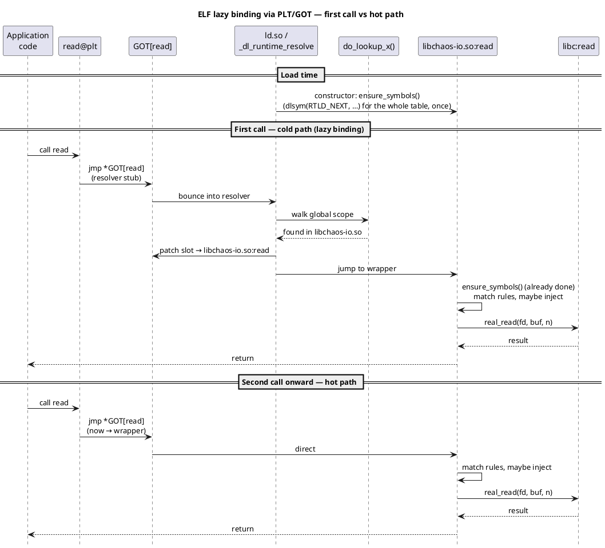
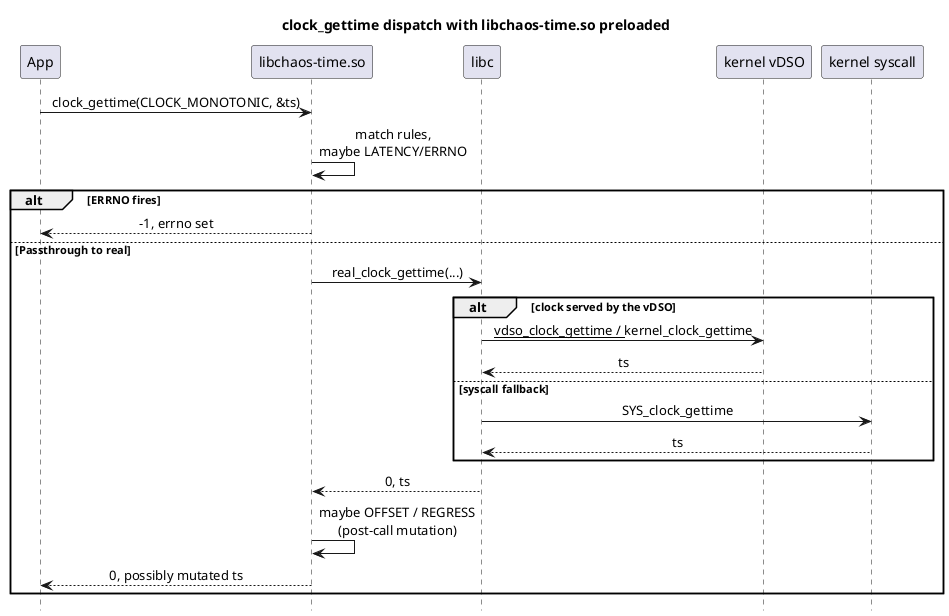

<!--
━━━━━━━━━━━━━━━━━━━━━━━━━━━━━━━━━━━━━━━━━━━━━━━━━━━━━━━━━━━━━
  Engineered by  Christian Schnapka
                 Embedded Principal+ Engineer
                 Macstab GmbH · Hamburg, Germany
                 https://macstab.com
━━━━━━━━━━━━━━━━━━━━━━━━━━━━━━━━━━━━━━━━━━━━━━━━━━━━━━━━━━━━━
-->

# Platform Internals Reference

> *Engineered by* **[Christian Schnapka](https://macstab.com)** — Embedded Principal+ Engineer · [Macstab GmbH](https://macstab.com) · Hamburg, Germany

---

> The layer below the per-library docs: what the kernel, the dynamic loader and the C library do when an `LD_PRELOAD` object defines `read`, why the wrappers work, and where they are bypassed.
>
> Scope: ELF on Linux, x86_64 (amd64) and aarch64 (arm64), glibc and musl. Release objects are built with gcc:10 on glibc 2.31 and on Alpine 3.20 (musl); glibc 2.31 is the oldest glibc the runtime suites load them into, and `test/runtime/check_glibc_baseline.sh` rejects any imported glibc symbol version above `GLIBC_2.17`. SECCOMP mode (`chaos-init`) needs Linux 5.5 or later. No other operating system or loader is covered.

---

## Table of contents

1. [ELF symbol resolution at process start](#1-elf-symbol-resolution-at-process-start)
2. [The `dlsym(RTLD_NEXT, …)` idiom and the resolver pseudo-handles](#2-the-dlsymrtld_next--idiom-and-the-resolver-pseudo-handles)
3. [Symbol versioning: `dlsym` vs `dlvsym`](#3-symbol-versioning-dlsym-vs-dlvsym)
4. [`STT_GNU_IFUNC` and the resolver phase](#4-stt_gnu_ifunc-and-the-resolver-phase)
5. [The vDSO surface](#5-the-vdso-surface)
6. [`AT_SECURE` and the LD_PRELOAD strip](#6-at_secure-and-the-ld_preload-strip)
7. [Statically linked binaries](#7-statically-linked-binaries)
8. [Syscall-direct runtimes (Go, Rust `nostd`, Zig)](#8-syscall-direct-runtimes-go-rust-nostd-zig)
9. [glibc vs musl divergence matrix](#9-glibc-vs-musl-divergence-matrix)
10. [Kernel UAPI surfaces we deliberately do not interpose](#10-kernel-uapi-surfaces-we-deliberately-do-not-interpose)
11. [Detection vectors — we do not hide](#11-detection-vectors--we-do-not-hide)
12. [Memory ordering of the config snapshot swap](#12-memory-ordering-of-the-config-snapshot-swap)
13. [Design pattern catalogue](#13-design-pattern-catalogue)
14. [References](#14-references)

---

## 1. ELF symbol resolution at process start

For a dynamically linked program, `execve(2)` maps the executable, finds its `PT_INTERP`
program header (`/lib64/ld-linux-x86-64.so.2` for glibc on amd64,
`/lib/ld-linux-aarch64.so.1` on arm64, `/lib/ld-musl-<arch>.so.1` for musl), maps that
interpreter and jumps to it. The dynamic loader (`ld.so`) does everything below.

**Reference.** ELF gABI ch. 5 "Program Loading and Dynamic Linking" — https://refspecs.linuxfoundation.org/elf/gabi4+/ch5.dynamic.html · `ld.so(8)` · glibc `elf/rtld.c` (`_dl_start`, `dl_main`) · musl `ldso/dynlink.c` (`__dls2`, `__dls3`).

### 1.1. Building the link-map

`ld.so` builds the global lookup scope, an ordered list of loaded objects (glibc
`struct link_map`, musl `struct dso`), in this order:

1. The main executable.
2. `LD_PRELOAD` entries, left to right (glibc also reads `/etc/ld.so.preload`, which is
   root-controlled and applies to every process).
3. The executable's `DT_NEEDED` entries in declaration order (`libc.so.6` among them on
   glibc).
4. Their `DT_NEEDED` entries, breadth-first.

Symbol lookup walks this list and returns the first definition. That single rule is what
`LD_PRELOAD` interposition rests on: a libchaos object precedes the C library, so its `read`
wins for every caller that binds `read` through the global scope.

**Reference.** glibc `elf/dl-deps.c` (`_dl_map_object_deps`), `elf/dl-lookup.c` (`do_lookup_x`); musl `ldso/dynlink.c` (`find_sym`).

### 1.2. Lazy binding via PLT/GOT

For each external function the program calls, the static linker emits:

- a **PLT entry**: a stub that jumps through a GOT slot;
- a **GOT slot**: initially pointing back into the PLT's resolver path (lazy binding), or
  filled at load time when the object is linked with `-z now` / run with `LD_BIND_NOW`.

First call under lazy binding: application → `read@plt` → GOT → `_dl_runtime_resolve`
(glibc) → `_dl_fixup` → `do_lookup_x` walks the scope → finds `libchaos-io.so:read` → writes
its address into the GOT slot → jumps there. Every later call: application → `read@plt` →
GOT (now the wrapper) → wrapper. **One indirect branch.**

**Reference.** System V ABI AMD64 supplement, PLT/GOT — https://gitlab.com/x86-psABIs/x86-64-ABI · AArch64 ELF ABI (AAELF64) — https://github.com/ARM-software/abi-aa.

### 1.3. What our wrapper does

The wrapper needs the *real* function, the next definition after itself:

```c
real_read = dlsym(RTLD_NEXT, "read");
```

`RTLD_NEXT` searches the scope starting after the calling object, so it skips the wrapper
and finds the next `read`: another libchaos library that exports it, or the C library.

The libraries resolve their whole table once per process, not per symbol and not per call:

```c
/* src/core/chaos_io.c (abridged) */
static volatile chaos_once_t g_chaos_io_symbols_once = CHAOS_ONCE_INIT;

static void chaos_io_resolve_all_symbols(void)
{
    chaos_io_resolve_symbol(&g_chaos_io_real_read, "read");
    chaos_io_resolve_symbol(&g_chaos_io_real_write, "write");
    /* ... every other real function ... */
}

void chaos_io_ensure_symbols(void)
{
    (void)chaos_once(&g_chaos_io_symbols_once, chaos_io_resolve_all_symbols);
}
```

- Every wrapper calls `chaos_<lib>_ensure_symbols()` first; after the first completion it is
  one acquire load and a predictable branch.
- `chaos_once()` (`src/common/chaos_once.h`) runs the initialiser exactly once; concurrent
  callers `sched_yield()` until it is done, and the release/acquire pair makes the completed
  table visible on aarch64. A call from inside the initialiser on the same thread (`dlsym` →
  `calloc` → a preloaded allocator → `mmap` → `libchaos-memory`) returns at once instead of
  deadlocking.
- `pthread_once()` is not used: before glibc 2.34 it lives in libpthread, and a preloaded
  object that needs it fails with "undefined symbol" in every program that does not link
  libpthread.

### 1.4. Initial-call ordering (sequence)

Diagram source: [`docs/diagrams/linkmap.puml`](diagrams/linkmap.puml).



Hot-path cost of interposition itself: one indirect branch through the patched GOT slot and
one indirect call through the cached real-function pointer. The wrapper body (guard check,
throttled rule-file check, rule match) dominates; see
[ARCHITECTURE.md, Change check](ARCHITECTURE.md#change-check) for measured per-call costs.

---

## 2. The `dlsym(RTLD_NEXT, …)` idiom and the resolver pseudo-handles

`dlsym(3)` accepts three kinds of handle:

| Handle | Meaning |
|---|---|
| Real handle | Returned by `dlopen(3)`. Lookup is rooted at that object and its dependencies. |
| `RTLD_DEFAULT` | The global scope in load order, as for a normal symbol reference. First match wins. |
| `RTLD_NEXT` | The scope starting after the calling object. The interposer's way to reach the definition it replaces. |

**Reference.** `dlsym(3)`; glibc `elf/dl-sym.c` (`_dl_sym`, `_dl_vsym`); musl `ldso/dynlink.c`.

On glibc before 2.34 `dlsym` lives in libdl; the libraries link `-ldl`.

### 2.1. Why `RTLD_NEXT` and not `RTLD_DEFAULT`

`RTLD_DEFAULT` would find the wrapper itself (it precedes the C library in the scope) and
the wrapper would call itself forever. `RTLD_NEXT` skips the calling object. When two
libchaos libraries export the same name (`read`, `write`, `readv`, `writev`, `close`,
`__read_chk`: io and net), `RTLD_NEXT` from the first reaches the second, and from the second
the C library; both see the call and each decides only for its own descriptor kind.

### 2.2. Failure modes

A required symbol that `dlsym(RTLD_NEXT, …)` cannot find (NULL with `dlerror()` set) is
fatal: `chaos_<lib>_resolve_symbol()` calls `abort()`, at load time or at the first
interposed call. There is no real function to forward to, and fabricating an error would
inject a fault no rule asked for. No interposed required symbol is missing on supported
glibc or musl versions.

Symbols that older C libraries lack are resolved optionally; their pointer stays NULL and the
wrapper falls back:

```c
/* libchaos-process: execveat is not exported by every musl version */
if (g_chaos_process_real_execveat == NULL)
{
#ifdef SYS_execveat
    return (int)syscall(SYS_execveat, directory_fd, path, argv, envp, flags);
#else
    errno = ENOSYS;
    return -1;
#endif
}
```

The full list (`close_range`, `closefrom`, `renameat2`, the `__*_chk` stdio variants,
`execveat`, `execvpe`, `fexecve`, `pthread_create`) and each fallback are in
[SAFETY.md §5.1](SAFETY.md#51-the-one-exception-unresolvable-symbols).

### 2.3. `dlerror(3)` and thread safety

`dlerror(3)` state is per thread on glibc and musl. The libraries call it only during
resolution: once before `dlsym` to clear stale state and once after a NULL result to tell
"symbol absent" from "symbol defined as NULL". No wrapper calls it on the hot path.

### 2.4. Caching invariant

A resolved pointer is never re-resolved for the life of the process. Later `dlopen` calls
can add objects to the scope, but they come after the C library in search order and do not
change what `RTLD_NEXT` from a preloaded object finds. The one deliberate exception is
`pthread_create` in `libchaos-process`: while its pointer is NULL (libpthread not yet
loaded on glibc before 2.34), every call retries the lookup.

---

## 3. Symbol versioning: `dlsym` vs `dlvsym`

glibc uses GNU symbol versioning to keep several ABI variants of one name in one library.
The symbol table marks the **default version** with `@@` (`stat@@GLIBC_2.33`) and older ones
with `@` (`stat@GLIBC_2.2.5`). `dlsym(handle, "name")` returns the default version;
`dlvsym(handle, "name", "GLIBC_x.y")` returns a specific one.

**Reference.** Ulrich Drepper, "How to Write Shared Libraries" — https://www.akkadia.org/drepper/dsohowto.pdf · "Symbol Versioning" — https://www.akkadia.org/drepper/symbol-versioning · glibc `*/Versions` maps · `dlvsym(3)`.

### 3.1. What this means for us

- **Lookups.** `dlsym(RTLD_NEXT, "pread")` returns the default version, the one an
  application built with a current toolchain binds to. `dlvsym` is not used.
- **The libraries' own imports.** A library linked against a newer glibc binds the newest
  default versions it sees (`stat@GLIBC_2.33`, `dlsym@GLIBC_2.34` on glibc 2.36), and the
  loader then refuses it on every older glibc. Release objects are therefore built on
  glibc 2.31 (gcc:10), and `check_glibc_baseline.sh` fails the build if any import is newer
  than `GLIBC_2.17`, the aarch64 floor.

### 3.2. The skew case

An application can bind an older version on purpose (`__asm__(".symver ...")`). Interposition
still works, because the wrapper wins by name in scope order, but the wrapper's signature
must match what the caller passes. On the two supported architectures, both LP64, `off_t` is
64 bits wide with or without `_FILE_OFFSET_BITS=64` (the build does not define it), so the
large-file variants (`pread64`) share the base function's signature and the libraries export
them as aliases of the same wrapper ([§6.5](#65-alternate-entry-names-large-file-and-fortified-variants)).
32-bit targets, where the widths differ, are not built.

### 3.3. musl

musl does not use symbol versioning: one definition per name. **Reference.** musl `ldso/dynlink.c`; https://wiki.musl-libc.org/.

---

## 4. `STT_GNU_IFUNC` and the resolver phase

glibc declares many hot string and memory functions (`memcpy`, `memset`, `memmove`,
`strlen`, `strchr`, ...) as `STT_GNU_IFUNC` symbols. The loader resolves such a symbol by
*calling* its resolver, which returns the implementation for the running CPU (selected via
`cpuid` or `AT_HWCAP`); relocations use `R_*_IRELATIVE` or a normal symbol relocation whose
target is the resolver's result. `dlsym` on an IFUNC symbol also runs the resolver and
returns the selected implementation.

**Reference.** https://sourceware.org/glibc/wiki/GNU_IFUNC · glibc `sysdeps/x86_64/multiarch/` · binutils `bfd/elf-ifunc.c`.

### 4.1. Why it matters for interposition

IFUNC does not bypass `LD_PRELOAD`: an application call site binds by name, and a preloaded
definition of `memcpy` would win in scope order like any other. A real-function pointer a
wrapper obtains with `dlsym(RTLD_NEXT, …)` for an IFUNC symbol is the CPU-specific
implementation the application would otherwise have called.

### 4.2. The brittle case

glibc's *internal* calls to these functions (inside `printf`, `fread`, ...) use internal
aliases, not the public PLT entries, and never reach a preloaded definition. An interposer
of `memcpy` would see only the application's own calls, not the libc-internal ones, and the
share would depend on which code path the application happens to take.

### 4.3. Why we don't ship `libchaos-mem-string`

The fault signal would be partial and path-dependent for the reason in §4.2, so string and
memory primitives are not interposed. The same split is why `libchaos-io` wraps the stdio
functions (`fread`, `fwrite`, `fprintf`, ...) itself: both C libraries implement them with
internal system calls that a `read`/`write` wrapper never sees (`test_stdio.sh`).

---

## 5. The vDSO surface

The kernel maps a small ELF object, the vDSO, into every process. Its functions read clocks
from a kernel-maintained data page without entering the kernel.

**Reference.** `vdso(7)` — https://man7.org/linux/man-pages/man7/vdso.7.html · kernel `arch/x86/entry/vdso/`, `arch/arm64/kernel/vdso/`.

### 5.1. Per-arch surface

Exported vDSO functions on the supported architectures (per `vdso(7)`):

| Arch | Functions |
|---|---|
| `x86_64` | `__vdso_clock_gettime`, `__vdso_clock_getres`, `__vdso_gettimeofday`, `__vdso_time`, `__vdso_getcpu` |
| `aarch64` | `__kernel_clock_gettime`, `__kernel_clock_getres`, `__kernel_gettimeofday`, `__kernel_rt_sigreturn` |

Which clock IDs each architecture serves from the vDSO, and the counter it reads, are in
[`docs/TIME.md §2.1`](TIME.md#21-per-architecture-vdso-clock-support). The facts that
matter here:

- The C library finds the vDSO through `getauxval(AT_SYSINFO_EHDR)` at startup and calls
  its `clock_gettime` from inside its own `clock_gettime`. The application's call binds to
  `libchaos-time`'s wrapper first, so the vDSO call happens **downstream** of the wrapper:
  the wrapper decides before, and can mutate the result after.
- `CLOCK_PROCESS_CPUTIME_ID` and `CLOCK_THREAD_CPUTIME_ID` are not served by the vDSO and
  always enter the kernel; the wrapper still sees them, because it intercepts the libc
  function, not the system call.
- The libraries use the vDSO themselves: `src/common/chaos_clock.h` looks up
  `__vdso_clock_gettime` (x86_64) or `__kernel_clock_gettime` (aarch64) in the vDSO's
  `DT_HASH` symbol table and calls it directly for the rule-file throttle, `@from`/`@until`
  windows and the hits schedule. That keeps those clocks out of `libchaos-time`'s reach and
  free of system calls.

### 5.2. Dispatch path for `clock_gettime`

Diagram source: [`docs/diagrams/vdso.puml`](diagrams/vdso.puml).



The vDSO call happens inside the C library, after the wrapper has matched. The wrapper is
not bypassed.

### 5.3. Where we *are* bypassed

1. **Direct system call.** `syscall(SYS_clock_gettime, ...)` never reaches a libc function.
2. **Direct vDSO call.** Code that parses the vDSO itself (as `chaos_clock.h` does) and calls
   its `clock_gettime`. Rare in applications.
3. **Statically linked programs.** [§7](#7-statically-linked-binaries).
4. **Runtimes that do not use libc for time.** The Go runtime calls the vDSO directly
   ([§8.1](#81-go)).

### 5.4. What the docs must say

The libraries catch every clock read *that goes through the C library's exported
functions*, not every clock read. [`docs/TIME.md` §10](TIME.md#10-bypass-surfaces--when-the-wrapper-is-not-invoked)
lists the bypasses with the same cases as above.

---

## 6. `AT_SECURE` and the LD_PRELOAD strip

When `execve(2)` starts a new image, the kernel passes the auxiliary vector (auxv) on the
stack. `AT_SECURE` tells the loader whether to run in secure-execution mode.

**Reference.** `getauxval(3)` · `ld.so(8)` "Secure-execution mode" · kernel `fs/exec.c`, `security/commoncap.c` · glibc `sysdeps/generic/unsecvars.h` · `capabilities(7)`.

### 6.1. When `AT_SECURE` is non-zero

The kernel sets `AT_SECURE=1` when any of these holds for the `execve`:

1. The effective UID changes (set-user-ID file).
2. The effective GID changes (set-group-ID file).
3. File capabilities (`setcap(8)`, xattr `security.capability`) raise the permitted set.
4. An LSM requests it (an SELinux domain transition without `noatsecure`).

Under `no_new_privs` the kernel ignores set-user-ID bits and file capabilities, so 1-3 do
not apply.

### 6.2. What `ld.so` does in secure mode

- **glibc.** `LD_PRELOAD` entries containing a `/` are ignored; entries without one are
  loaded only from the standard search directories and only if the object is itself
  set-user-ID. The variables in `sysdeps/generic/unsecvars.h` (among them `LD_PRELOAD`,
  `LD_LIBRARY_PATH`, `LD_AUDIT`, `LD_DEBUG_OUTPUT`, `LD_ORIGIN_PATH`, `LD_PROFILE`,
  `GCONV_PATH`, `LOCALDOMAIN`, `LOCPATH`, `MALLOC_TRACE`, `NLSPATH`, `RES_OPTIONS`,
  `TMPDIR`, `TZDIR`) are removed from the program's environment.
- **musl.** `LD_PRELOAD` and `LD_LIBRARY_PATH` are ignored entirely.
- **`secure_getenv(3)`** returns NULL for every variable.

### 6.3. Implication for chaos injection

**Privileged programs do not load our objects.** The libraries are given by path and are not
set-user-ID, so set-user-ID programs (`sudo`, `passwd`) and programs with file capabilities
run without them. The options, each with a cost, are in
[SAFETY.md §1.2](SAFETY.md#12-workarounds-and-why-not-to-use-them). Preloading into a
privileged program would be a privilege escalation; the kernel and loader together prevent
it, and that is correct.

### 6.4. Detection

```c
#include <sys/auxv.h>

if (getauxval(AT_SECURE) != 0)
{
    /* Secure execution: LD_PRELOAD was not honoured. */
}
```

The wrappers need no such check: in secure mode they are not loaded. A test harness that
expects injection should check the target before trusting a green run: a running target's
`/proc/<pid>/maps`, or a fresh `/tmp/.chaos-<lib>.status` carrying the target's pid (written
by the constructor at load).

### 6.5. Alternate entry names: large-file and fortified variants

The loader binds by name, and glibc exports several names for one operation:

- **Large-file names.** On 64-bit glibc `open64`, `pread64`, `mmap64` and the rest are
  separate symbols with the base function's signature. Programs built with large-file
  support, the JDK, Redis, nginx and MySQL bind to them; a wrapper exported only as `open`
  never sees those calls. Each library therefore exports the `64` names as aliases of the
  base wrapper (`__attribute__((alias))`, same address).
- **Fortified variants.** `_FORTIFY_SOURCE` builds (the default for Debian and Ubuntu
  packages) call `__read_chk`, `__pread_chk`, `__open_2`, `__recv_chk`, `__fread_chk`,
  `__fprintf_chk` and similar instead of the base function. glibc's own versions call
  internal symbols and bypass interposition. The libraries export them too: each checks the
  buffer as glibc does (calling `__chk_fail()` on overflow) and then runs the base wrapper.

Both exist only where `__GLIBC__` and `__LP64__` are defined; musl has neither.
`test/runtime/test_variants_glibc.sh` faults every variant of io, memory and net through the
built objects.

---

## 7. Statically linked binaries

A statically linked program has its C library inside the executable. It has no `PT_INTERP`,
the kernel never starts `ld.so`, and `LD_PRELOAD` has no effect.

**Reference.** `elf(5)` "Program header" · Ulrich Drepper, "Static Linking Considered Harmful" — https://www.akkadia.org/drepper/no_static_linking.html · https://wiki.musl-libc.org/.

### 7.1. Common static targets

- **Go with `CGO_ENABLED=0`**, the usual way Go services are built for `FROM scratch`
  images. With cgo enabled, Go links dynamically against the C library by default.
- **musl-static C programs** in `FROM scratch` or distroless images.
- **busybox and toybox** in static configurations.
- **Embedded distributions** that link statically for predictable size.

### 7.2. What reaches them: SECCOMP mode

LD_PRELOAD mode cannot reach static programs. For them, `chaos-init` applies the same rule
files from outside the process at the system-call layer (seccomp user notification): io,
net, memory and process rules, with ERRNO, LATENCY and poll TIMEOUT but no data effects
(TORN, CORRUPT, ...), and with a higher cost per call. A rule file containing a rule SECCOMP
mode cannot apply is rejected and reported in its status file. See
[SECCOMP.md](SECCOMP.md).

### 7.3. Detection

```sh
file /path/to/binary   # "statically linked": LD_PRELOAD cannot inject; use chaos-init
ldd /path/to/binary    # "not a dynamic executable": same
```

This is a property of the build, so check it when choosing the injection mode, not at run
time.

---

## 8. Syscall-direct runtimes (Go, Rust `nostd`, Zig)

Some runtimes issue system calls without the C library and are wholly or partly out of
reach of LD_PRELOAD mode. SECCOMP mode reaches their system calls regardless
(`test_seccomp.sh` runs a `CGO_ENABLED=0` Go program under `chaos-init`).

### 8.1. Go

The Go runtime (gc toolchain) has its own system-call entry points in assembly
(`runtime/sys_linux_amd64.s`, `runtime/sys_linux_arm64.s`) and its own `syscall` package:

- **Time.** `time.Now` and the runtime's monotonic clock call the vDSO's `clock_gettime`
  directly, without libc and without a system call. `libchaos-time` never sees them.
- **I/O, sockets, processes.** The `os`, `net` and `syscall` packages issue raw system
  calls. libchaos-io, -net and -process never see them.

**`CGO_ENABLED=1` is a partial answer.** The binary then links the C library dynamically,
and calls that go through C (cgo code, and the `net` package's cgo resolver when Go selects
it, which reaches `getaddrinfo` and so `libchaos-dns`) are interposable. Go's own scheduler,
I/O and clock still bypass libc.

**Reference.** https://go.dev/src/runtime/sys_linux_amd64.s · https://go.dev/wiki/cgo.

### 8.2. Rust `nostd` / `linux-raw-sys`

Programs built with `#![no_std]` on raw system calls, or on `rustix` with its `linux_raw`
backend (`linux-raw-sys`), bypass libc like Go. Programs using `std` (including most
`tokio` programs) call the C library through the `libc` crate and are interposable.

### 8.3. Zig

Zig's `std.os.linux` issues system calls directly; programs built on it are not
interposable. Zig code that links libc and calls it is.

### 8.4. What this means for testing those runtimes

- **Static or libc-free binaries:** SECCOMP mode (`chaos-init`, [SECCOMP.md](SECCOMP.md)) for
  io, net, memory and process rules.
- **In-process fault points:** `gofail` (https://github.com/etcd-io/gofail) for Go, the
  `fail` crate (fail-rs) for Rust.
- **Kernel fault injection:** `tc netem` for network; the kernel's fault-injection framework
  (`failslab`, `fail_page_alloc`, `fail_make_request`, configured under
  `/sys/kernel/debug/`; `Documentation/fault-injection/fault-injection.rst`), which affects
  the whole machine and needs `CAP_SYS_ADMIN`.

---

## 9. glibc vs musl divergence matrix

The libraries target both C libraries. Every behavioural difference that reaches a wrapper
is named here.

| Symbol / behavior | glibc | musl | Our handling |
|---|---|---|---|
| `execveat(2)` | Public since 2.34 | Not exported by every version | Resolved optionally; if absent, the wrapper issues `SYS_execveat` directly |
| `close_range(2)`, `closefrom(3)` | Public since 2.34 | Version-dependent | Resolved optionally: `close_range` reports `ENOSYS`; `closefrom` falls back to `SYS_close_range`, then a `close` loop |
| `renameat2(2)` | Public since 2.28 | Version-dependent | Resolved optionally; if absent, `SYS_renameat2` directly |
| `accept4(2)`, `sendmmsg(2)`, `recvmmsg(2)` | Public | Public | Interposed by `libchaos-net` |
| `epoll_pwait2(2)` | Public in recent versions | Version-dependent | Not interposed |
| `copy_file_range(2)` | Public since 2.27 | Public | Interposed by `libchaos-io` (as a write to the output fd) |
| `clock_gettime` vDSO route | Yes | Yes | Interposed at the libc function; the vDSO is downstream of the wrapper |
| 64-bit `time_t` on 32-bit targets | `__clock_gettime64` and friends | `time_t` is 64-bit since 1.2.0 | Out of scope: no 32-bit builds |
| Symbol versioning | `@@GLIBC_x.y` throughout | None | `dlsym` returns the default version; imports capped at `GLIBC_2.17` |
| `dlsym` location | libdl before 2.34, libc after | libc | Link `-ldl` |
| `pthread_once`, `pthread_create` location | libpthread before 2.34 | libc | `chaos_once()` instead of `pthread_once`; `pthread_create` resolved optionally and retried |
| `dlerror(3)` | Per-thread | Per-thread | Called only during resolution |
| Large-file and `_chk`/`_2` names | Separate exported symbols | None | Exported as aliases/wrappers on 64-bit glibc only ([§6.5](#65-alternate-entry-names-large-file-and-fortified-variants)) |
| stdio internals | `fread`/`fwrite`/`fprintf` use internal system calls | Same | `libchaos-io` wraps the stdio functions itself |
| `pthread_create` clone flags | `CLONE_VM\|CLONE_FS\|CLONE_FILES\|CLONE_SYSVSEM\|CLONE_SIGHAND\|CLONE_THREAD\|CLONE_SETTLS\|CLONE_PARENT_SETTID\|CLONE_CHILD_CLEARTID` | Similar set (`src/thread/pthread_create.c`) | Interposed at `pthread_create`, not `clone`; the difference is invisible to the wrapper |
| `posix_spawn` child creation | `clone(CLONE_VM\|CLONE_VFORK)` since 2.24; never calls the exported `fork` | Internal to musl | Interposed at the exported `posix_spawn`/`posix_spawnp`; write rules against them, not against `fork` |
| `gethostbyname*`, `gethostbyaddr*` | Public (obsolete in POSIX.1-2008) | Public (built on the resolver) | Interposed by `libchaos-dns`, together with `getaddrinfo`, `getnameinfo`, `freeaddrinfo` |
| `getaddrinfo` resolution | NSS modules per `nsswitch.conf` (`libnss_files`, `libnss_dns`, ...) | Built-in resolver, no NSS | Interposed at the exported function, before any NSS dispatch |
| `res_*()` family | `libresolv` | libc | Not interposed |
| `errno` | `(*__errno_location())`, thread-local | Same shape | Used only through `<errno.h>` |
| `_GNU_SOURCE` extensions | Guarded by `_GNU_SOURCE` | Mostly provided | Built with `-D_GNU_SOURCE` (`accept4`, `RENAME_NOREPLACE`, `O_TMPFILE`, ...) |
| Stack protector | `-fstack-protector` available | Available | Built with `-fno-stack-protector`: no `__stack_chk_fail` import, and no canary failure path calling `write` back into `libchaos-io` before its table is resolved |

---

## 10. Kernel UAPI surfaces we deliberately do not interpose

LD_PRELOAD mode catches only functions the C library exports. These kernel interfaces are
out of scope:

| Kernel UAPI | Why out of scope |
|---|---|
| `futex(2)` (`SYS_futex`, `SYS_futex_waitv`) | No public libc wrapper; used inside `pthread_mutex` and condition variables. Faulting it would break the C library's own synchronisation. |
| `io_uring(2)` (`io_uring_setup`, `io_uring_enter`, `io_uring_register`) | Submissions and completions travel through shared rings; the system call only initiates or waits. No per-operation libc boundary exists. |
| `bpf(2)` | Privileged; not an application I/O path. |
| `perf_event_open(2)` | Privileged; not an application I/O path. |
| `prctl(2)` | Process-control state; not a fault-injection target. |
| `seccomp(2)` | Sandbox setup; faulting it would weaken the target's own sandbox. |
| `keyctl(2)` | Kernel keyring; out of scope. |
| `userfaultfd(2)` | User-space page-fault handling; out of scope. |
| `inotify(7)` | Path watching; not a fault-injection target. |
| Direct `syscall(2)` calls | Bypass libc entirely. A bypass in LD_PRELOAD mode; SECCOMP mode sees them for the system calls its filter covers. |

Candidates for future libraries are tracked in
[`docs/development/ROADMAP.md`](development/ROADMAP.md).

---

## 11. Detection vectors — we do not hide

The libraries are an engineering tool, not malware. A program that wants to know whether it
is being faulted can:

1. **Read `getenv("LD_PRELOAD")`**, present unless secure-execution mode removed it.
2. **Read `/proc/self/maps`**, which lists every mapped object with its path.
3. **Walk the link map** with `dlinfo(dlopen(NULL, RTLD_NOW), RTLD_DI_LINKMAP, &lm)`.
4. **Compare `dlsym(RTLD_DEFAULT, "read")` with the address libc's own handle returns**
   (`dlsym(dlopen("libc.so.6", RTLD_NOW), "read")`): a difference means an interposer.
5. **Look for the control files**: `/tmp/.chaos-<lib>.conf`, `.status`, `.hits.<n>`. The
   rule-file checks are visible to `strace -e trace=%stat` (`newfstatat` or `statx`), at
   most once per millisecond per library.
6. **Observe the faults**: a `read()` that returns `EIO` on a freshly written file on tmpfs
   has no hardware explanation.

This is deliberate. **Test infrastructure must be auditable.** A tool an application cannot
detect would also go unnoticed when it runs where it was never meant to.

Practical use: a test harness asserts that the hits file of the rule under test is non-zero
before it trusts a passing resilience test, so a run in which the fault never fired cannot
pass silently.

---

## 12. Memory ordering of the config snapshot swap

Rules are published lock-free: two static snapshots, an active index, and a 64-bit change
stamp that doubles as the reload claim. The primitives (`src/core/chaos_io_internal.h`; the
other libraries have identical copies):

```c
/* Reads a volatile 64-bit shared value with a full memory barrier. */
static inline uint64_t chaos_io_atomic_load_u64(volatile uint64_t *value)
{
    __sync_synchronize();
    return *value;
}

/* Performs a compare-and-swap on a shared 64-bit value. */
static inline int
chaos_io_atomic_cas_u64(volatile uint64_t *value, uint64_t expected, uint64_t desired)
{
    return __sync_bool_compare_and_swap(value, expected, desired);
}
```

### 12.1. The semantics of `__sync_synchronize()`

GCC documents `__sync_synchronize()` as a full memory barrier. It compiles to `mfence` (or
a `lock`-prefixed instruction) on x86_64 and `dmb ish` on aarch64.
`__sync_bool_compare_and_swap` is a full barrier as well.

**Reference.** GCC manual, "Legacy `__sync` Built-in Functions for Atomic Memory Access" — https://gcc.gnu.org/onlinedocs/gcc/_005f_005fsync-Builtins.html · Intel SDM vol. 3A §8.2 · Arm ARM, "Memory ordering".

This is stronger than the C11 model requires for these accesses (an acquire load and a
release store would do). x86_64 loads are already acquire under TSO, so the extra cost lands
mainly on aarch64.

### 12.2. Why this is correct

Barriers on the call path of a wrapper with a loaded rule set:

| Step | Barriers |
|---|---|
| `chaos_<lib>_ensure_symbols()` | one acquire load (`chaos_once`) |
| Throttle check: `chaos_io_atomic_load_u64(&cached_mtime)` | one full barrier, every call |
| Active snapshot: `__sync_synchronize()` then index load | one full barrier per rule lookup |
| Seqlock: `chaos_snapshot_read_begin` / `_read_valid` | two full barriers per rule lookup |

Trade-off taken: correctness that does not depend on per-site ordering analysis, at a few
full barriers per call. The measured per-call costs in
[ARCHITECTURE.md, Change check](ARCHITECTURE.md#change-check) include them.

### 12.3. Snapshot publication ordering

The reload sequence, run only by the thread that won the claim:

1. CAS the stamp from its old value to `RELOADING` (`0xff…fe`): exclusive reload ownership.
2. Make the inactive snapshot's sequence odd (`chaos_snapshot_write_begin`), then read, check
   (`fstat` stamp unchanged) and parse the rule file into it in place. No allocation.
3. Make the sequence even (`chaos_snapshot_write_end`, barrier first).
4. `__sync_synchronize()`; store the new active index; `__sync_synchronize()`.
5. Store the new stamp, releasing the claim.

A thread that sees `RELOADING` does not wait; it serves the call from the snapshot that is
still active, which step 2 never touches. The snapshot being rewritten is the one that was
active two reloads ago; a reader preempted while copying a rule out of it sees the sequence
change and discards the copy (seqlock). A failed read in step 2 releases the claim by
restoring the old stamp, leaving the active snapshot in place. This is a double-buffer with
a seqlock, not RCU: there are no grace periods and nothing is freed.

**Reference.** Paul E. McKenney, *Is Parallel Programming Hard, And, If So, What Can You Do About It?* (sequence locks, RCU) — https://kernel.org/pub/linux/kernel/people/paulmck/perfbook/perfbook.html.

### 12.4. Future direction (not committed)

Newer code already uses the `__atomic` builtins with explicit orderings (`chaos_once.h`, the
fd cache). Moving the snapshot path to acquire/release would remove the full barriers on
aarch64; it requires a per-site review of every ordering the current full barriers provide
implicitly.

---

## 13. Design pattern catalogue

Named patterns help reviewers find the load-bearing structure.

| Pattern | Where applied | Source of name |
|---|---|---|
| **Symbol interposer** | Every library: export the libc name, forward with `dlsym(RTLD_NEXT, …)` | John Levine, *Linkers and Loaders*, ch. 10 |
| **Decorator** | A wrapper adds rule matching and an effect around the real function | Gamma et al., *Design Patterns* |
| **Strategy** | Effects (ERRNO, LATENCY, TORN, CORRUPT, ...) are interchangeable behaviours per rule | Gamma et al. |
| **Adapter** | Optional symbols: one wrapper surface whether the libc exports `execveat`, `renameat2`, `closefrom` or not | Gamma et al. |
| **Direct-mapped cache** | fd → path cache (`src/config/chaos_io_fdcache.c`): process-wide, 32 slots, per-slot seqlock and generation | Hennessy & Patterson (cache organisation) |
| **Reentrancy guard** | `__thread int g_chaos_<lib>_tls_guard`; enter returns the previous value, leave restores it | Common interposer idiom |
| **Double buffer + seqlock** | Rule snapshots: rewrite the inactive one, publish by index; readers validate a sequence | McKenney, *perfbook* (sequence locks) |
| **Once-only initialisation** | `chaos_once()` resolves the real-function table on first need | POSIX `pthread_once` semantics |
| **Per-thread PRNG** | `__thread uint64_t g_chaos_<lib>_tls_prng_state`, xorshift64\* seeded through SplitMix64 | Vigna, "An experimental exploration of Marsaglia's xorshift generators, scrambled" |
| **Fail-open / safe default** | Missing, rejected or unreadable rule file → no rules; internal error → real call | Kleppmann, *Designing Data-Intensive Applications*, "Reliability" |

### 13.1. Specifically-not-used patterns (with reasons)

- **Singleton.** State is file-scope static in one translation unit; C needs no wrapper
  object around it.
- **Observer / pub-sub.** Reload is polled (at most once per millisecond), not notified. A
  notification path (inotify, signals) would need a thread or a signal handler in every
  preloaded process.
- **Factory.** No abstract types; nothing to construct.
- **Visitor.** Rules are a flat array scanned linearly (at most 256).

---

## 14. References

### Specifications

- POSIX.1-2017 / IEEE Std 1003.1-2017 — https://pubs.opengroup.org/onlinepubs/9699919799/
- ISO/IEC 9899:1999 (C99), the language of the libraries
- ELF gABI ch. 5 — https://refspecs.linuxfoundation.org/elf/gabi4+/ch5.dynamic.html
- System V ABI AMD64 supplement (PLT/GOT) — https://gitlab.com/x86-psABIs/x86-64-ABI
- Arm AArch64 ELF ABI — https://github.com/ARM-software/abi-aa

### Linux man-pages

- `ld.so(8)`, `ldd(1)`, `dlopen(3)`, `dlsym(3)`, `dlvsym(3)`, `dlerror(3)`, `dlinfo(3)`
- `vdso(7)`, `getauxval(3)`, `secure_getenv(3)`
- `execve(2)`, `execveat(2)`, `clone(2)`, `fork(2)`, `vfork(2)`, `posix_spawn(3)`, `pthread_create(3)`, `pthread_atfork(3)`
- `clock_gettime(2)`, `nanosleep(2)`, `clock_nanosleep(2)`, `gettimeofday(2)`
- `mmap(2)`, `munmap(2)`, `mprotect(2)`, `madvise(2)`
- `read(2)`, `write(2)`, `readv(2)`, `writev(2)`, `pread(2)`, `pwrite(2)`, `preadv(2)`, `pwritev(2)`
- `socket(2)`, `bind(2)`, `listen(2)`, `connect(2)`, `accept(2)`, `accept4(2)`, `shutdown(2)`
- `getaddrinfo(3)`, `getnameinfo(3)`, `nsswitch.conf(5)`
- `proc(5)` for `/proc/self/maps`, `/proc/self/fd`
- `seccomp(2)`, `seccomp_unotify(2)`, `capabilities(7)`, `credentials(7)`

### Toolchain documentation

- GCC `__sync_*` builtins — https://gcc.gnu.org/onlinedocs/gcc/_005f_005fsync-Builtins.html
- GCC `__atomic_*` builtins — https://gcc.gnu.org/onlinedocs/gcc/_005f_005fatomic-Builtins.html
- GCC function attributes (`visibility`, `alias`, `constructor`) — https://gcc.gnu.org/onlinedocs/gcc/Common-Function-Attributes.html

### Source-of-truth

- glibc — https://sourceware.org/git/?p=glibc.git
  - `elf/dl-lookup.c` (`do_lookup_x`)
  - `elf/dl-runtime.c` (`_dl_fixup`)
  - `elf/dl-sym.c` (`_dl_sym`, `_dl_vsym`)
  - `sysdeps/x86_64/multiarch/` (IFUNC dispatch)
  - `sysdeps/unix/sysv/linux/clock_gettime.c` (vDSO route)
  - `sysdeps/generic/unsecvars.h` (secure-mode environment strip)
  - `nptl/pthread_create.c`
- musl — https://git.musl-libc.org/cgit/musl
  - `ldso/dynlink.c`
  - `src/time/clock_gettime.c`
  - `src/thread/pthread_create.c`
- Linux kernel — https://git.kernel.org/
  - `arch/x86/entry/vdso/`, `arch/arm64/kernel/vdso/`
  - `fs/exec.c`, `security/commoncap.c` (`AT_SECURE`)
  - `kernel/fork.c` (clone, fork)
  - `Documentation/fault-injection/fault-injection.rst`

### Books and papers

- Levine, John. *Linkers and Loaders.* Morgan Kaufmann, 1999. Ch. 10 "Dynamic Linking and Loading".
- Drepper, Ulrich. "How to Write Shared Libraries". https://www.akkadia.org/drepper/dsohowto.pdf
- Drepper, Ulrich. "Symbol Versioning". https://www.akkadia.org/drepper/symbol-versioning
- Gamma, Helm, Johnson, Vlissides. *Design Patterns*. Addison-Wesley, 1994.
- Kleppmann, Martin. *Designing Data-Intensive Applications*. O'Reilly, 2017.
- McKenney, Paul E. *Is Parallel Programming Hard, And, If So, What Can You Do About It?* https://kernel.org/pub/linux/kernel/people/paulmck/perfbook/perfbook.html
- Vigna, Sebastiano. "An experimental exploration of Marsaglia's xorshift generators, scrambled". *ACM TOMS* 42(4), 2016.

---

<div align="center">

*Architecture, implementation, and documentation crafted with Love and Passion by*

**[Christian Schnapka](https://macstab.com)**  
Embedded Principal+ Engineer  
[Macstab GmbH](https://macstab.com) · Hamburg, Germany

*Building systems that operate correctly at the edges — including the ones you deliberately break.*

</div>
