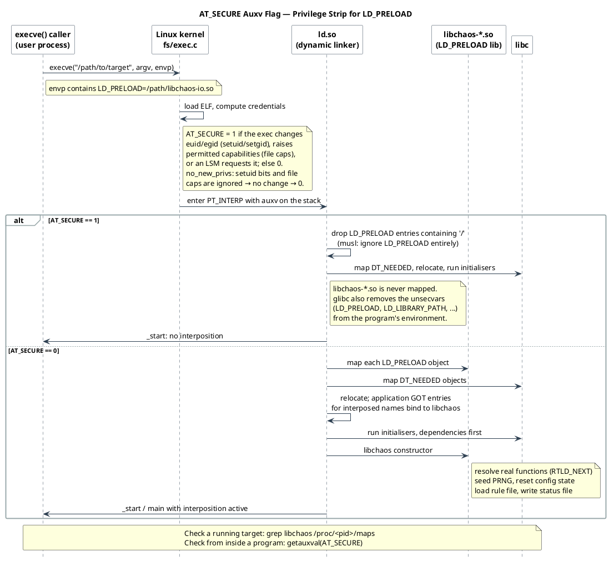

<!--
━━━━━━━━━━━━━━━━━━━━━━━━━━━━━━━━━━━━━━━━━━━━━━━━━━━━━━━━━━━━━
  Engineered by  Christian Schnapka
                 Embedded Principal+ Engineer
                 Macstab GmbH · Hamburg, Germany
                 https://macstab.com
━━━━━━━━━━━━━━━━━━━━━━━━━━━━━━━━━━━━━━━━━━━━━━━━━━━━━━━━━━━━━
-->

# Safety and Operational Boundaries

> *Engineered by* **[Christian Schnapka](https://macstab.com)** — Embedded Principal+ Engineer · [Macstab GmbH](https://macstab.com) · Hamburg, Germany

---

This document specifies what the libchaos libraries guarantee when something goes wrong,
which privilege and sandbox boundaries apply to them, and which operational mistakes cause
damage. The libraries are a fault-injection tool for test and staging environments. They
are not a security boundary, and anyone who can write a rule file controls the faults of
every process that loads the matching library.

---

## Table of Contents

1. [AT_SECURE and the Privilege Strip](#1-at_secure-and-the-privilege-strip)
2. [setuid, setgid, and File Capabilities](#2-setuid-setgid-and-file-capabilities)
3. [Container Capabilities and LD_PRELOAD](#3-container-capabilities-and-ld_preload)
4. [seccomp Interaction](#4-seccomp-interaction)
5. [Fail-Open Guarantee](#5-fail-open-guarantee)
6. [Reentrancy Invariant](#6-reentrancy-invariant)
7. [The "Never Preload Into Dev Shell" Footgun](#7-the-never-preload-into-dev-shell-footgun)
8. [Detectability and Audit Trail](#8-detectability-and-audit-trail)
9. [Config File Security](#9-config-file-security)
10. [Interaction with Sanitisers and Debug Runtimes](#10-interaction-with-sanitisers-and-debug-runtimes)
11. [Cross-Library Composition Hazards](#11-cross-library-composition-hazards)

---

## 1. AT_SECURE and the Privilege Strip

A program started with more privilege than its caller runs in secure-execution mode, and
the dynamic linker then does not load the libchaos libraries from `LD_PRELOAD`. The
libraries cannot influence this, and must not: preloading caller-chosen code into a
privileged program is a privilege escalation.

The kernel signals secure-execution mode with the auxiliary-vector entry `AT_SECURE`
(tag 23) set to 1. It sets it when the `execve` changes credentials or an LSM asks for it:

- the file is set-user-ID and the effective UID differs from the real UID;
- the file is set-group-ID and the effective GID differs from the real GID;
- the file's capabilities (`security.capability` xattr) raise the permitted set;
- an LSM requests it (an SELinux domain transition without the `noatsecure` permission).

What the loader then does with `LD_PRELOAD`:

| Loader | Behaviour under `AT_SECURE=1` |
|---|---|
| glibc `ld.so` | Ignores preload entries that contain a `/`. Entries without a slash are loaded only from the standard search directories and only if the object file is itself set-user-ID. The variables in `sysdeps/generic/unsecvars.h` (`LD_PRELOAD`, `LD_LIBRARY_PATH`, `LD_AUDIT`, ...) are removed from the program's environment. |
| musl | Ignores `LD_PRELOAD` and `LD_LIBRARY_PATH` entirely. |

The libchaos libraries are always given as a path (`/path/libchaos-io-glibc-amd64.so`) and
are never set-user-ID, so in practice they are never loaded into such a program.

Reference: `ld.so(8)` "Secure-execution mode"; `getauxval(3)`; kernel `fs/exec.c` and
`security/commoncap.c`.

### 1.1 Verifying AT_SECURE

Check the target, not a helper program: `LD_PRELOAD=... printenv LD_PRELOAD` proves
nothing, because `printenv` is not privileged and does load the library.

```sh
# Is the target privileged at exec? (setuid/setgid bit, or file capabilities)
stat -c '%A %U:%G %n' /usr/bin/target
getcap /usr/bin/target

# Did the library load into the running target?
grep libchaos /proc/<pid>/maps || echo "not loaded"
```

From inside a program you control:

```c
#include <stdio.h>
#include <sys/auxv.h>

int main(void)
{
    printf("AT_SECURE = %lu\n", getauxval(AT_SECURE));
    return 0;
}
```

### 1.2 Workarounds (and Why Not to Use Them)

- **Run the caller as the file's owner.** A set-user-ID-root program started by root changes
  no credentials, so `AT_SECURE` stays 0. It also means running the whole test harness as
  root, where an injected fault in the harness's own I/O can damage system files.
- **Start it under `no_new_privs`.** With `PR_SET_NO_NEW_PRIVS` (Kubernetes
  `allowPrivilegeEscalation: false`) the kernel ignores the set-user-ID bit and file
  capabilities at `execve`, so `AT_SECURE` stays 0 and the library loads; the program then
  runs without the privilege it was built to have, which usually changes the behaviour under
  test.
- **`/etc/ld.so.preload`.** Read by the loader regardless of the environment and
  root-controlled; it preloads into every dynamically linked process on the system. Not
  recommended (see [§7](#7-the-never-preload-into-dev-shell-footgun)).

### 1.3 AT_SECURE Flow Diagram

Kernel, loader and library at `execve` ([source](diagrams/atsecure.puml)):



---

## 2. setuid, setgid, and File Capabilities

Apart from `AT_SECURE`, the libraries have no notion of privilege. Once loaded they run with
the target process's credentials, and every file they touch is accessed with those
credentials.

File capabilities matter only through `AT_SECURE` ([§1](#1-at_secure-and-the-privilege-strip)).

A rule file the process may not open (for example root-owned, mode 0600, and a process
running as another user) fails `open` with `EACCES`. The library then runs with no rules,
reports `state=error`, `reason=file unreadable` in `/tmp/.chaos-<lib>.status`, and does not
try again until the file's stamp (mtime, size, inode, device) changes. See
[§5](#5-fail-open-guarantee).

---

## 3. Container Capabilities and LD_PRELOAD

In a container `LD_PRELOAD` is an ordinary environment variable. Loading a library into a
dynamically linked program that is not set-user-ID needs no capability. A statically linked
program never runs the dynamic linker and is unreachable in LD_PRELOAD mode; SECCOMP mode
(`chaos-init`, [SECCOMP.md](SECCOMP.md)) covers it.

### 3.1 Read-Only Filesystem

Every path the libraries use is compiled in (`/tmp/.chaos-<lib>.conf`, `.status`,
`.hits.<n>`); there is no environment override. With a read-only root filesystem
(Kubernetes `readOnlyRootFilesystem: true`) and no writable `/tmp`:

- rules cannot be written, so nothing is injected;
- status and hits writes fail; the failure is ignored and errno preserved.

Mount a writable volume (`emptyDir`) at `/tmp`.

### 3.2 `no-new-privileges` securityContext

`allowPrivilegeEscalation: false` sets `PR_SET_NO_NEW_PRIVS` on the container's first
process, inherited by every descendant. `execve` then gains no privilege from set-user-ID
bits or file capabilities. It does not affect `LD_PRELOAD`; it makes set-user-ID targets
reachable, without their privilege ([§1.2](#12-workarounds-and-why-not-to-use-them)).
`chaos-init` sets `no_new_privs` on its child itself, as seccomp requires for an
unprivileged filter.

### 3.3 AppArmor and SELinux

A profile that denies reading or mapping (`PROT_EXEC`) the library file stops the loader from
loading it. glibc's loader prints `ERROR: ld.so: object '<path>' from LD_PRELOAD cannot be
preloaded ...: ignored.` to stderr and runs the program without the library: no rule
applies and no status file is written. Treat a missing `/tmp/.chaos-<lib>.status` after a
start with a rule file present as "library not loaded".

---

## 4. seccomp Interaction

A seccomp filter applies to the real system calls a process makes. The libraries add a few
system calls of their own; an injected ERRNO makes none.

### 4.1 Syscalls Used by the Libraries

| System call (as issued on Linux) | Purpose | Path |
|---|---|---|
| `newfstatat` or `statx` (via libc `stat`), `fstat` | rule-file change check, read consistency check | at most once per ms per library, plus every reload |
| `openat`, `read`, `close` | rule-file read | raw system calls (net, dns, time, memory, process); the real `open`/`read`/`close` (io) |
| `openat`, `read`, `close` | `/dev/urandom` seed | once per library, raw system calls |
| `openat`, `write`, `fchmod`, `linkat`, `renameat` (`renameat2` on arm64), `unlinkat`, `faccessat` | status and hits files | raw system calls; failures ignored |
| `clock_nanosleep` | LATENCY | raw system call, restarted on `EINTR` |
| `gettid` | lazy per-thread PRNG seed | raw system call, first draw per thread |
| `readlink` or `readlinkat` (via libc `readlink`) | fd → path (`libchaos-io`) | fd-cache miss |
| `mmap`, `munmap` | fd-cache table (`libchaos-io`) | raw system calls, once per process |

Clock reads for the change-check throttle and the hits schedule go through the vDSO and make
no system call where the vDSO provides `clock_gettime`. The Docker runtime suites run the
libraries under Docker's default seccomp profile (none of them relaxes it).

### 4.2 Failure behaviour under a restrictive filter

A filter that denies one of these calls (`SECCOMP_RET_ERRNO`) degrades, never aborts:

| Denied | Effect |
|---|---|
| `/dev/urandom` open/read | seed falls back to `0x6a09e667f3bcc909 ^ getpid()`: per-process, but predictable |
| `stat` | rule file treated as missing: no rules |
| rule-file `open`/`read` | `EACCES`/`EPERM`: `reason=file unreadable`, no rules; other errors: active rules kept, retried at the next look |
| status/hits writes | no report; injection unaffected |
| `clock_nanosleep` | LATENCY returns at once instead of sleeping |
| `mmap` (fd cache) | every lookup reads `/proc/self/fd` |

### 4.3 seccomp and Injected Syscalls

An injected ERRNO returns before the real function is called, so no system call reaches the
kernel and the filter sees nothing. A LATENCY or TORN rule still issues the real call (TORN
with a shorter count), which the filter judges as usual.

SECCOMP mode is the inverse arrangement: `chaos-init` installs a filter with a notification
listener and decides the faults in the supervisor. It needs Linux 5.5 or later; on an older
kernel or where the runtime's profile refuses `seccomp`, it reports `state=unsupported` in
`/tmp/.chaos-init.status` and starts the application without faults.

---

## 5. Fail-Open Guarantee

The most important operational property:

> **Any internal error leads to the real call.** The library never fabricates a failure for
> a call no rule selected.

Conditions and outcome:

| Condition | Outcome |
|---|---|
| Rule file absent | no rules; status file removed |
| Rule file has an invalid line, more than 256 rules, or a rule SECCOMP mode cannot apply | whole file rejected, no rules; status file names the line |
| Rule file of 256 KiB (262 144 bytes) or more | rejected, no rules, `reason=file too large` |
| Rule file holds a NUL byte | rejected, no rules, `reason=file contains a NUL byte` |
| `open` fails with `EACCES`/`EPERM`, or the path is a directory | no rules, `reason=file unreadable`, not retried until the stamp changes |
| `open`/`read` fails otherwise (`EIO`, `EMFILE`, file vanished), or the file changed while read | **previous rules stay active**; retried at the next look |
| Another thread is reloading | this call uses the active rules |
| fd cannot be resolved to a path, or the path is excluded | call passes through |
| Probability, `@from`/`@until` window, `@size` gate or `@first` budget says no | call passes through |
| Reentrancy guard set | call passes through at once |

Removing the rule file restores normal behaviour within about 1 ms: once rules are loaded,
each library looks at the file at most once per millisecond, and a missing file publishes an
empty rule set. Every rejection is visible in `/tmp/.chaos-<lib>.status`
([ARCHITECTURE.md, Status file](ARCHITECTURE.md#status-file)).

### 5.1 The One Exception: Unresolvable Symbols

Fail-open covers operational errors. It does not cover a real function that does not exist:
when `dlsym(RTLD_NEXT, ...)` returns NULL with a `dlerror()` set for a required symbol,
`chaos_<lib>_resolve_symbol()` calls `abort()`. There is nothing to fall through to, and
returning an invented error would break the guarantee above.

Resolution is lazy: the symbol table is filled once, by the constructor or by the first
wrapper call that happens before it, whichever comes first (IO.md, "Symbol resolution is
lazy"). The abort therefore happens at load time or at the first interposed call. When
porting to a libc that lacks an interposed symbol, expect the target to abort, not the load
to fail.

Symbols older C libraries lack are resolved optionally and do not abort:

| Library | Optional symbols | Behaviour when absent |
|---|---|---|
| `libchaos-io` | `close_range` | `ENOSYS`, as the missing libc function would report |
| `libchaos-io` | `closefrom` | raw `SYS_close_range`, else `SYS_close` on every fd up to `_SC_OPEN_MAX` |
| `libchaos-io` | `renameat2` | raw `SYS_renameat2` (`ENOSYS` where the architecture has none) |
| `libchaos-io` | `__vfprintf_chk`, `__fread_chk`, `__fgets_chk` | the unfortified `vfprintf`, `fread`, `fgets` |
| `libchaos-process` | `execveat` | raw `SYS_execveat` system call (`ENOSYS` where the architecture has none) |
| `libchaos-process` | `execvpe`, `fexecve` | `ENOSYS` |
| `libchaos-process` | `pthread_create` | lookup retried on every call; `EAGAIN` if still absent |

`pthread_create` lives in libpthread before glibc 2.34. In a program that never links
libpthread (`cat`, `sh`) it does not exist when `libchaos-process` loads, and aborting there
killed every such program before `main()`. A program that can call `pthread_create` has
libpthread loaded (possibly later, through `dlopen`), so the retried lookup succeeds in
practice. `EAGAIN` is the error `pthread_create` itself documents for a thread it cannot
create. `test_baseline_glibc.sh` checks this on glibc 2.31.

---

## 6. Reentrancy Invariant

Each library keeps a per-thread guard (`__thread int g_chaos_<lib>_tls_guard`). While it is
set, that library's wrappers call the real function without matching a rule.

**Invariant:** a library sets its guard around every libc call it makes on its own behalf
that it also interposes (the real-function call itself, `stat`, `readlink` on
`/proc/self/fd`, the `libchaos-io` rule-file read through the real `open`/`read`). Such
calls never re-enter the library's own rule logic.

**Why:** without it the library would inject into itself. A rule on `open` could fail the
read of its own rule file indefinitely; a wrapper reached from inside a wrapper would
recurse.

**Corollary:** calls a library makes while its guard is set are not application calls.
They match no rule, count no hit and advance no FAIL_AFTER counter.

**Cross-library scope:** the guard is per library, so it does not stop a *different*
library's wrapper. The libraries therefore avoid interposable functions for their own work
altogether: rule files of net, dns, time, memory and process, all status and hits files,
injected sleeps and the fd-cache mapping use raw system calls; clocks use the vDSO. No
library's rules can fault another library's control plane
(`test/runtime/test_isolation_glibc.sh`).

**Guard restoration:** `chaos_<lib>_enter_internal()` returns the previous value and
`chaos_<lib>_leave_internal()` restores it (not 0), so nested internal sections unwind
correctly. See `docs/MEMORY.md` §14 for the protocol.

---

## 7. The "Never Preload Into Dev Shell" Footgun

The most common operational error:

```sh
export LD_PRELOAD=/path/libchaos-io-glibc-amd64.so
# ... forget to unset it ...
# ... run git, ls, your editor, your CI tool, anything ...
```

Every dynamically linked process started from that shell inherits the library, and every
one of them reads the same `/tmp/.chaos-io.conf`. A rule meant for one service then hits:

- `git`: failed or torn writes under `.git/` corrupt objects and the index;
- `ssh`, package managers, editors: failed reads and writes, partial files;
- the test runner itself: failures in its own I/O, reported as test failures;
- anything spawned later from that shell, long after the test.

Scope `LD_PRELOAD` to the target invocation:

```sh
LD_PRELOAD=/path/libchaos-io-glibc-amd64.so ./target [args]
```

Never `export LD_PRELOAD` in an interactive shell. In a test suite, set it only in the
environment of the subprocess under test.

In Makefiles:

```makefile
run-with-chaos:
	LD_PRELOAD=$(CHAOS_LIB) $(TARGET_BIN)
```

Not:

```makefile
export LD_PRELOAD = $(CHAOS_LIB)   # WRONG: every recipe, including make's own tools
```

---

## 8. Detectability and Audit Trail

### 8.1 How to Detect a Loaded Preload Library

From outside the process:

```sh
grep libchaos /proc/<pid>/maps                         # mapped objects
tr '\0' '\n' < /proc/<pid>/environ | grep LD_PRELOAD   # environment at exec
ls -l /tmp/.chaos-*.status /tmp/.chaos-*.hits.*       # reports the libraries wrote
```

From inside the process (`_GNU_SOURCE`, link with `-ldl` before glibc 2.34):

```c
#define _GNU_SOURCE
#include <dlfcn.h>
#include <link.h>
#include <stdio.h>

int main(void)
{
    struct link_map *lm = NULL;
    void *self = dlopen(NULL, RTLD_NOW);

    if (self == NULL || dlinfo(self, RTLD_DI_LINKMAP, &lm) != 0)
    {
        return 1;
    }
    for (; lm != NULL; lm = lm->l_next)
    {
        printf("%s\n", lm->l_name);
    }
    return 0;
}
```

### 8.2 No Built-In Logging

The libraries write nothing to stdout or stderr, on purpose:

1. Output from inside a wrapper would interleave with the application's own output on fds
   the application owns, and would cost a system call on hot paths.
2. A `write` from inside `libchaos-io` would need its own reentrancy handling, and from any
   other library it would pass through `libchaos-io`'s wrapper and its rules.

Observability comes from three files per library instead, all written with raw system calls:

- `/tmp/.chaos-<lib>.status`: the outcome of the last load (rules accepted, or the first
  rejected line and why);
- `/tmp/.chaos-<lib>.hits.<n>`: per process, how often each rule fired;
- the application's own behaviour: the error it reports, the latency it measures, the retry
  it performs, which is what the test asserts on.

### 8.3 Indirect Audit Signals

To confirm that injection reaches a target:

- Load a rule that always fires on a call the target certainly makes
  (`*:open:ENOENT:1.0` for `libchaos-io`) and check that the hits file counts it.
- Compare `strace -f -e trace=openat ./target` with and without the rule: an injected ERRNO
  never reaches the kernel, so the system call is missing from the trace while the
  application still reports `ENOENT`.

---

## 9. Config File Security

Rule files are fully trusted. Anyone who can create or replace `/tmp/.chaos-<lib>.conf`
controls the faults of every process on that machine (or in that mount namespace) that loads
`libchaos-<lib>`.

**Default location:** the paths are compiled in under `/tmp`, which is world-writable
(mode 1777) on Linux. Any local user can create a rule file before the legitimate writer
does.

The status and hits files are mode 0666 so that a process of another user (an application
that dropped root) can still update them; any user can also overwrite them with false
reports.

**Consequence:** on a shared host, any user can write `*:write:EIO:1.0` to
`/tmp/.chaos-io.conf`, and every process running with `libchaos-io` preloaded fails every
file write within about 1 ms.

**Mitigations:**

1. **Private `/tmp`.** Give each target its own mount namespace with a private `/tmp`
   (a container, or a tmpfs mounted for the test).
2. **Container isolation.** A container's `/tmp` is not reachable by host users without
   access to the container's filesystem.
3. **No ownership check exists.** The libraries do not verify the rule file's owner; adding
   one would also reject legitimate cross-user setups (an image that writes rules as root and
   runs the application as another user).

This is a deliberate limitation, acceptable where the test operator controls the whole
machine or container. The libraries do not belong on multi-tenant production hosts.

**Symbolic links.** The rule file is opened without `O_NOFOLLOW` on purpose: rule files
mounted through a link (Kubernetes ConfigMap volumes go through `..data`) must keep working.
A link another user planted in a sticky `/tmp` is not followed where
`fs.protected_symlinks=1` (the default on current distributions). Status and hits files are
never written through a link: the staging file is created with
`O_CREAT | O_EXCL | O_NOFOLLOW` and renamed over the target, and the in-place fallback opens
the target with `O_NOFOLLOW` and without `O_CREAT` (which `fs.protected_regular` would
refuse).

**Descriptor leaks.** net, dns, time, memory and process open the rule file with
`O_CLOEXEC`, so the descriptor of a reload in progress does not leak into a program another
thread executes. `libchaos-io` opens it with plain `O_RDONLY` through the real `open`; a
concurrent `execve` on another thread can inherit that descriptor for the duration of the
read.

**Signal handlers.** An interposed call made in a signal handler can take over a due reload.
Reload and parsing take no lock; probabilities and qualifier numbers are parsed by hand,
independent of the locale (`strtod` would stop at the `.` of `0.5` under `de_DE`), and the
parsers call no `malloc`. Status and hits reports are formatted with `snprintf` using only string
and integer conversions, and written with raw system calls. A handler that
interrupts the thread holding the reload claim sees `RELOADING` and uses the active rules; one
that interrupts the hits writer leaves its hit pending for the writer.

---

## 10. Interaction with Sanitisers and Debug Runtimes

The libraries are not built with sanitizer instrumentation. A sanitizer therefore sees their
code as uninstrumented: it checks none of their memory accesses and reports no races inside
them. What remains is ordering in the link map.

### 10.1 AddressSanitiser (ASan)

ASan interposes `malloc`, `free`, `mmap`, `munmap` and many libc functions. With libchaos
in front, a call goes application → libchaos wrapper → `RTLD_NEXT` → ASan interceptor →
libc. Each layer forwards to the next definition, so both work.

With the dynamic ASan runtime (GCC's default), ASan requires its runtime to come first in the
initial library list and aborts with "ASan runtime does not come first in initial library
list" when another preload precedes it. Put `libasan.so` first in `LD_PRELOAD`, or set
`ASAN_OPTIONS=verify_asan_link_order=0`. ASan's own internal mappings use its own system
call path and do not reach `libchaos-memory`.

### 10.2 ThreadSanitiser (TSan)

TSan interposes `pthread_create`, the `pthread_mutex_*` family and other synchronisation
functions. With `libchaos-process` loaded, `pthread_create` goes libchaos wrapper → TSan
interceptor → libc. Because the libchaos objects are uninstrumented, TSan reports no races
on their globals; their lock-free state (CAS, seqlocks, `__sync` barriers) is invisible to
it.

### 10.3 Valgrind

Valgrind runs the whole client, preloaded objects included, on its synthetic CPU, so
interposition behaves as without it. Memcheck tracks heap blocks (the `malloc` family), not
`mmap` regions: an injected `munmap` failure that leaves a mapping in place is not reported
as a leak, and needs no suppression.

---

## 11. Cross-Library Composition Hazards

All six libraries can be preloaded together. The hazards, and how the code handles each:

### 11.1 Config Reload Cascades

- **Change checks multiply.** Each library checks its own rule file, at most once per
  millisecond per process, with one `stat` each. Six libraries cost at most six `stat`
  calls per millisecond per process, independent of the call rate.
- **A LATENCY delay never passes through another library.** Each guard is its own
  variable, so it does not stop a *different* library's wrapper. When the delay went through
  `usleep()` (io, net, dns) or a `dlsym(RTLD_NEXT, "usleep")` pointer (memory, process,
  reaching `libchaos-time` whenever it came later in `LD_PRELOAD`), a time rule such as
  `usleep:ERRNO:EINTR` ended another library's 300 ms delay after 1 ms, and `usleep:LATENCY`
  lengthened it. Every library now sleeps through `chaos_sleep_ms()`
  (`src/common/chaos_sleep.h`), a direct `clock_nanosleep` system call no preloaded library
  can intercept. `test/runtime/test_isolation_glibc.sh` checks each library's delay under
  hostile time rules in both preload orders.
- **No library can fault another's rule file.** An io rule on `/tmp` would otherwise fail
  the other libraries' rule-file reads; they read with raw system calls, and `libchaos-io`
  excludes every `/tmp/.chaos-*` path from its own rules.

### 11.2 Simultaneous FAIL_AFTER Counters

FAIL_AFTER counters exist only in `libchaos-process`: one counter per operation, shared by
all threads of a process, incremented atomically. They count only calls that reach a
`libchaos-process` wrapper with a matching FAIL_AFTER rule; no other library's internal work
creates processes or threads, so nothing else advances them. They reset when a new rule set is
published and in a forked child (per process, like `@first`). There is no counter sharing
between libraries.

### 11.3 LD_PRELOAD Order and Link-Map

`LD_PRELOAD` lists objects left to right; the loader places them in the global scope in that
order, after the executable and before its `DT_NEEDED` libraries.

- **Which library faults a call does not depend on order.** Libraries that export the same
  name (`read`, `write`, `readv`, `writev`, `close`, `__read_chk`: io and net) decide for
  disjoint descriptor kinds (files vs sockets) and forward everything else along the chain.
  Order would matter only if two libraries decided for the same kind, which the
  ownership rule forbids ([ARCHITECTURE.md](ARCHITECTURE.md#formal-symbol-ownership-theorem)).
- **Every library sees every call.** Each wrapper forwards with `dlsym(RTLD_NEXT, name)`,
  resolved once per process (constructor or first call). With `io:net` order, `write` goes
  application → io → net → libc; with `net:io`, application → net → io → libc.
  `test_sharing_glibc.sh` checks both orders.

### 11.4 Constructor Ordering

ELF initialisers run dependencies first. Another object's constructor can therefore call an
interposed function before a libchaos constructor has run, which is why every wrapper
resolves the real functions itself (`chaos_<lib>_ensure_symbols()`) instead of relying on
the constructor. Each libchaos constructor resolves its real functions, seeds its PRNG,
registers its atfork handler and loads its rule file; none depends on another libchaos
library, so their relative order does not affect correctness.

---

<div align="center">

*Architecture, implementation, and documentation crafted with Love and Passion by*

**[Christian Schnapka](https://macstab.com)**  
Embedded Principal+ Engineer  
[Macstab GmbH](https://macstab.com) · Hamburg, Germany

*Building systems that operate correctly at the edges — including the ones you deliberately break.*

</div>
