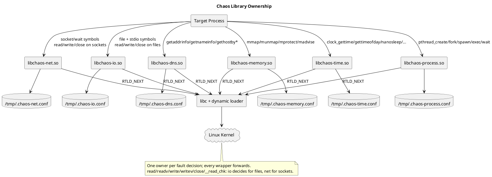
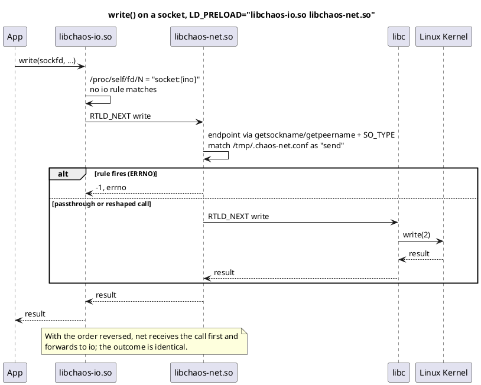
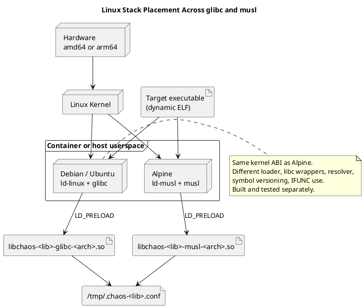
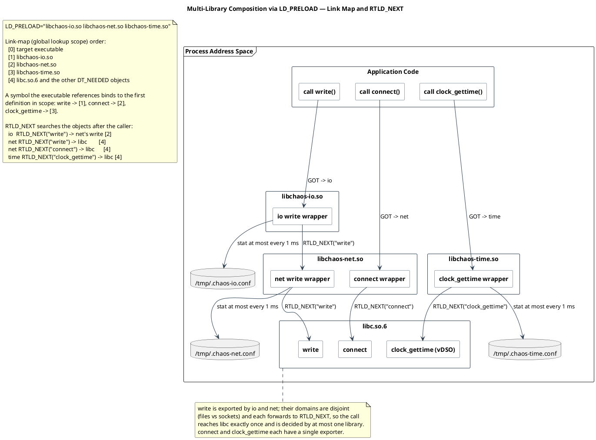

<!--
━━━━━━━━━━━━━━━━━━━━━━━━━━━━━━━━━━━━━━━━━━━━━━━━━━━━━━━━━━━━━
  Engineered by  Christian Schnapka
                 Embedded Principal+ Engineer
                 Macstab GmbH · Hamburg, Germany
                 https://macstab.com
━━━━━━━━━━━━━━━━━━━━━━━━━━━━━━━━━━━━━━━━━━━━━━━━━━━━━━━━━━━━━
-->

# Chaos Testing Libraries System Manual

> *Engineered by* **[Christian Schnapka](https://macstab.com)** — Embedded Principal+ Engineer · [Macstab GmbH](https://macstab.com) · Hamburg, Germany

---

## Table of Contents

- [1. Overview](#1-overview)
- [2. Architectural Context](#2-architectural-context)
- [3. Key Concepts and Terminology](#3-key-concepts-and-terminology)
- [4. End-to-End Behavior](#4-end-to-end-behavior)
- [5. Architecture Diagrams](#5-architecture-diagrams)
- [6. Component Breakdown](#6-component-breakdown)
- [7. Data Model and State](#7-data-model-and-state)
- [8. Concurrency and Threading Model](#8-concurrency-and-threading-model)
- [9. Error Handling and Failure Modes](#9-error-handling-and-failure-modes)
- [10. Security Model](#10-security-model)
- [11. Performance Model](#11-performance-model)
- [12. Observability and Operations](#12-observability-and-operations)
- [13. Configuration Reference](#13-configuration-reference)
- [14. Extension Points and Compatibility Guarantees](#14-extension-points-and-compatibility-guarantees)
- [15. Stack Walkdown](#15-stack-walkdown)
- [16. References](#16-references)
- [17. Platform Internals Reference](#17-platform-internals-reference)

## 1. Overview

### Purpose

This repository ships six Linux fault-injection libraries that interpose libc
symbols in a target process through `LD_PRELOAD`, plus `chaos-init`, a static
supervisor that applies the same rules to processes the preload cannot reach:

| Library | Domain | Rule file |
| --- | --- | --- |
| `libchaos-io` | files: open, read, write, sync, truncate, rename, unlink, stdio streams | `/tmp/.chaos-io.conf` |
| `libchaos-net` | sockets: lifecycle, payload, readiness waits | `/tmp/.chaos-net.conf` |
| `libchaos-dns` | resolver: `getaddrinfo`, `getnameinfo`, `gethostby*` | `/tmp/.chaos-dns.conf` |
| `libchaos-time` | clocks and sleeps | `/tmp/.chaos-time.conf` |
| `libchaos-memory` | `mmap`, `munmap`, `mprotect`, `madvise` | `/tmp/.chaos-memory.conf` |
| `libchaos-process` | thread and process creation, exec, wait | `/tmp/.chaos-process.conf` |

The purpose is narrow: an unmodified application observes controlled failures
at the libc call boundary it already uses. No source change, RPC shim, JVM
agent, sidecar, kernel module or traffic-control rule is involved.

### Scope

In scope:

- fault injection into dynamically linked processes through `LD_PRELOAD` (LD_PRELOAD mode)
- fault injection into any process, static binaries and Go programs included,
  through seccomp user notification (SECCOMP mode, `chaos-init`; see
  [SECCOMP.md](SECCOMP.md))
- glibc and musl, amd64 and arm64: four release tuples, each built and tested separately
- composition of any subset of the six libraries in one process

Out of scope:

- static binaries and raw-syscall runtimes in LD_PRELOAD mode (SECCOMP mode covers them)
- kernel-space interception, packet-level shaping, eBPF policy
- instrumentation inside language runtimes
- two libraries deciding the same call (see [Global Invariant](#global-invariant))

### Assumptions

- In LD_PRELOAD mode the target is a dynamically linked ELF executable whose
  loader honours `LD_PRELOAD` (no `AT_SECURE`, see §17).
- The code path under test traverses an interposed symbol. A runtime that
  issues the system call itself (Go, static musl) is invisible to the
  preload; use SECCOMP mode.
- The operator can set environment variables and write `/tmp/.chaos-*.conf`
  inside the target's mount namespace.
- Correctness means correct on all four tuples, not on the build host.

### Non-Goals

- One preload object that owns every symbol.
- One selector grammar for unrelated fault domains.
- Hiding coverage limits; every known gap is listed in
  [Known Coverage Limitations](#known-coverage-limitations).

### Documentation Standard

Every document in this repository describes implemented behaviour first and
labels future work as such. It states ownership boundaries, invariants,
failure and passthrough behaviour, and the libc, loader, kernel and
architecture constraints that change correctness. Diagrams appear only where
they are more precise than prose.

### Global Invariant

`every fault decision has exactly one owner, and every wrapper forwards along the chain`

A symbol may be exported by more than one library only when the libraries'
domains are disjoint by descriptor kind. Six symbols are shared:
`read`, `readv`, `write`, `writev`, `close` and the fortified `__read_chk`.
`libchaos-io` decides them for files, `libchaos-net` for sockets. Every other
symbol has exactly one exporter.

The rule is a correctness boundary, not style: overlapping decisions make the
outcome depend on `LD_PRELOAD` order, inject twice, and diverge between glibc
and musl in ways that cannot be debugged after the fact. §17 states it
formally; `test/runtime/test_sharing_glibc.sh` proves it at runtime for the
shared symbols in both preload orders.

How each library recognises its own descriptors:

- `libchaos-io` resolves a descriptor to the target of `/proc/self/fd/<fd>`.
  A socket resolves to `socket:[<inode>]`, which never starts with `/`, so the
  wildcard selector `*` does not match it and no path prefix covers it.
- `libchaos-net` derives an endpoint with `getsockname`/`getpeername` and
  `SO_TYPE`; on a file this fails with `ENOTSOCK` and the call is not decided.
- Both forward every call they do not decide to `dlsym(RTLD_NEXT, ...)`, never
  directly to libc, so each library sees every call whatever the preload order.

Exported symbols per library (verified against the `CHAOS_*_EXPORT`
definitions in `src/`):

| Library | Exported symbols |
| --- | --- |
| `libchaos-io` | `open`, `open64`, `openat`, `openat64`, `__open_2`, `__open64_2`, `__openat_2`, `__openat64_2`, `creat`, `creat64`, `pread`, `pread64`, `pwrite`, `pwrite64`, `preadv`, `preadv64`, `pwritev`, `pwritev64`, `__pread_chk`, `__pread64_chk`, `fsync`, `fdatasync`, `ftruncate`, `ftruncate64`, `truncate`, `truncate64`, `fallocate`, `fallocate64`, `posix_fallocate`, `posix_fallocate64`, `unlink`, `unlinkat`, `rmdir`, `remove`, `rename`, `renameat`, `renameat2`, `sendfile`, `sendfile64`, `copy_file_range`, `dup2`, `dup3`, `close_range`, `closefrom`, `closedir`, `pclose`; stdio: `fopen`, `fopen64`, `freopen`, `freopen64`, `fclose`, `fread`, `fwrite`, `fgets`, `fputs`, `fgetc`, `getc`, `fputc`, `putc`, `getline`, `getdelim`, `__getdelim`, `fprintf`, `vfprintf`, `fflush`, `__fread_chk`, `__fgets_chk`, `__fprintf_chk`, `__vfprintf_chk`; **shared, files only:** `read`, `readv`, `write`, `writev`, `close`, `__read_chk` |
| `libchaos-net` | `socket`, `socketpair`, `bind`, `listen`, `connect`, `accept`, `accept4`, `shutdown`, `send`, `sendto`, `sendmsg`, `sendmmsg`, `recv`, `recvfrom`, `recvmsg`, `recvmmsg`, `__recv_chk`, `__recvfrom_chk`, `poll`, `__poll_chk`, `ppoll`, `__ppoll_chk`, `select`, `pselect`, `epoll_wait`, `epoll_pwait`; **shared, sockets only:** `read`, `readv`, `write`, `writev`, `close`, `__read_chk` |
| `libchaos-dns` | `getaddrinfo`, `freeaddrinfo`, `getnameinfo`, `gethostbyname`, `gethostbyname_r`, `gethostbyname2`, `gethostbyname2_r`, `gethostbyaddr`, `gethostbyaddr_r` |
| `libchaos-time` | `clock_gettime`, `gettimeofday`, `time`, `timespec_get`, `nanosleep`, `clock_nanosleep`, `sleep`, `usleep` |
| `libchaos-memory` | `mmap`, `mmap64`, `munmap`, `mprotect`, `madvise`, `posix_madvise` |
| `libchaos-process` | `pthread_create`, `fork`, `posix_spawn`, `posix_spawnp`, `system`, `popen`, `execve`, `execveat`, `execv`, `execvp`, `execvpe`, `execl`, `execle`, `execlp`, `fexecve`, `waitpid`, `wait`, `wait3`, `wait4`, `waitid` |

Consequences:

- Socket traffic through `read`/`write`/`readv`/`writev` is endpoint-aware:
  `libchaos-net` counts it as `recv`/`send`, so
  `tcp4://10.0.0.5:6379:recv:ECONNRESET:1.0` applies whichever call the
  program uses.
- Pipes, eventfds, timerfds and memfds (`pipe:[N]`, `anon_inode:[...]`,
  `/memfd:<name>`) belong to neither domain unless an io rule names them
  explicitly: a TORN or CORRUPT intended for files would break their protocols.
- Descriptors 0, 1 and 2 are never decided by `libchaos-io`.

## 2. Architectural Context

### System Boundaries

LD_PRELOAD mode runs entirely inside the target process: application, dynamic
loader, preloaded libraries, libc, kernel. SECCOMP mode adds one process,
`chaos-init`, which runs as the container's PID 1, installs a seccomp filter
with a notification listener in its child, and answers the notified system
calls from outside the tracee.

Neither mode uses kernel modules, cgroup controllers, sidecar daemons or an
external control plane. The only control channel is a file per library.

### Stable External Contracts

- artifact names: `libchaos-<lib>-<libc>-<arch>.so` in `dist/`
  (`<libc>` ∈ {glibc, musl}, `<arch>` ∈ {amd64, arm64}); native builds
  produce `build/libchaos-<lib>.so`
- the exported symbol set of each library (table in §1)
- the rule file path and grammar of each library ([DSL.md](DSL.md))
- the qualifiers `@first`, `@from`, `@until`, `@size`
- the status file `/tmp/.chaos-<lib>.status` and the hits file
  `/tmp/.chaos-<lib>.hits.<n>` formats (§7)
- `chaos-init` command line and `/tmp/.chaos-init.status`
- the four-tuple release gate

### Internal Contracts

Not public API, free to change: source layout, helper names, constructor
decomposition, snapshot layout, per-thread state layout, test harness
structure. There is no installed header and no C API.

### Dependency Direction

- the application calls a libc symbol
- the first preloaded object that exports it receives the call (the wrapper)
- the wrapper decides: inject, or not
- the wrapper calls the real function, the next definition in the link map,
  resolved once with `dlsym(RTLD_NEXT, name)`; that may be another chaos
  library, which applies the same procedure
- the last link is libc, which enters the kernel

Libraries never link against each other. Shared code lives in header-only
`src/common/*.h` (`static inline`) and is compiled into every object, so each
`.so` depends only on libc and `libdl` (`LDLIBS ?= -ldl`).

### Trust Boundaries

The libraries are not a security boundary. They execute with the target's
privileges.

- Rule files are trusted operator input.
- Paths, payloads, DNS names, socket addresses and clocks of the application
  are untrusted data but cross no privilege boundary.
- Injected corruption and failure are the intended behaviour, not mitigations.

### Deployment and Runtime Context

The target is a Linux process, usually inside a container. Typical images:
Debian or Ubuntu (glibc) and Alpine (musl). The kernel ABI is the same; the
loader, libc wrappers, resolver and header surface differ. Hence four release
tuples: glibc-amd64, glibc-arm64, musl-amd64, musl-arm64.

glibc builds must not bind a symbol version newer than `GLIBC_2.17`
(`test/runtime/check_glibc_baseline.sh`, a release gate in `release.yml`,
overridable with `GLIBC_BASELINE`):
glibc is backward- but not forward-compatible, and a library that binds
`stat@GLIBC_2.33` is refused by the loader in every older image (Debian 11,
Ubuntu 20.04, RHEL 8, Amazon Linux 2). Symbols newer than the build baseline
(`close_range`, `closefrom`, `renameat2`, the fortified `__*_chk` names,
`execveat`, `execvpe`, `fexecve`) are resolved as optional: when absent, the
wrapper reports `ENOSYS`, exactly what the caller would see from that libc.
`pthread_create`, which lives in libpthread before glibc 2.34, is resolved on
its first use, after libpthread may have been loaded.

### DNS Injection Modes

There are two DNS fault boundaries. They are complementary, not
interchangeable.

**Process-local, `libchaos-dns`.** Boundary: `getaddrinfo`, `getnameinfo`,
`gethostbyname*`, `gethostbyaddr*` inside the process.

- per-process targeting, no `NET_ADMIN`, deterministic failure at the libc contract
- effects: `GAI` (synthetic `EAI_*`), `LATENCY`, `REWRITE`, `SERVICE`,
  `OVERRIDE` (literal answers), and post-resolution `FILTER_FAMILY`,
  `SHUFFLE`, `LIMIT`
- invisible to callers that implement their own resolver (Go's pure-Go
  resolver, c-ares, Java's resolver when configured to bypass libc); models no
  wire-level behaviour (packets, nameserver failover, truncation)

**Stack-level, below the process.** Boundary: the resolver path, usually a
redirected or replacement nameserver (iptables, `tc`, an injected CoreDNS).

- covers every resolver implementation in the namespace
- models NXDOMAIN, SERVFAIL, REFUSED, truncation and nameserver failover on the wire
- needs more privilege and set-up; per-process targeting only through topology

When both are active, `libchaos-dns` decides first (latency, rewrite,
synthetic `EAI_*`). Only a call it passes on reaches libc and the stack-level
resolver. Use preload DNS to test the application's handling of resolver
results, stack-level DNS to test the resolver path itself, and both for
layered fault models.

## 3. Key Concepts and Terminology

| Term | Meaning |
| --- | --- |
| rule file | `/tmp/.chaos-<lib>.conf`, one per library; re-read when its change stamp changes (reload) |
| rule | one line of a rule file: selector, operation, effect, value, optional probability and qualifiers |
| selector | what a rule matches: path prefix (io), endpoint (net), DNS name or address (dns), operation[/target] (time, memory, process) |
| effect | what a matching rule does: `ERRNO`, `LATENCY`, `TIMEOUT`, `CORRUPT`, `TORN`, `TRICKLE`, `DUP`, `RESET`, `OFFSET`, `REGRESS`, `GAI`, `REWRITE`, `OVERRIDE`, `SERVICE`, `FILTER_FAMILY`, `SHUFFLE`, `LIMIT`, `FAIL_AFTER` |
| probability | chance in [0, 1] that a matching rule fires on a call, sampled from a per-thread PRNG |
| qualifier | `@first=N`, `@from=T`, `@until=T`, `@size>N`, `@size<N` (`src/common/chaos_policy.h`) |
| hit | one application of a rule's effect; counted per rule |
| status file | `/tmp/.chaos-<lib>.status`, outcome of the last load of the rule file |
| hits file | `/tmp/.chaos-<lib>.hits.<n>`, per-process hit counts per rule |
| reload | replacing the active rule set after the rule file changed |
| wrapper | the exported function that replaces a libc symbol |
| real function | the next definition of the symbol, `dlsym(RTLD_NEXT, name)` |
| internal mode | per-thread recursion guard set while a library calls real functions on its own behalf; wrappers seen in internal mode pass through |
| LD_PRELOAD mode | injection by interposition in the target process |
| SECCOMP mode | injection by `chaos-init` through seccomp user notification |
| tracee | a process supervised by `chaos-init` |

## 4. End-to-End Behavior

### Startup Lifecycle

1. The loader maps the objects listed in `LD_PRELOAD` after the executable and
   before its `DT_NEEDED` libraries.
2. Each library's ELF constructor runs: it resolves the real functions
   through `chaos_once()`, seeds the process PRNG from 8 bytes of
   `/dev/urandom` (raw `openat`/`read` system calls; fallback: a constant XOR
   the pid), resets the snapshots, registers a `pthread_atfork` child handler,
   loads the rule file once and writes the status file, so a bad rule file is
   reported at start-up rather than at the first matching call.
3. The application runs with the wrappers in place.

Constructors are not guaranteed to run first. ELF initialisers run in
dependency order, so another library's constructor can call an interposed
symbol before the chaos constructor has run (`libcap-ng` does file I/O in its
initialiser; under `setpriv`, `su` and `runuser` that crashed with SIGSEGV
before symbol resolution became lazy). Every wrapper therefore calls
`chaos_<lib>_ensure_symbols()` first. After the first call this is one
acquire load and a predictable branch.

`chaos_once()` (`src/common/chaos_once.h`) replaces `pthread_once()`: before
glibc 2.34 `pthread_once` lives in libpthread, and a preload that references
it fails with `undefined symbol: pthread_once` in every program that does not
load libpthread (`cat`, `sh`). A call from inside the initialiser on the same
thread (`dlsym` → `calloc` → a preloaded allocator → `mmap` →
`libchaos-memory`) returns 0 instead of deadlocking, and that call passes
through.

Failure behaviour: a mandatory real function that `dlsym` cannot resolve
calls `abort()`. A wrapper with a NULL real function would crash later at an
unrelated site; failing at load is diagnosable.

### Normal Call Lifecycle

1. **Guard.** If the thread is in internal mode, call the real function.
2. **Symbols.** `ensure_symbols()`.
3. **Refresh** (`chaos_<lib>_config_prepare()`, errno preserved). At most
   once per `CHAOS_CHECK_INTERVAL_NS` (1 ms, measured on the vDSO
   `CLOCK_MONOTONIC`), `stat()` the rule file and compare its change stamp
   (hash of mtime, size, inode, device). On a change, one thread reloads
   (§8). With no active rules, return here and call the real function: no
   selector is derived, no `readlink`, no `getsockname`.
4. **Selector.** Derive what the rules match on: path (io, via the fd cache
   or the `openat` directory), endpoint (net), name or address (dns),
   operation and target (time, memory, process).
5. **Select.** Scan the active snapshot linearly (at most 256 rules) for the
   most specific matching rule per effect class; ties go to the longer
   selector text, so line order never changes the outcome.
6. **Gate.** Check `@from`/`@until` against `CLOCK_REALTIME`, `@size` against
   the call's byte count, then the probability, then claim an `@first` slot,
   then count the hit.
7. **Effect.** Pre-call effects (`LATENCY`, `ERRNO`, `TIMEOUT`, `GAI`, ...)
   run before the real call; post-call effects (`CORRUPT`, `OFFSET`,
   `FILTER_FAMILY`, ...) transform its result. `TORN`, `TRICKLE` and `DUP`
   reshape the request or the result.
8. **Return** what libc would return, except for the injected fault. errno is
   left untouched on every path that does not inject.

### Why Domain Separation Matters

A descriptor can be a file, directory, pipe, socket, eventfd, timerfd, epoll
instance or memfd. `read` and `write` are generic descriptor operations. The
libraries therefore partition by what the descriptor is, not by symbol name:
io's selector model is path prefixes, net's is endpoints, and neither
grammar can express the other's domain.

### Concrete Routing Rules

| Call | Decided by |
| --- | --- |
| file and stdio calls; `read`/`write`/`readv`/`writev`/`close` on files | `libchaos-io` |
| socket lifecycle, `send*`/`recv*`, readiness waits; `read`/`write`/`readv`/`writev`/`close` on sockets | `libchaos-net` |
| resolver calls | `libchaos-dns` |
| clocks and sleeps | `libchaos-time` |
| mapping, protection, advice | `libchaos-memory` |
| thread and process creation, exec, wait | `libchaos-process` |

### Distinct Failure Boundaries

`libchaos-io` reasons about path prefixes, descriptor-to-path resolution,
partial writes (`TORN`), read corruption and durability (`fsync`,
`fdatasync`). `libchaos-net` reasons about endpoints, receive corruption,
short and duplicated receives, abortive close (`RESET`) and readiness
timeouts. Flattening both into one grammar would make each less precise.

## 5. Architecture Diagrams

### Component Ownership

Which library decides which calls, and how they compose without overlap.



Composition rests on disjoint decision domains, not on cooperative overlap.

### Call Routing

A shared symbol (`write`) on a socket, with io preloaded before net.



The decision depends on the descriptor, not on preload order.

### Linux Stack Placement

Where distro, libc, loader, kernel and architecture differences matter.



Debian/Ubuntu and Alpine differ in loader and libc behaviour, not in the
kernel beneath them.

### Multi-Library LD_PRELOAD Composition

Link-map order and the `RTLD_NEXT` chain ([source](diagrams/composition.puml)).



## 6. Component Breakdown

### `libchaos-io`

Responsibilities:

- path-prefix selectors; boundary-aware prefix match (`/data` covers
  `/data/x`, not `/database`); `*` covers absolute paths except `/memfd:`
- descriptor-to-path resolution through a process-wide fd cache
- effects `ERRNO`, `LATENCY`, `TORN` (write side), `CORRUPT` (read side)
- stdio streams: `ERRNO` raises the stream's error indicator (bit `0x20` of
  the first word of `FILE` on glibc and musl), so `ferror()` is true as after
  a real failure; `TORN` does not apply

Operations: `read`, `write`, `open`, `close`, `fsync`, `fdatasync`, `pread`,
`pwrite`, `truncate`, `allocate`, `unlink`, `rename_from`, `rename_to`. Every
exported alias maps onto one of them (`readv` → `read`, `sendfile` and
`copy_file_range` → `write` on the destination, `creat`/`fopen` → `open`,
`fread`/`fgets` → `read`, `rmdir`/`remove` → `unlink`, ...).

State: two snapshots, fd cache (§7). Dependencies: libc, `libdl`,
`/proc/self/fd`.

Extension rule: new file or descriptor symbols belong here unless their
domain is unambiguously another library's.

### `libchaos-net`

Responsibilities:

- endpoint selectors: `*`, `tcp4://`, `tcp6://`, `udp4://`, `udp6://`,
  `unix://`, with wildcard host and port
- operations `socket`, `bind`, `listen`, `connect`, `accept`, `shutdown`,
  `poll`, `send`, `recv`, `close`
- effects `ERRNO`, `LATENCY`, `CORRUPT` (recv), `TIMEOUT` (poll),
  `RESET` (close: abortive close, the peer receives an RST), `TRICKLE`
  (recv on stream sockets: at most N bytes per call), `DUP` (recv: deliver
  the previous payload once more)

State: two snapshots; no socket identity cache (net shares `close` with io
and cannot observe every way a descriptor is freed, so identity is derived
per call); a lazily mapped `DUP` payload table (64 slots × 4096 bytes,
raw `mmap`) allocated the first time a `DUP` rule needs it. Epoll membership is read from
`/proc/self/fdinfo/<epfd>` per wait, at most 256 KiB (about 4000 watched
descriptors); when it cannot be read, the wait passes through.

Extension rule: socket and readiness symbols belong here. Generic
descriptor symbols are shared with io and must decide only on sockets.

### `libchaos-dns`

Responsibilities:

- selectors for forward lookups (any, exact, dot-anchored suffix) and for
  reverse lookups (any, exact address)
- pre-call effects `GAI`, `LATENCY`; rewrites `REWRITE`, `SERVICE`;
  `OVERRIDE` (literal addresses, a list libchaos-dns allocates and its
  `freeaddrinfo` releases); post-resolution transforms applied in the order
  `FILTER_FAMILY` → `SHUFFLE` → `LIMIT`

Precedence: exact (rank 3) > suffix (2) > any (1); equal ranks go to the
longer selector text.

Extension rule: resolver symbols belong here, never in `libchaos-net`.

### `libchaos-time`

Responsibilities: `clock_gettime` (selectors `clock_gettime` and
`clock_gettime/<clock>`), `nanosleep`, `usleep`. `gettimeofday`, `time` and
`timespec_get` read the realtime clock under the `clock_gettime/realtime`
rules; `clock_nanosleep` and `sleep` follow the `nanosleep` rules.

Effects: `ERRNO`, `LATENCY`, `OFFSET` (signed millisecond shift of the
returned time, clamped at `{0, 0}`), `REGRESS` (one clock per rule: the first
matching read is real, a later firing read jumps back by the offset, and the
clock stays shifted from then on; its state survives reloads in the rule's
hit slot). Neither `OFFSET` nor `REGRESS` preserves monotonicity of
`CLOCK_MONOTONIC`; stepping a clock backwards is their purpose.

### `libchaos-process`

Responsibilities: selectors `*` or an operation name; operations
`pthread_create`, `fork`, `posix_spawn`, `posix_spawnp`, `execve`,
`execveat`, `waitpid`. `system` and `popen` fail under the `posix_spawn`
rules; the `exec*` family under the exec rules; `wait`, `wait3`, `wait4`,
`waitid` under the `waitpid` rules.

Effects: `ERRNO`, `LATENCY`, `FAIL_AFTER` (`ERRNO,N`: the first N calls of
the operation succeed, later calls fail; one counter per operation, shared by
all threads, reset when a reload changes the rule file).

Notes:

- `posix_spawn` and `posix_spawnp` are decided at their own ABI boundary.
  Neither libc's implementation calls the exported `fork`, so `fork` rules do
  not reach them.
- All decisions for `execve` and `execveat` complete before the real call.
  A successful exec replaces the image; no destructor runs and the library is
  present in the new image only if `LD_PRELOAD` is inherited.
- `vfork` is not interposed. A future wrapper must not sleep in the child,
  which shares the parent's stack until it execs or exits.

### `libchaos-memory`

Responsibilities: selectors `*`, an operation, or `mmap/anon` / `mmap/file`
(by `MAP_ANONYMOUS`); operations `mmap` (and `mmap64` on 64-bit glibc),
`mprotect`, `madvise` (and `posix_madvise`), `munmap`. Effects: `ERRNO`,
`LATENCY`.

Which heap allocations `mmap/anon` reaches depends on the allocator: glibc's
malloc maps anonymous memory directly only for requests above
`M_MMAP_THRESHOLD` (128 KiB by default); musl's allocator and jemalloc use
`mmap` differently, so the same rule fails different allocations. There is
deliberately no `CORRUPT`: a mapping is live process memory, not a result
buffer.

### `chaos-init`

A statically linked supervisor (`-static`, built separately with
`make native-init`): `chaos-init --libs io,net -- <entrypoint> [args...]`.
It forks the application, which sets `no_new_privs`, installs a seccomp
filter with `SECCOMP_FILTER_FLAG_NEW_LISTENER` and hands the listener back
over a socketpair, then execs. `chaos-init` writes `/tmp/.chaos-init.status`
(`active`, or `unsupported` with the reason) before releasing the child, then
answers each notification: fail, delay (held in a queue so other threads
proceed), or continue unchanged, by the rules of the libraries named in
`--libs`. It requires Linux 5.5 (`SECCOMP_USER_NOTIF_FLAG_CONTINUE`) and uses
`SECCOMP_FILTER_FLAG_WAIT_KILLABLE_RECV` from Linux 5.19. Data effects
(`CORRUPT`, `TORN`, ...) cannot be applied from outside and are rejected
with reason `unsupported in seccomp mode`. Details: [SECCOMP.md](SECCOMP.md).

### Shared Internal Scaffold

`src/common/` holds header-only modules compiled into every library:

| Header | Provides |
| --- | --- |
| `chaos_once.h` | run-once initialisation without libpthread |
| `chaos_clock.h` | vDSO clock lookup through `AT_SYSINFO_EHDR`, the 1 ms rule-file throttle, the 20 ms racy-stamp window |
| `chaos_sleep.h` | the `LATENCY` sleep: raw `clock_nanosleep(CLOCK_MONOTONIC)`, restarted on `EINTR`, errno preserved |
| `chaos_policy.h` | qualifier parsing and gating; locale-independent probability parsing |
| `chaos_status.h` | status file writer; raw-syscall rule-file reads |
| `chaos_hits.h` | hit slots, snapshot seqlock, hits file writer |

There is no runtime `libchaos-common.so`; every library stays standalone.
`src/common/chaos_domain_stub.c` is a constructor scaffold for a future
domain library and is not linked into any shipped object.

## 7. Data Model and State

### Config Files

| Library | Rule file | Status file | Hits files |
| --- | --- | --- | --- |
| `libchaos-io` | `/tmp/.chaos-io.conf` | `/tmp/.chaos-io.status` | `/tmp/.chaos-io.hits.<n>` |
| `libchaos-net` | `/tmp/.chaos-net.conf` | `/tmp/.chaos-net.status` | `/tmp/.chaos-net.hits.<n>` |
| `libchaos-dns` | `/tmp/.chaos-dns.conf` | `/tmp/.chaos-dns.status` | `/tmp/.chaos-dns.hits.<n>` |
| `libchaos-time` | `/tmp/.chaos-time.conf` | `/tmp/.chaos-time.status` | `/tmp/.chaos-time.hits.<n>` |
| `libchaos-memory` | `/tmp/.chaos-memory.conf` | `/tmp/.chaos-memory.status` | `/tmp/.chaos-memory.hits.<n>` |
| `libchaos-process` | `/tmp/.chaos-process.conf` | `/tmp/.chaos-process.status` | `/tmp/.chaos-process.hits.<n>` |

### Rule Model

Shapes (the full ABNF is in [DSL.md](DSL.md)):

```text
libchaos-io      <path-prefix>:<operation>:<effect-or-errno>:<value>
libchaos-net     <endpoint-selector>:<operation>:<effect-or-errno>:<value>
libchaos-dns     <selector>:<effect-or-EAI_name>:<value>
libchaos-time    <selector>:<effect>:<value>[@<probability>]
libchaos-memory  <selector>:<effect>:<value>[@<probability>]
libchaos-process <selector>:<effect>:<value>[@<probability>]
```

Every library accepts trailing qualifiers before an optional `# comment`:

```text
tcp4://127.0.0.1:5432:connect:ECONNREFUSED:1.0 @first=3 # net
/data:write:EIO:1.0 @from=1760000000000 @until=1760000005000
tcp4://127.0.0.1:9092:send:LATENCY:200 @size>65536
```

- `@first=N`: fires at most N times per process (claims are cleared in a forked child).
- `@from=T`, `@until=T`: active while wall-clock Unix milliseconds are in
  `[from, until)`; read from the vDSO or a raw system call, never through
  `libchaos-time`, so an `OFFSET` rule does not move another rule's window.
- `@size>N`, `@size<N`: only calls that move more (fewer) than N bytes;
  calls without a byte count never match a size-gated rule.

Probabilities are parsed without `strtod`: `0`, `1`, `0.<digits>`,
`1.<zeros>`. An application may call `setlocale(LC_ALL, "")` (the JVM does),
and under a German locale `strtod` stops at the `.` of `0.5`.

Parsing is all-or-nothing. One invalid line, an unknown qualifier, a
qualifier without a rule, an `@until` not after its `@from`, or more than 256
rules leaves the library with no rules and a status file that names the line.

### Status and Hits Files

Status file, replaced after every load:

```text
state=ok|error
rules=<active rules>
line=<1-based line of the first rejected rule>       (error only)
reason=invalid rule|too many rules|file too large|file unreadable|file contains a NUL byte
text=<that line, at most 200 bytes>                  (error only)
pid=<writer>
```

Without a rule file the status file is removed, so a status file always
describes the rule file beside it.

Hits file, one per process image: `<count><TAB><rule text>` per rule of the
active file. `<n>` is the pid, or `pid × 10^9 + <load-time digits>` when a file
of that pid already exists (an exec keeps the pid but loads the library anew,
and containers sharing `/tmp` each have a pid 1). Readers sum all
`.hits.*` files. A process writes on each of its first 64 hits, then at most
every 100 ms on a hit, and at normal exit. A forked child starts from zero.

Both are written to a staging name (`.chaos-staging-<pid>-<nonce>-<name>`,
`O_CREAT|O_EXCL|O_NOFOLLOW`, mode 0666) and renamed into place with raw
system calls, so a reader never sees half a file and a user's io rule cannot
fail the write. In a sticky `/tmp` where another user owns the target, the
writer falls back to rewriting it in place.

### Mutable State

Per library, all static:

| State | Size | Scope |
| --- | --- | --- |
| two rule snapshots | 2 × 256 rules | process |
| hit-slot pool | 2 × 256 slots | process |
| rule-file read buffer | 262,144 + 1 bytes | process |
| rule texts (status, hits) | 256 × 201 bytes | process |
| hits write buffer | 256 × 222 + 1 bytes | process |
| real-function pointers | one per resolved symbol | process |
| recursion guard (`int`) and PRNG state (`uint64_t`, xorshift64*) | 12 bytes | thread |

Library-specific:

- `libchaos-io`: fd cache, 32 slots × (`PATH_MAX` + 12 bytes), mapped once
  per process on the first store with a raw `mmap` (no allocator, no
  interposed `mmap`); per-slot seqlock and generation; on mapping failure
  every lookup reads `/proc/self/fd` (slower, correct). It used to be
  thread-local, which cost every thread 128 KiB of static TLS and left other
  threads' entries stale after `close`.
- `libchaos-net`: `DUP` payload table, 64 × 4096 bytes, mapped on first use.
- `libchaos-process`: one `FAIL_AFTER` counter per operation.

### Invariants

- A missing rule file means no rules. An invalid one means no rules and
  `state=error`.
- A selector that cannot be derived (unresolvable path, non-socket, unknown
  family) means passthrough.
- No library decides a call outside its domain.
- The real-function table is complete before any wrapper uses it.
- A rule copy is used only if the snapshot sequence was even and unchanged
  across the copy, and fires only while its hit slot's generation matches.

## 8. Concurrency and Threading Model

### Execution Model

All work runs synchronously on the calling thread. There are no worker
threads, watcher threads or timers. The rule file is noticed by the next
intercepted call after it changes (within 1 ms of throttle plus the reload).

### State Ownership

| Process-wide | Per thread |
| --- | --- |
| real-function table, snapshots, active index, cached change stamp, hit pool, fd cache, `DUP` table, `FAIL_AFTER` counters | recursion guard, PRNG state, `chaos_once` re-entry flag |

### Publication Model

1. A thread that sees a new change stamp CASes the cached stamp to the
   sentinel `RELOADING`. One thread wins; every other thread keeps using the
   active snapshot.
2. The winner marks the inactive snapshot's sequence odd, reads the file with
   raw `openat`/`read`, parses into it, assigns hit slots (a rule whose text
   was already active keeps its slot, so its count, `@first` claims and
   `REGRESS` state continue), writes the status file, releases slots of rules
   that left (bumping their generation), and publishes: full barrier
   (`__sync_synchronize`), flip the active index, store the new stamp.
3. Readers copy a rule under the snapshot seqlock. Two reloads later the same
   snapshot is rewritten; a reader preempted mid-copy sees the sequence change
   and discards the copy instead of using half of two rules.

A file stamped within 20 ms of now (`CHAOS_RACY_WINDOW_MS`) is loaded
provisionally and read again on the next look until it is older: file
systems take mtime from a coarse clock, and an in-place rewrite of equal size
within one tick changes no stamp field. A re-read with an identical FNV-1a
content hash keeps the snapshot, counts and counters.

### Race Expectations

Accepted: one thread runs on the old rule set while another has published
the new one; the next call on that thread converges. A rule copy held across
a blocking call after its rule left the file neither fires nor counts.

Excluded: partial snapshot visibility, two concurrent reloaders, lost or
double-counted hits across a reload.

### Fork, vfork, exec and Signals

- `fork`: each library's `pthread_atfork` child handler releases a reload
  claim inherited mid-reload, clears hit counts and `@first` claims, renumbers
  the hits file, undoes an in-progress `REGRESS` decision, and clears the
  forking thread's PRNG state so pre-forked workers do not all draw the same
  sequence.
- `vfork`: the child shares the parent's memory and runs no atfork handler;
  it counts into the parent's slots and never takes over the parent's reload
  claim or writes a hits file.
- `exec`: the new image loads the libraries afresh if `LD_PRELOAD` is
  inherited; a new hits-file number keeps the old image's counts.
- Signal handlers may call wrappers. The match path does not allocate, the fd
  cache and `DUP` table are mapped with raw `mmap`, the vDSO lookup never
  waits (a contended lookup falls back for that call), and `chaos_once`
  returns instead of waiting for itself. `libchaos-dns` result transforms
  allocate, as `getaddrinfo` itself does.

### JVM Relevance

None in this code. Java, Python, Ruby, Node and other runtimes matter only
through the libc symbols they reach.

## 9. Error Handling and Failure Modes

### Intended Failure Model

`uncertainty degrades to passthrough`

The libraries fail open: when they cannot decide, the application runs as if
they were absent.

| Condition | Behaviour |
| --- | --- |
| rule file missing | no rules; status file removed |
| invalid line, unknown qualifier, > 256 rules | no rules; `state=error` naming the line |
| file ≥ 262,144 bytes, unreadable (`EACCES`, a directory), NUL byte | no rules; `state=error`, `line=0`; not re-read until it changes |
| transient read failure | active rules kept; retried on the next look |
| selector not derivable | passthrough for that call |
| status or hits write fails | ignored; errno unchanged |
| optional real function absent | wrapper returns `ENOSYS` |
| mandatory real function absent | `abort()` at first resolution (fail-fast) |
| SECCOMP filter cannot be installed | application starts without chaos; `/tmp/.chaos-init.status` says why |

### Expected Failures

Handled as part of normal operation: rule-file open/read failure, rejected
rules, unparseable addresses, unsupported socket families, epoll membership
that cannot be read, DNS rules that match nothing, waits with no matching
descriptor.

### Unexpected Failures

Fail-fast: a mandatory real function that `dlsym(RTLD_NEXT, ...)` cannot
resolve. There is no partially interposed mode.

### Cross-Library Failure Risk

The highest-severity architectural fault is two libraries deciding the same
call: preload-order-dependent behaviour, double injection, divergent
selector semantics, musl/glibc divergence. It is prevented by design (§1)
and by `test_sharing_glibc.sh`, not by runtime detection. A library's own
work never passes through another library: rule-file reads, status writes,
the `LATENCY` sleep and the throttle clock all use raw system calls or the
vDSO, and `test_isolation_glibc.sh` checks that a `libchaos-time` rule failing
every sleep, or a `libchaos-io` rule failing every file under `/tmp`, does
not change another library's behaviour.

### Known Coverage Limitations

In LD_PRELOAD mode:

- static binaries, and setuid/setgid/file-capability binaries (the loader
  strips `LD_PRELOAD` under `AT_SECURE`), are not reached; SECCOMP mode
  reaches the former
- direct system calls bypass interposition (Go's runtime, raw `syscall()`)
- calls libc makes internally (stdio buffer fills, `posix_spawn` internals)
  do not pass through the exported symbols; stdio wrappers fire once per
  stdio call, not per system call
- the `scanf` family (`__isoc99_*`, `__isoc23_*`) and `*_unlocked` stdio are not wrapped
- file data moved by `splice`, `mmap` or other paths outside the wrapped set is not faulted
- `vfork`, `clone`, `kill`, `pthread_kill`, `mremap`, `brk`, `sbrk`,
  `openat2`, `statfs`, `msync` are not interposed

## 10. Security Model

### Threat-Oriented Explanation

The libraries are deliberate in-process failure injectors. They corrupt
reads, fail opens, writes, connects and lookups, and stall calls on purpose.
Use them in test, staging and controlled experiments. They are not isolation
boundaries, policy enforcement or audit mechanisms.

### Secrets and Sensitive Data

The libraries do not log. Logging from an interposer risks recursion, adds
size, and leaks data. The only files written are the status and hits files,
which contain rule texts (operator input), counts and the pid, never
application data.

### File-System Exposure

Rule files are read from a fixed path in `/tmp`; anyone who can write them
controls the faults. Status and hits files are created mode 0666 through
`O_EXCL|O_NOFOLLOW` staging names, so a pre-planted symlink cannot redirect a
write. See [SAFETY.md](SAFETY.md) for `AT_SECURE`, container capabilities and
rule-file hardening.

### Least Privilege

The libraries inherit the target's privileges; run the target with the
privileges the test needs, no more. `chaos-init` needs no capability: it sets
`no_new_privs`, which also prevents set-user-ID programs started by the
application from gaining privileges.

## 11. Performance Model

### Hot Paths

Cost of an intercepted call with no active rules:

- TLS guard check and `chaos_once` acquire load
- one vDSO `clock_gettime(CLOCK_MONOTONIC)` for the throttle
- at most one `stat()` of the rule file per millisecond per library
  (on every call where the architecture has no vDSO clock symbol known to
  `chaos_clock.h`, i.e. outside amd64 and arm64)
- the real call

Selector derivation happens only when rules are active (exception:
`getnameinfo` formats the address with `inet_ntop` before matching). With
active rules, add:

- io: fd-cache lookup; `readlink("/proc/self/fd/<fd>")` on a miss;
  directory resolution for relative `openat`
- net: `getsockname`/`getpeername` and `getsockopt(SO_TYPE)`; one
  `/proc/self/fdinfo/<epfd>` read per `epoll_wait` with a `poll` rule
- all: a linear scan of at most 256 rules; qualifier checks (wall-clock read
  only for rules with `@from`/`@until`); one PRNG step
- a hit: an atomic increment and, on the first 64 hits and then at most every
  100 ms, a hits-file rewrite

Measured costs and their provenance: [BENCHMARKS.md](BENCHMARKS.md).

### Size Discipline

Explicit wrappers, no runtime common library, `-Os`, section garbage
collection and full stripping (see [ENGINEERING.md](ENGINEERING.md#build-flag-rationale))
keep each object small and its reasoning surface auditable.

### Why Not a Monolith

One preload object for all domains would enlarge constructor and recursion
surface, mix selector semantics, make musl/glibc portability harder and make
coverage less meaningful. Separate libraries keep the hot path and the
reasoning surface per domain small, and let an operator load only what a
test needs.

## 12. Observability and Operations

### Current Operational Signals

| Signal | Answers |
| --- | --- |
| `/tmp/.chaos-<lib>.status` | Did the rule file load? How many rules? Which line was rejected and why? |
| `/tmp/.chaos-<lib>.hits.<n>` | Which rules fired, how often, in which process? A rule at 0 hits has a selector that does not match what the program does. |
| `/tmp/.chaos-init.status` | Is SECCOMP mode active, or why not? |
| application errno, latency, logs | What the application observed |

### Health Semantics

There is no health endpoint. A library is healthy when it loaded (the
process did not abort at start), its status file says `state=ok` with the
expected rule count, and its hits files show the expected rules firing.

### Debugging Workflow

1. Confirm the target is dynamically linked and not `AT_SECURE`
   (otherwise use SECCOMP mode).
2. Confirm the artifact matches the target's libc and architecture.
3. Read `/tmp/.chaos-<lib>.status`: `state=ok`, expected `rules=`.
   A missing status file means the library never loaded or found no rule file.
4. Read `/tmp/.chaos-<lib>.hits.*`: a rule at 0 hits never matched.
5. Confirm the call path reaches an exported symbol (`ltrace`, `strace`,
   [§1 table](#global-invariant)).
6. Confirm the owning library for that call (§4 routing table).
7. If the behaviour is libc-sensitive, reproduce on both glibc and musl.

### What Must Be Monitored

CI gates (`.github/workflows/`): `clang-format` conformance; native build,
unit tests, 100.00 % per-file line coverage of every library source and of
every `chaos-init` module except `chaos_init.c` (`test/runtime/check_coverage.sh`) and verified doc
examples (`ci.yml`); every glibc runtime suite against the native build;
ASan and UBSan unit runs; the clang static analyzer; and, on every branch
push, the four release tuples each built and runtime-tested on a runner of
their own architecture (`matrix.yml`).

## 13. Configuration Reference

| Library | Rule file | Effects |
| --- | --- | --- |
| `libchaos-io` | `/tmp/.chaos-io.conf` | `ERRNO`, `LATENCY`, `TORN` (write side), `CORRUPT` (read side) |
| `libchaos-net` | `/tmp/.chaos-net.conf` | `ERRNO`, `LATENCY`, `CORRUPT` (recv), `TIMEOUT` (poll), `RESET` (close), `TRICKLE` (recv, stream), `DUP` (recv) |
| `libchaos-dns` | `/tmp/.chaos-dns.conf` | `GAI`, `LATENCY`, `REWRITE`, `SERVICE`, `OVERRIDE`, `FILTER_FAMILY`, `SHUFFLE`, `LIMIT` |
| `libchaos-time` | `/tmp/.chaos-time.conf` | `ERRNO`, `LATENCY`, `OFFSET` and `REGRESS` (clock_gettime selectors; `REGRESS` needs `clock_gettime/<clock>`) |
| `libchaos-memory` | `/tmp/.chaos-memory.conf` | `ERRNO`, `LATENCY` |
| `libchaos-process` | `/tmp/.chaos-process.conf` | `ERRNO`, `LATENCY`, `FAIL_AFTER` |

Limits (identical in every library):

| Limit | Value |
| --- | --- |
| rules per file | 256 |
| rule file size | < 262,144 bytes (256 × 1024) |
| rule text kept in status and hits files | 200 bytes |
| rule-file check interval | 1 ms |
| racy-stamp window | 20 ms |
| eager hits writes / interval | 64 / 100 ms |

Exact grammar per library: [DSL.md](DSL.md) and the library documents
([IO.md](IO.md), [NETWORK.md](NETWORK.md), [DNS.md](DNS.md),
[TIME.md](TIME.md), [MEMORY.md](MEMORY.md), [PROCESS.md](PROCESS.md)).

### Safe and Unsafe Assumptions

Safe:

- one rule file and one grammar per domain
- an effect not allowed for an operation rejects the whole file
- a rule-file change takes effect without restarting the target

Unsafe:

- one rule file describing several domains
- reusing a network selector for paths or vice versa
- a rule that is in the file is a rule that fires: check the hits file

## 14. Extension Points and Compatibility Guarantees

### Stable Extension Rule

- Add a symbol only if its domain is unambiguous.
- Add it to exactly one library, or, for a generic descriptor symbol, to both
  io and net with disjoint decisions and forwarding through `RTLD_NEXT`.
- Prove it on glibc and musl, amd64 and arm64, before calling it complete.

### Compatibility Guarantees

- one owner per decision
- one rule file per library at a fixed path
- status and hits file formats
- the four-tuple release discipline
- no public SDK or C API

### Migration Rule

When a feature seems to need a decision another library already owns, do not
overlap. Keep the limitation explicit, redesign the selector or effect, or
move the feature to a more specific symbol.

## 15. Stack Walkdown

### API and framework level

Applications reach libc directly (C, C++), or through runtimes that
eventually call it (CPython, the JVM, Node, Ruby). A runtime that calls an
exported symbol can be faulted; one that issues system calls itself (Go,
static musl binaries) cannot in LD_PRELOAD mode and needs SECCOMP mode.

### Application and runtime level

What matters is the symbol actually used at run time, not the language:

- `cp` may copy with `copy_file_range` or `sendfile` instead of `write`
  (both are io `write` on the destination)
- network code may use `send`/`recv` or `read`/`write` on sockets (both are
  net `send`/`recv`)
- stdio output goes through `fwrite`/`fprintf` (io `write`), not `write`

### JVM level

There is no JVM agent, no bytecode instrumentation and no Java Memory Model
contract here. The JVM matters as a producer of libc calls and as a program
that calls `setlocale(LC_ALL, "")`, which is why probabilities are parsed
without `strtod`.

### Memory and concurrency level

- the real-function table is published with release/acquire (`chaos_once`)
- snapshots are published with full barriers and read under a seqlock
- hit counts and `@first` claims use atomic add and CAS
- the recursion guard and PRNG are thread-local; the hot path takes no lock

### OS, libc, loader, and container level

1. The kernel starts the ELF interpreter.
2. The loader maps the executable, then the `LD_PRELOAD` objects, then the
   `DT_NEEDED` closure.
3. References bind to the first definition in that order.
4. Each wrapper reaches the next definition through `dlsym(RTLD_NEXT, ...)`.
5. libc performs the call and enters the kernel.

Alpine means musl, Debian and Ubuntu mean glibc; the kernel is the same, but
loader, symbol versioning, IFUNC use, resolver and wrapper behaviour differ
enough that both are tested. The C source is architecture-agnostic; the
artifact, calling convention, loader tuple, vDSO symbol name
(`__vdso_clock_gettime` on amd64, `__kernel_clock_gettime` on arm64) and
optimizer output are not, so both architectures are tested.

### Hardware level

The libraries need user-space execution, atomic instructions and system
calls. No fault decision depends on the hardware; amd64 vs arm64 matters
through memory ordering (arm64 is weakly ordered, which is why the
real-function table needs release/acquire rather than a plain flag), code
generation and timing.

### Infrastructure level

A container shares the host kernel; its image decides musl or glibc.
`LD_PRELOAD` and the rule files must be present in the target container.
Distroless images with dynamic binaries work in LD_PRELOAD mode; static
images need SECCOMP mode with `chaos-init` as PID 1.

## 16. References

- `ld.so(8)` — dynamic loader, `LD_PRELOAD`, `AT_SECURE`
- `dlsym(3)` — `RTLD_NEXT`
- `vdso(7)`, `getauxval(3)` — vDSO and `AT_SYSINFO_EHDR`
- `pthread_atfork(3)`, `fork(2)`, `vfork(2)`, `execve(2)`
- `seccomp(2)`, `seccomp_unotify(2)` — SECCOMP mode
- `socket(7)`, `connect(2)`, `accept(2)`, `send(2)`, `recv(2)`
- `poll(2)`, `ppoll(2)`, `select(2)`, `epoll(7)`
- `getaddrinfo(3)`, `getnameinfo(3)`, `gethostbyname(3)`
- `clock_gettime(2)`, `clock_nanosleep(2)`
- `mmap(2)`, `mprotect(2)`, `madvise(2)`
- `proc(5)` — `/proc/self/fd`, `/proc/self/fdinfo`
- ELF gABI — executable and shared object model

## 17. Platform Internals Reference

ELF link-map order, PLT/GOT binding, vDSO dispatch, `AT_SECURE`, glibc/musl
divergence and `STT_GNU_IFUNC` are documented in
[`docs/PLATFORM.md`](PLATFORM.md). The facts every library depends on:

**Symbol resolution order.** The global lookup scope is the executable, then
the `LD_PRELOAD` objects in order, then the `DT_NEEDED` closure. A reference
binds to the first definition in that scope. `dlsym(RTLD_NEXT, name)` searches
the objects after the caller, so from a chaos library it reaches the next
chaos library that exports `name`, and from the last one, libc. Diagram:
`docs/diagrams/linkmap.puml`.

**Binding cost.** With lazy binding the first call through a PLT entry runs
the loader's resolver; later calls jump straight to the wrapper. The real
function pointers are resolved once per process (constructor or first wrapper
call) and cached.

**vDSO and `clock_gettime`.** libc's `clock_gettime` reads the clock from the
vDSO without a system call. The `libchaos-time` wrapper runs before libc's
function, so it controls the result regardless of how libc obtains it. Go's
runtime and static binaries call the vDSO or the kernel directly and bypass
the preload. The libraries' own clock (throttle, hits, rule windows) calls the
vDSO symbol found through `AT_SYSINFO_EHDR` directly, so `libchaos-time`
cannot influence it. Diagram: `docs/diagrams/vdso.puml`.

**`AT_SECURE`.** The kernel sets `AT_SECURE` in the auxiliary vector for
setuid, setgid and file-capability executables; the loader then ignores
`LD_PRELOAD` and the libraries are never mapped. This is a loader security
boundary, not a library limitation ([PLATFORM.md §6](PLATFORM.md)).

**glibc vs musl.** [PLATFORM.md §9](PLATFORM.md) has the divergence matrix:
symbol versioning, `STT_GNU_IFUNC`, `execveat` availability, `posix_spawn`
implementation, allocator use of `mmap`. Per-library notes are in the library
documents.

**Formal ownership statement:**

> For a call `c` on symbol `s` with descriptor `d`, let `decides(L, c)` hold
> when chaos library `L` may fault `c`. The system is correct if:
> - `∀c: |{L : decides(L, c)}| ≤ 1` — for every symbol exported by several
>   libraries, their domains (files for io, sockets for net) are disjoint, so
>   at most one library decides any call
> - every exported wrapper forwards a call it does not decide, and the call it
>   decides after applying its effect, to `dlsym(RTLD_NEXT, s)` — the next
>   definition in the link map — and never to libc directly
>
> Then the call reaches libc exactly once, is faulted by at most one library,
> and the outcome does not depend on `LD_PRELOAD` order: the chain visits
> every library in whichever order, and only the deciding one acts. The only
> exception to forwarding is a synthetic failure that performs no call at all
> (an `open` that fails with `EIO`): nothing happened that another library
> needs to see. `close` has no such exception — it always closes, as on Linux.
>
> Exporting a symbol from two libraries with *overlapping* domains is the
> violation this rule prevents: both would fault the same call.

The statement is enforced by design review and verified at runtime by
`test/runtime/test_sharing_glibc.sh`, which runs every sharing scenario under
io alone, net alone, io then net, and net then io.

---

<div align="center">

*Architecture, implementation, and documentation crafted with Love and Passion by*

**[Christian Schnapka](https://macstab.com)**  
Embedded Principal+ Engineer  
[Macstab GmbH](https://macstab.com) · Hamburg, Germany

*Building systems that operate correctly at the edges — including the ones you deliberately break.*

</div>
