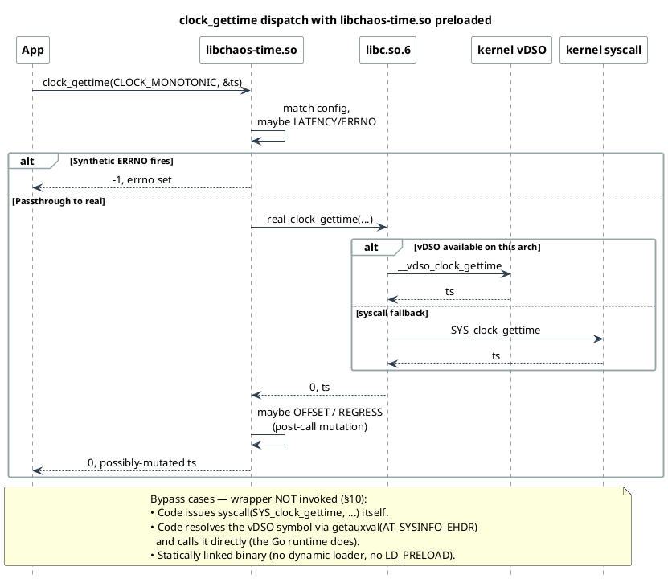

<!--
━━━━━━━━━━━━━━━━━━━━━━━━━━━━━━━━━━━━━━━━━━━━━━━━━━━━━━━━━━━━━
  Engineered by  Christian Schnapka
                 Embedded Principal+ Engineer
                 Macstab GmbH · Hamburg, Germany
                 https://macstab.com
━━━━━━━━━━━━━━━━━━━━━━━━━━━━━━━━━━━━━━━━━━━━━━━━━━━━━━━━━━━━━
-->

# libchaos-time Technical Reference

> *Engineered by* **[Christian Schnapka](https://macstab.com)** — Embedded Principal+
> Engineer · [Macstab GmbH](https://macstab.com) · Hamburg, Germany

---

`libchaos-time` is the LD_PRELOAD library that fails, delays and shifts the clock reads
and sleeps of a dynamically linked process. It changes what the process observes at the
libc boundary; it never changes a kernel clock, the vDSO data page or another process.
Repository-wide ownership and composition rules are in [`docs/SYSTEM.md`](SYSTEM.md);
loader-level internals (link map, PLT/GOT, `dlsym(RTLD_NEXT)`, vDSO symbol tables) are
in [`docs/PLATFORM.md`](PLATFORM.md).

| | |
|---|---|
| Wrappers | `clock_gettime()`, `gettimeofday()`, `time()`, `timespec_get()`, `nanosleep()`, `clock_nanosleep()`, `sleep()`, `usleep()` |
| Selectors | `*`, `clock_gettime`, `clock_gettime/<clock>`, `nanosleep`, `usleep` |
| Effects | ERRNO, LATENCY, OFFSET, REGRESS |
| Qualifiers | `@first`, `@from`, `@until`, `@size` (accepted; `@size` never matches, §8.4) |
| Rule file | `/tmp/.chaos-time.conf` |
| Status file | `/tmp/.chaos-time.status` |
| Hits file | `/tmp/.chaos-time.hits.<n>` |
| Verification | unit tests with a 100.00 % line-coverage gate on `src/time/*.c`; runtime suites `test/runtime/test_time_glibc.sh` and `test_time_alpine.sh` (glibc and musl, amd64 and arm64) |

SECCOMP mode (`chaos-init`) applies no time rules: clock reads go through the vDSO
without a system call ([SECCOMP.md §6](SECCOMP.md#6-not-possible)).

---

## Table of Contents

1. [Clock Taxonomy](#1-clock-taxonomy)
2. [vDSO Offload Table per Architecture](#2-vdso-offload-table-per-architecture)
3. [Hardware Clock Sources — TSC and CNTVCT_EL0](#3-hardware-clock-sources--tsc-and-cntvct_el0)
4. [clock_gettime Selector Grammar](#4-clock_gettime-selector-grammar)
5. [OFFSET and REGRESS — Monotonicity Implications](#5-offset-and-regress--monotonicity-implications)
6. [nanosleep — EINTR and Cancellation Contract](#6-nanosleep--eintr-and-cancellation-contract)
7. [usleep — Surface and Constraints](#7-usleep--surface-and-constraints)
8. [DSL Grammar and Rule Semantics](#8-dsl-grammar-and-rule-semantics)
9. [Per-Hook Call Flows](#9-per-hook-call-flows)
10. [Bypass Surfaces — When the Wrapper Is Not Invoked](#10-bypass-surfaces--when-the-wrapper-is-not-invoked)
11. [clock_nanosleep and Absolute Deadlines](#11-clock_nanosleep-and-absolute-deadlines)
12. [gettimeofday, time and timespec_get](#12-gettimeofday-time-and-timespec_get)
13. [sleep and alarm](#13-sleep-and-alarm)
14. [Non-Coverage: setitimer and POSIX Timer APIs](#14-non-coverage-setitimer-and-posix-timer-apis)
15. [Limit: Futex Timeouts Under a Shifted Clock](#15-limit-futex-timeouts-under-a-shifted-clock)
16. [Non-Coverage: timerfd](#16-non-coverage-timerfd)
17. [Reentrancy Guard and TLS State](#17-reentrancy-guard-and-tls-state)
18. [PRNG Model](#18-prng-model)
19. [Config Reload Protocol](#19-config-reload-protocol)
20. [glibc vs musl Divergence](#20-glibc-vs-musl-divergence)
21. [Execution Boundary Summary and Limits](#21-execution-boundary-summary-and-limits)

---

## 1. Clock Taxonomy

The clock a rule targets decides which program behaviour it exercises. Every clock ID
below is accepted by `clock_gettime()`; nine of them have a selector name (§4.1), any
other is addressed by number.

### 1.1 POSIX-Mandatory Clocks

| Clock ID                   | Value | Semantics                                                                                 |
|----------------------------|-------|-------------------------------------------------------------------------------------------|
| `CLOCK_REALTIME`           | 0     | Wall clock. Set by `settimeofday`, `clock_settime`; stepped and slewed by NTP.            |
| `CLOCK_MONOTONIC`          | 1     | Never set; slewed by NTP; does not advance while the system is suspended.                 |
| `CLOCK_PROCESS_CPUTIME_ID` | 2     | CPU time of all threads of the calling process.                                           |
| `CLOCK_THREAD_CPUTIME_ID`  | 3     | CPU time of the calling thread.                                                           |

### 1.2 Linux Extension Clocks

| Clock ID                 | Value | Semantics                                                                       |
|--------------------------|-------|---------------------------------------------------------------------------------|
| `CLOCK_MONOTONIC_RAW`    | 4     | Like MONOTONIC, without NTP frequency correction.                               |
| `CLOCK_REALTIME_COARSE`  | 5     | REALTIME at tick resolution (`CONFIG_HZ`); no counter read.                     |
| `CLOCK_MONOTONIC_COARSE` | 6     | MONOTONIC at tick resolution.                                                   |
| `CLOCK_BOOTTIME`         | 7     | Like MONOTONIC, but advances during suspend.                                    |
| `CLOCK_REALTIME_ALARM`   | 8     | REALTIME; timers on it wake the system. Timers need `CAP_WAKE_ALARM`.           |
| `CLOCK_BOOTTIME_ALARM`   | 9     | BOOTTIME; timers on it wake the system. Timers need `CAP_WAKE_ALARM`.           |
| `CLOCK_SGI_CYCLE`        | 10    | Reserved; unused by mainline Linux.                                             |
| `CLOCK_TAI`              | 11    | International Atomic Time: REALTIME plus the kernel's TAI offset (`adjtimex`).  |

### 1.3 Which Clock Exercises What

- **REALTIME** carries every wall-clock decision: certificate and token expiry, cron-style
  scheduling, log timestamps. `clock_gettime/realtime:OFFSET:86400000` moves the process
  one day ahead without waiting. A realtime rule also governs `gettimeofday()`, `time()`
  and `timespec_get(TIME_UTC)` (§12), so the process never sees two wall clocks.
- **MONOTONIC** carries intervals: timeouts, backoff, rate limiters, latency histograms.
  OFFSET and REGRESS here break the non-decreasing guarantee on purpose (§5).
- **MONOTONIC_RAW** is read by benchmark and profiling code that must not see NTP slew.
- **PROCESS/THREAD_CPUTIME_ID** feed CPU budgets and profilers; they are never served by
  the vDSO (§2.1), but the wrapper sees them like any other `clock_gettime()` call.
- **BOOTTIME** measures elapsed time across suspend.
- **TAI** is read by PTP and timing-sensitive systems; the offset to UTC is 37 s since
  2017. It is rarely exercised and easy to forget.

---

## 2. vDSO Offload Table per Architecture

The vDSO is a kernel-provided shared object, announced to every process through
`AT_SYSINFO_EHDR` in the auxiliary vector. Its `clock_gettime` computes the time in user
space from a kernel-maintained data page and a hardware counter, without a system call.
`libchaos-time` sits in front of libc, so the vDSO is downstream of the wrapper (§2.2).

### 2.1 Per-Architecture vDSO Clock Support

`libchaos-time` and `chaos-init` are built for x86_64 and aarch64 only; other
architectures are outside the supported matrix and are not listed. Kernel sources:
`lib/vdso/gettimeofday.c` (generic vDSO) plus the per-architecture files below.

| Architecture | Kernel source file                       | vDSO symbol              | Hardware counter                                                                 | Clocks served by the vDSO                                                       |
|--------------|------------------------------------------|--------------------------|----------------------------------------------------------------------------------|---------------------------------------------------------------------------------|
| x86_64       | `arch/x86/entry/vdso/vclock_gettime.c`   | `__vdso_clock_gettime`   | TSC (`rdtsc`/`rdtscp`); paravirtual clocks under KVM (`pvclock`) and Hyper-V      | REALTIME, MONOTONIC, MONOTONIC_RAW, REALTIME_COARSE, MONOTONIC_COARSE, BOOTTIME, TAI |
| aarch64      | `arch/arm64/kernel/vdso/vgettimeofday.c` | `__kernel_clock_gettime` | Generic Timer virtual counter `CNTVCT_EL0` (`isb; mrs`)                           | REALTIME, MONOTONIC, MONOTONIC_RAW, REALTIME_COARSE, MONOTONIC_COARSE, BOOTTIME, TAI |

- `CLOCK_PROCESS_CPUTIME_ID`, `CLOCK_THREAD_CPUTIME_ID` and the ALARM clocks are not
  served by the vDSO on either architecture; libc issues `SYS_clock_gettime` for them.
- The vDSO also falls back to the system call when the current clocksource cannot be
  read from user space (for example an unstable TSC marked unusable by the kernel).
- The same symbols are what `chaos_clock.h` resolves for the libraries' own throttle and
  `@from`/`@until` clock (§19), so a time rule never moves another rule's clock.

### 2.2 Interposition and the vDSO

`libchaos-time` exports `clock_gettime`; with LD_PRELOAD the dynamic linker binds every
PLT reference to it. The wrapper calls the real function (the libc definition found with
`dlsym(RTLD_NEXT)`), and libc calls the vDSO. The wrapper therefore owns the result
whether libc used the vDSO or the system call. Dispatch sequence
([source](diagrams/vdso.puml)):



### 2.3 Fallback to Syscall

Without a vDSO entry for the clock, without a vDSO mapping, or with an unreadable
clocksource, libc issues `SYS_clock_gettime`. Interposition is unaffected: the wrapper
intercepts the libc symbol, not the mechanism behind it. The wrapper itself issues
`SYS_clock_gettime` directly only while the real pointer is still unresolved (a call
from inside symbol resolution, §17).

References: `vdso(7)`; kernel `lib/vdso/gettimeofday.c`; glibc
`sysdeps/unix/sysv/linux/clock_gettime.c`.

---

## 3. Hardware Clock Sources — TSC and CNTVCT_EL0

Background for reasoning about what OFFSET cannot touch. The kernel publishes, per
clocksource, a base time, the counter value it was taken at (`cycle_last`) and a
`mult`/`shift` pair. A reader computes `base + ((counter - cycle_last) * mult) >> shift`
under a sequence counter and retries while the kernel updates the page.

### 3.1 x86_64: TSC

The Time Stamp Counter is a 64-bit per-core counter. With `constant_tsc` and
`nonstop_tsc` it ticks at a fixed rate independent of frequency scaling and idle states.
`rdtsc` can be reordered by out-of-order execution; `rdtscp` waits for prior
instructions and returns the CPU id in `ecx`. When the kernel marks the TSC unstable it
switches clocksource, and the vDSO falls back to the system call.

### 3.2 aarch64: CNTVCT_EL0

The ARMv8 Generic Timer provides a 64-bit system counter at the frequency in
`CNTFRQ_EL0`. The vDSO reads the virtual view, `CNTVCT_EL0`, preceded by `isb` so the
read is not speculated ahead of earlier instructions. EL0 access is enabled by the
kernel through `CNTKCTL_EL1`.

### 3.3 Relevance to Injection

The counter and the kernel's data page are read-only to user space and untouched by this
library. OFFSET and REGRESS rewrite the `struct timespec` the wrapper returns, after the
real call. The fault lives at the ABI boundary of one process: other processes,
`chaos-init`, and the libraries' own clocks (`chaos_clock.h`) keep reading real time.

---

## 4. clock_gettime Selector Grammar

```
clock_gettime/<clock>
```

### 4.1 Recognised Clock Names

| Selector                           | clockid_t                      |
|------------------------------------|--------------------------------|
| `clock_gettime/realtime`           | `CLOCK_REALTIME` (0)           |
| `clock_gettime/monotonic`          | `CLOCK_MONOTONIC` (1)          |
| `clock_gettime/process_cputime_id` | `CLOCK_PROCESS_CPUTIME_ID` (2) |
| `clock_gettime/thread_cputime_id`  | `CLOCK_THREAD_CPUTIME_ID` (3)  |
| `clock_gettime/monotonic_raw`      | `CLOCK_MONOTONIC_RAW` (4)      |
| `clock_gettime/realtime_coarse`    | `CLOCK_REALTIME_COARSE` (5)    |
| `clock_gettime/monotonic_coarse`   | `CLOCK_MONOTONIC_COARSE` (6)   |
| `clock_gettime/boottime`           | `CLOCK_BOOTTIME` (7)           |
| `clock_gettime/tai`                | `CLOCK_TAI` (11)               |

- Names are matched with `strcmp`: **case-sensitive**, lower case only.
  `clock_gettime/MONOTONIC` is not a name; it is parsed as a number, fails, and rejects
  the rule file.
- Any other text is parsed with `strtol(…, 10)` and compared with the `clockid_t`
  argument: `clock_gettime/1` equals `clock_gettime/monotonic`. Numbers are not
  range-checked, so dynamic clock IDs (`FD_TO_CLOCKID`) can be targeted.
- A name is compiled in only if the libc headers define the constant; on Linux with glibc
  or musl all nine are present.

### 4.2 Precedence

For each effect the wrapper picks one rule, by rank, not by file order:

| Rank | Selector                 | Matches                                                  |
|------|--------------------------|----------------------------------------------------------|
| 3    | `clock_gettime/<clock>`  | `clock_gettime` reads (and §12 readers) of that clock    |
| 2    | `clock_gettime`, `nanosleep`, `usleep` | every call of that operation               |
| 1    | `*`                      | every call of every operation                            |

A higher rank wins. Equal rank: the longer selector text wins. Equal rank and length: the
first such rule in the file wins. Effects are selected independently, so one read can
take a LATENCY from `*`, an ERRNO from `clock_gettime` and an OFFSET from
`clock_gettime/realtime`.

---

## 5. OFFSET and REGRESS — Monotonicity Implications

### 5.1 OFFSET Semantics

`OFFSET:N` adds `N` milliseconds to the `struct timespec` of a successful read.

- `N` is a signed decimal (`+` and `-` accepted), `|N| ≤ 3155760000000` (100 years). A
  larger value, or one `strtoll` reports as out of range, rejects the rule file: the
  shift is negated for REGRESS and for absolute deadlines (§11), which `INT64_MIN` would
  not survive.
- Valid only on `clock_gettime` and `clock_gettime/<clock>`; on `*`, `nanosleep` or
  `usleep` it rejects the rule file.
- Arithmetic is in `int64_t`, with `tv_nsec` normalised into `[0, 999999999]`.
- **A result before the epoch is clamped to `{0, 0}`.** `OFFSET:-86400000` on a
  `CLOCK_MONOTONIC` that reads 3600 s returns `0.000000000`, not a negative time; every
  read inside that hour returns the same value.
- The probability is drawn on every read, per thread. A read that misses the gate is
  returned unshifted; each shifted read is one hit.
- `N = 0` is legal: the rule fires and counts hits but shifts nothing.

### 5.2 Monotonicity Breaks by Design

`CLOCK_MONOTONIC` promises non-decreasing values. Under OFFSET it does not hold:

1. **Probability below 1.** Read *k* is shifted by +N, read *k+1* is not: the clock
   appears to step back by almost N. Code that asserts `end - start >= 0` fails.
2. **Negative N.** Every shifted read is N earlier; the clock still advances, from an
   earlier point. Only the transition (rule added, gate missed, rule removed) is visible.
3. **Reload.** Adding, changing or removing the rule steps the observed clock by the
   difference.

This is the purpose. Backward and forward steps of "monotonic" time happen in
production: VM live migration, suspend/resume, hypervisor timer bugs. The library
changes only the value one process observes; the kernel clock and its guarantee stay
intact.

### 5.3 OFFSET on CLOCK_REALTIME

`CLOCK_REALTIME` is already adjustable, so a realtime OFFSET models an NTP step or a
wrong host clock: `clock_gettime/realtime:OFFSET:+3600000` moves wall time one hour
ahead for certificate expiry, session timeouts, lease renewal and log correlation.

A realtime rule covers every wall-clock reader the library wraps. glibc and musl serve
`gettimeofday()`, `time()` and `timespec_get()` without calling the exported
`clock_gettime`, so each has its own wrapper that reads `CLOCK_REALTIME` through the
`clock_gettime` rules (§12): LATENCY, ERRNO, OFFSET and REGRESS of
`clock_gettime/realtime`, `clock_gettime` and `*` apply to them exactly as to
`clock_gettime(CLOCK_REALTIME)`.

### 5.4 Thread Safety of OFFSET

OFFSET is stateless: the rule copy is taken from the active snapshot under its sequence
counter (§19), the arithmetic is on the caller's buffer, and the hit is counted with an
atomic add. Two threads reading the same instant can return different values because
each draws its own probability sample.

### 5.5 REGRESS — a One-Time Backward Step

`clock_gettime/monotonic:REGRESS:5000` makes the clock step back once, observably:

1. The first read under the rule (inside its `@from`/`@until` window) is returned real
   and arms the rule. The program now holds a time to go back from.
2. A later read where the rule fires (window, probability, `@first`) is returned
   5000 ms earlier. That decision is the jump and counts **one hit**.
3. Every read after the jump stays shifted by 5000 ms without drawing again, so the
   clock advances normally from the earlier time.

Rules of the effect:

- **A clock is required.** Only `clock_gettime/<clock>` is valid; bare `clock_gettime`,
  `*`, `nanosleep` and `usleep` reject the rule file. The state belongs to the rule, and
  one rule across all clocks would arm on one clock and jump on another.
  `clock_gettime/realtime:REGRESS:…` also steps `gettimeofday()`, `time()` and
  `timespec_get()`.
- **Value:** `1 ≤ ms ≤ 3155760000000`; zero or negative rejects the rule file.
- **State machine** (per process, in the rule's hit slot, `chaos_hits.h`):
  `0` unarmed → `1` armed → `3` deciding → `2` jumped, or back to `1` when the gate
  misses. Transitions use compare-and-swap: exactly one thread decides the jump; a read
  that meets state `3` is returned unshifted.
- **Reload:** a reload that keeps the rule's text keeps the state. Removing the rule ends
  the shift: the observed clock jumps forward by the same amount.
- **Window:** outside `@from`/`@until` nothing is shifted, also after the jump.
- **fork():** the child inherits the state (a jumped parent has a jumped child); a
  decision in progress (`3`) is reset to `1`.
- With `@size` the rule never jumps (clock reads carry no byte count, §8.4).

A static negative OFFSET never shows the step, because the first read is already
shifted. REGRESS exists for code that must survive the step itself: timeouts, rate
limiters, leases and elapsed-time arithmetic that trust `CLOCK_MONOTONIC`.

When both an OFFSET and a REGRESS rule match a read, OFFSET is applied first, then
REGRESS.

---

## 6. nanosleep — EINTR and Cancellation Contract

### 6.1 Kernel Contract

`nanosleep()` returns -1 with `EINTR` when a signal handler runs, writes the unslept time
to `*rem` if `rem` is non-NULL, and is never restarted by `SA_RESTART`
(`signal(7)`; see [PROCESS.md §8.1](PROCESS.md#81-the-restartable--non-restartable-split)).
It is a cancellation point.

### 6.2 Injected EINTR

An ERRNO rule fires before the real call. With `EINTR` the wrapper copies the request
into `*rem` (when both pointers are non-NULL), sets `errno` and returns -1, without
sleeping:

```c
if (request != NULL && remaining != NULL)
{
    *remaining = *request;
}
errno = EINTR;
return -1;
```

The full request is reported as remaining because none of it elapsed. A caller that
loops on `nanosleep(&rem, &rem)` retries correctly; one that ignores `EINTR` returns
early. Any other injected errno leaves `*rem` untouched.

### 6.3 LATENCY on nanosleep

`nanosleep:LATENCY:200` sleeps 200 ms before the real call; the caller observes its
request plus 200 ms. The delay:

- sleeps through the real `usleep` (resolved with `dlsym(RTLD_NEXT)`), in chunks of at
  most 1 s, with the reentrancy guard raised; the real `nanosleep` is used, and
  restarted on `EINTR`, only where `usleep` did not resolve;
- preserves the caller's `errno`;
- **can end early on a signal:** the real `usleep` returns on `EINTR` and the chunk is
  not resumed, so each signal shortens the delay by up to the rest of a 1 s chunk. The
  other libraries sleep with a restarted raw `clock_nanosleep` (`chaos_sleep.h`) and do
  not have this property;
- counts one hit, also for `LATENCY:0`.

### 6.4 Cancellation

The real `usleep`/`nanosleep` used for the injected delay are cancellation points. A
deferred `pthread_cancel()` pending or arriving during an injected delay acts there,
including inside `clock_gettime()`, `gettimeofday()` and `time()`, which are not
cancellation points on their own. An injected ERRNO is not a cancellation point. Once the
real `nanosleep()` runs, normal POSIX cancellation applies.

---

## 7. usleep — Surface and Constraints

`usleep(3)` sleeps a number of microseconds. POSIX.1-2001 marked it obsolescent and
POSIX.1-2008 removed it; glibc and musl still export it.

### 7.1 Own Selector, Own Rules

`usleep` has its own selector. `usleep` rules apply to `usleep()` only; `nanosleep`
rules never apply to a `usleep()` call. The real `usleep` runs with the reentrancy guard
raised, so whatever libc does inside it (glibc and musl both implement it with a
nanosleep) bypasses the wrappers.

### 7.2 Effects

- LATENCY delays the call (§6.3).
- ERRNO returns -1 with the configured `errno`; there is no remaining-time output, so the
  caller cannot know how much elapsed and must measure with a clock if it retries.
- OFFSET and REGRESS are rejected on `usleep`.

A rule `usleep:ERRNO:EINTR` exposes callers that ignore `usleep()`'s return value. In new
code, `nanosleep()` and `clock_nanosleep()` (§11) replace it.

---

## 8. DSL Grammar and Rule Semantics

### 8.1 Grammar (RFC 5234 ABNF)

```abnf
line         = [ rule *( 1*WSP qualifier ) ] [ comment ] LF
rule         = selector *WSP ":" *WSP effect *WSP ":" *WSP value
selector     = "*"
             / "clock_gettime"
             / "clock_gettime/" ( clock-name / clock-id )
             / "nanosleep"
             / "usleep"
clock-name   = "realtime" / "monotonic" / "monotonic_raw"
             / "realtime_coarse" / "monotonic_coarse"
             / "boottime" / "tai"
             / "process_cputime_id" / "thread_cputime_id"
clock-id     = [ "+" / "-" ] 1*DIGIT                 ; strtol, base 10
effect       = "ERRNO" / "LATENCY" / "OFFSET" / "REGRESS"
value        = payload [ "@" probability ]           ; no blank before "@"
payload      = errno / latency-ms / offset-ms
errno        = "EINVAL" / "EFAULT" / "EINTR" / "EPERM" / "ENOSYS" / "EAGAIN"
             / 1*DIGIT                               ; 1 .. 2147483647
latency-ms   = 1*DIGIT                               ; 0 .. 4294967295
offset-ms    = [ "+" / "-" ] 1*DIGIT                 ; |v| <= 3155760000000; REGRESS: 1 ..
probability  = "0" / "1" / "0." 1*DIGIT / "1." 1*"0"
qualifier    = "@first=" 1*18DIGIT                   ; > 0
             / "@from=" 1*18DIGIT / "@until=" 1*18DIGIT   ; Unix ms, until > from
             / "@size>" 1*18DIGIT / "@size<" 1*18DIGIT
comment      = "#" *( %x01-09 / %x0B-FF )
```

- Selectors, effect names and errno names are case-sensitive.
- Blanks (space, tab, CR) around fields are trimmed. Everything from the first `#` is a
  comment.
- The probability is attached to the value with `@` and no blank:
  `nanosleep:LATENCY:200@0.25`. Written as a separate word (`200 @0.25`) it is parsed as
  a qualifier, is unknown, and rejects the rule file.
- The probability is parsed locale-independently (`chaos_policy_parse_probability()`):
  an application's `setlocale(LC_ALL, "")` cannot break `0.5`. Missing means 1.
- A line with qualifiers but no rule rejects the rule file.

### 8.2 Effect Applicability

| Selector                | LATENCY | ERRNO | OFFSET | REGRESS |
|-------------------------|---------|-------|--------|---------|
| `*`                     | yes     | yes   | —      | —       |
| `clock_gettime`         | yes     | yes   | yes    | —       |
| `clock_gettime/<clock>` | yes     | yes   | yes    | yes     |
| `nanosleep`             | yes     | yes   | —      | —       |
| `usleep`                | yes     | yes   | —      | —       |

"—" rejects the rule file. No selector names `gettimeofday`, `time`, `timespec_get`,
`clock_nanosleep` or `sleep`; each follows the rules of the call it is a form of:

| Wrapper           | Follows rules of          | Failure report                                                                  |
|-------------------|---------------------------|---------------------------------------------------------------------------------|
| `gettimeofday`    | `clock_gettime/realtime`  | -1, `errno` set; microseconds derived from the shifted timespec                 |
| `time`            | `clock_gettime/realtime`  | `(time_t)-1`, `errno` set                                                       |
| `timespec_get`    | `clock_gettime/realtime`  | `TIME_UTC` only; returns 0 (other bases are forwarded)                          |
| `sleep`           | `nanosleep`               | returns the full request unslept, `errno` set                                   |
| `clock_nanosleep` | `nanosleep`               | returns the error number, `errno` untouched; EINTR fills `*rem` only for a relative sleep |

### 8.3 errno Values

Six names are recognised; any other errno is given as a decimal number. Values a caller
is likely to handle:

| Call              | errno                                                                     |
|-------------------|---------------------------------------------------------------------------|
| `clock_gettime()` | `EINVAL` (unsupported clock), `EFAULT` (bad pointer), `EPERM`             |
| `nanosleep()`     | `EINTR`, `EINVAL` (`tv_nsec` out of range), `EFAULT`                      |
| `usleep()`        | `EINTR`, `EINVAL`                                                         |

The library does not check that an errno is plausible for the call; `clock_gettime:ERRNO:5`
returns `EIO`.

### 8.4 Qualifiers

`@first`, `@from`, `@until` and `@size` behave as in every library (`chaos_policy.h`):
`@first=N` caps the firings per process, `@from`/`@until` gate on the real wall clock in
Unix milliseconds (read from the vDSO, so a realtime OFFSET does not move the window).
Clock reads and sleeps carry no byte count, so **a rule with `@size` parses but never
fires**.

### 8.5 Failure Behaviour of the Rule File

Parsing is all-or-nothing and fails open:

| Condition                                      | Rules applied           | Status file                                             |
|------------------------------------------------|-------------------------|---------------------------------------------------------|
| No rule file                                   | none                    | removed                                                 |
| Any invalid line                               | none                    | `state=error`, `line=<n>`, `reason=invalid rule`, `text=` |
| More than 256 rules                            | none                    | `reason=too many rules`                                 |
| File ≥ 262144 bytes (256 KiB)                  | none                    | `reason=file too large`, `line=0`                       |
| `EACCES`/`EPERM` on open, or a directory       | none                    | `reason=file unreadable`, `line=0`                      |
| A NUL byte in the file                         | none                    | `reason=file contains a NUL byte`, `line=0`             |
| Other read error, or file changed while read   | previous snapshot kept  | unchanged; retried on the next look                     |

---

## 9. Per-Hook Call Flows

Every wrapper first calls `chaos_time_ensure_symbols()` (one-time `dlsym(RTLD_NEXT)`
resolution, §17). "Bypass" forwards to the real function with the guard raised.

### 9.1 clock_gettime()

```
wrapper entry
  ├─ guard set or value == NULL          → bypass (NULL reaches libc's EFAULT)
  ├─ rule lookup (each lookup may reload, §19)
  ├─ LATENCY rule for (clock_gettime, clock_id)
  │    if it fires → sleep (§6.3)
  ├─ ERRNO rule
  │    if it fires → errno = value, return -1      (*value never written)
  ├─ real clock_gettime(clock_id, value)            (vDSO or syscall inside libc)
  │    on failure → return its result
  ├─ OFFSET rule  → if it fires: value += offset ms (clamped at {0, 0})
  ├─ REGRESS rule → arm / decide / keep shift (§5.5)
  └─ return 0
```

### 9.2 nanosleep()

```
wrapper entry
  ├─ guard set or request == NULL        → bypass
  ├─ LATENCY rule for nanosleep          → sleep (§6.3)
  ├─ ERRNO rule
  │    if it fires → if errno == EINTR: *rem = *req (rem != NULL); return -1
  └─ real nanosleep(req, rem)
```

### 9.3 usleep()

```
wrapper entry
  ├─ guard set                           → bypass
  ├─ LATENCY rule for usleep             → sleep (§6.3)
  ├─ ERRNO rule                          → errno = value, return -1
  └─ real usleep(usec)
```

### 9.4 Derived Wrappers

```
gettimeofday(tv, tz)   guard or tv == NULL → bypass; else §9.1 on CLOCK_REALTIME;
                       tz != NULL is filled by the real gettimeofday; tv from the timespec
time(t)                guard → bypass; else §9.1 on CLOCK_REALTIME; failure → (time_t)-1
timespec_get(ts, b)    guard, ts == NULL or b != TIME_UTC → bypass; else §9.1; failure → 0
sleep(s)               guard → bypass; LATENCY and ERRNO of nanosleep; ERRNO → return s
clock_nanosleep(c,f,r,m)
                       guard or r == NULL → bypass; LATENCY and ERRNO of nanosleep
                       (errno restored, error returned); TIMER_ABSTIME → deadline
                       converted (§11); real clock_nanosleep
```

`gettimeofday()` and `timespec_get()` read their pointer argument through a `volatile`
copy: glibc declares it `nonnull`, which would let the compiler drop the NULL test.

---

## 10. Bypass Surfaces — When the Wrapper Is Not Invoked

`libchaos-time` sees every clock read and sleep that goes through the exported libc
symbols. It does not see these:

### 10.1 Go Runtime

The Go runtime (gc toolchain) does not call libc for time. On linux/amd64 and
linux/arm64 it locates the vDSO itself and calls `__vdso_clock_gettime` /
`__kernel_clock_gettime` directly, with `SYS_clock_gettime` as its fallback; sleeps are
runtime timers, not `nanosleep()`. Go time is invisible to `libchaos-time` with or
without cgo, and invisible to SECCOMP mode as well
([SECCOMP.md §6](SECCOMP.md#6-not-possible)). Time faults for Go need source-level
injection (an injectable clock).

### 10.2 Direct vDSO Call

Code that parses the vDSO from `getauxval(AT_SYSINFO_EHDR)` and calls its
`clock_gettime` never passes the PLT. Outside language runtimes this is rare.

### 10.3 Direct System Call

`syscall(SYS_clock_gettime, …)`, `syscall(SYS_nanosleep, …)` or an inline `syscall`
instruction bypasses the libc symbol.

### 10.4 Libc-Internal Calls

Calls libc makes to its own functions bind inside libc and never reach the exported
symbol. This is why `gettimeofday`, `time`, `timespec_get`, `sleep` and
`clock_nanosleep` have wrappers of their own (§12, §13, §11). Other libc functions that
read the clock internally (for example timeouts computed inside `pthread_cond_timedwait`
or `sem_timedwait`, §15) are not affected.

### 10.5 Statically Linked Binaries

No dynamic loader, no LD_PRELOAD. SECCOMP mode reaches static binaries for other
libraries, not for time.

### 10.6 Programs Started Without the Preload

A set-user-ID or file-capability program runs with `AT_SECURE`, and the loader ignores
an `LD_PRELOAD` path with a slash ([PLATFORM.md §6](PLATFORM.md#6-at_secure-and-the-ld_preload-strip)).

Reference: `vdso(7)`; Go `src/runtime/vdso_linux.go`; [`docs/PLATFORM.md` §5.3](PLATFORM.md#53-where-we-are-bypassed).

---

## 11. clock_nanosleep and Absolute Deadlines

`clock_nanosleep()` follows the `nanosleep` rules (LATENCY, ERRNO). It reports failure by
returning the error number and leaves `errno` untouched; an injected `EINTR` fills
`*rem` only for a relative sleep, as POSIX specifies. glibc's own `nanosleep()` is built
on its internal `clock_nanosleep`, which never reaches this wrapper.

With `TIMER_ABSTIME` the request is a deadline the program computed from the clock as it
observes it, shifted by the OFFSET and REGRESS rules of `clock_gettime/<clock>` (or
`clock_gettime`). The kernel compares it with the real clock. The wrapper converts the
deadline back before the call:

- an OFFSET of +O ms is subtracted;
- a REGRESS of R ms that has jumped is added.

Without the conversion, `OFFSET:3000` made "now + 100 ms" sleep 3.1 s, and a negative
offset ended every absolute sleep at once.

Only a shift that every read carries is converted:

| Rule    | Converted when                                                                            |
|---------|-------------------------------------------------------------------------------------------|
| OFFSET  | probability 1, no `@first`, no `@size`, `@from`/`@until` window open                      |
| REGRESS | state jumped (`2`) and window open                                                        |

A deadline computed from a read the probability gate left unshifted cannot be told apart
and is passed unchanged. The conversion counts no hit.

---

## 12. gettimeofday, time and timespec_get

glibc and musl serve all three without calling the exported `clock_gettime`, so a
`clock_gettime` rule alone would leave them on the real wall clock: one process would see
two different wall clocks. Each has a wrapper that reads `CLOCK_REALTIME` through the
`clock_gettime` rules (§9.4) and converts the result:

- **`gettimeofday(tv, tz)`**: `tv_usec = tv_nsec / 1000` of the possibly shifted read. A
  non-NULL `tz` (obsolete) is filled by the real `gettimeofday`. ERRNO returns -1.
- **`time(t)`**: seconds of the read; `(time_t)-1` with `errno` on ERRNO, its only
  failure report. `t` may be NULL.
- **`timespec_get(ts, TIME_UTC)`**: the read itself; returns `TIME_UTC`, or 0 on failure.
  Other bases are forwarded unchanged.

While the real pointer is unresolved, `time()` reads `CLOCK_REALTIME` with
`SYS_clock_gettime` (aarch64 has no `time` system call) and `timespec_get()` likewise.

Reference: `gettimeofday(2)`, `time(2)`, `timespec_get(3)`.

---

## 13. sleep and alarm

**`sleep()`** is wrapped. glibc and musl implement it with their internal nanosleep,
which never passes through the exported symbol, so the wrapper applies the `nanosleep`
rules: LATENCY, then ERRNO. `sleep()` has no error return; an injected error is reported
the way an interrupted sleep is, as the whole request unslept (`return seconds`), with
`errno` set to the injected value.

**`alarm()`** is not wrapped. It arms a kernel timer that delivers `SIGALRM`; there is no
libc call at expiry to intercept, and faulting the arming call would need signal-domain
semantics this library does not model.

---

## 14. Non-Coverage: setitimer and POSIX Timer APIs

`setitimer()`, `timer_create()`, `timer_settime()`, `timer_gettime()` and `timer_delete()`
are not wrapped.

- They arm a timer once; expiry arrives as a signal or a `SIGEV_THREAD` callback, with no
  libc call to fault at that moment.
- `SIGEV_THREAD` creates threads inside libc, which `libchaos-process`'s `pthread_create`
  wrapper does not see either (libc-internal call, §10.4).
- `timerfd` is the modern alternative (§16).

---

## 15. Limit: Futex Timeouts Under a Shifted Clock

`pthread_cond_timedwait`, `pthread_mutex_timedlock`, `sem_timedwait`,
`std::condition_variable::wait_until` and `std::timed_mutex::try_lock_until` take an
absolute deadline and end in `futex(2)` (`FUTEX_WAIT_BITSET`), which compares it with the
real clock.

The program computes the deadline from a read OFFSET or REGRESS shifted. These functions
are not wrapped, so the deadline is not converted as for `clock_nanosleep` (§11): under
`clock_gettime/realtime:OFFSET:-3000` a one-second `pthread_cond_timedwait` returns
`ETIMEDOUT` at once, and a positive offset makes it wait that much longer. Shift a clock
only for programs whose timed waits do not depend on it, or expect those waits to be off
by the shift.

---

## 16. Non-Coverage: timerfd

`timerfd_create()`, `timerfd_settime()` and `timerfd_gettime()` are not wrapped.

- Expiry makes the descriptor readable; the event is delivered by `read(2)` or
  `epoll_wait(2)`, not by a time call.
- `timerfd_gettime()` returns the timer's setting, not a clock reading; `clock_gettime`
  rules do not affect it.
- Faulting expiry needs fd-type-aware `read` injection, which belongs to `libchaos-io`.

---

## 17. Reentrancy Guard and TLS State

Same design as `libchaos-memory` ([MEMORY.md §14](MEMORY.md#14-reentrancy-guard-and-tls-state)):

```c
extern __thread int g_chaos_time_tls_guard;          /* non-zero: inside the library */
extern __thread uint64_t g_chaos_time_tls_prng_state; /* 0: not seeded yet */
```

- Every call to a real function, the config `stat()`, and the LATENCY sleep run between
  `chaos_time_enter_internal()` and `chaos_time_leave_internal(previous)`. Leave restores
  the saved value instead of clearing it, so nested internal sections never drop the
  outer guard early.
- A wrapper entered with the guard set (from inside libc, or from a signal handler that
  interrupted the library on the same thread) forwards to the real function without
  consulting rules.
- The guard is per library. Rule files are read with raw `openat`/`read`/`close` system
  calls (`chaos_status.h`), so `libchaos-io` never sees `libchaos-time` reading its rules.
- **Symbol resolution** runs once, through `chaos_once()` (not `pthread_once()`, which
  lives in libpthread before glibc 2.34), from the constructor or from the first wrapper
  call, whichever comes first: another object's ELF constructor can call a wrapper before
  this library's constructor ran. A lookup `dlerror()` reports as failed calls `abort()`.
  While a pointer is still NULL (a call from inside the lookup, for example a preloaded
  allocator), each wrapper issues the system call libc would have made.

---

## 18. PRNG Model

xorshift64* per thread, identical across the libraries
([MEMORY.md §15](MEMORY.md#15-prng-model)):

- Process seed: 8 bytes from `/dev/urandom`, read with raw `openat`/`read`/`close` system
  calls in the constructor; fallback `0x6a09e667f3bcc909 ^ getpid()`.
- Thread seed: SplitMix64 finaliser of `process seed ^ gettid() ^ &local`, forced odd so
  the state is never 0. Seeded lazily on the first draw.
- Step: `x ^= x >> 12; x ^= x << 25; x ^= x >> 27`, output the upper 32 bits of
  `x * 0x2545f4914f6cdd1d`. A rule fires when `sample < p * 2^32`; `p ≤ 0` never fires and
  `p ≥ 1` always fires, both without drawing.
- In a forked child the atfork handler zeroes the calling thread's state, so pre-fork
  workers do not draw the same sequence.

---

## 19. Config Reload Protocol

Same two-snapshot design as the other libraries
([MEMORY.md §16](MEMORY.md#16-config-reload-protocol--two-snapshot-cas)), with
`CHAOS_TIME_MTIME_MISSING` (`0`), `CHAOS_TIME_MTIME_RELOADING` (`0xfffffffffffffffe`) and
`CHAOS_TIME_MTIME_UNKNOWN` (`0xffffffffffffffff`) as sentinels of the cached stamp.

- **When it looks.** Every rule lookup may look at the rule file, but at most once per
  1 ms per process (`CHAOS_CHECK_INTERVAL_NS`), timed with the vDSO `CLOCK_MONOTONIC`
  (never the wrapped `clock_gettime`, so a time rule does not change how often other
  libraries see their rules). Without a vDSO clock it looks on every lookup. The
  constructor loads the file once, so a bad rule file is reported at start-up.
- **Change stamp.** FNV-style hash of `st_mtim` (s and ns), `st_size`, `st_ino` and
  `st_dev`. Size catches an append within one mtime tick; inode catches a
  rename-over (`sed -i`). A file whose mtime is within 20 ms of now
  (`CHAOS_RACY_WINDOW_MS`) is loaded provisionally and read again on the next look; if
  its content hash is unchanged, the snapshot stays, with its counts and `@first` claims.
- **One reloader.** A CAS of the cached stamp to `RELOADING` elects one thread; others
  keep using the active snapshot without waiting. The winner parses into the inactive
  snapshot, attaches hit slots (rules with unchanged text keep their slot, counts and
  REGRESS state), writes the status file, then publishes index and stamp behind full
  barriers.
- **Readers.** A rule is copied out of the snapshot under a sequence counter and used
  only if the counter did not change, so a reader preempted across two reloads never
  uses half of one rule.
- **Torn writes.** The file is `fstat`ed after reading; a stamp different from the one
  that triggered the reload discards the copy and retries on the next look.
- **errno.** A reload leaves the caller's `errno` untouched.
- **fork().** The atfork child handler releases a `RELOADING` claim inherited from a
  thread that does not exist in the child, resets counts and `@first` claims, and gives
  the child its own hits file. vfork children share memory and run no handler; they see
  the parent's claims as busy and write nothing.

**Hits file** `/tmp/.chaos-time.hits.<n>`: one `count<TAB>rule text` line per rule,
`<n>` = pid (or `pid × 10^9 + salt` when a file of that pid exists, e.g. from the image
an `execve` replaced). Written on each of the process's first 64 hits, then at most every
100 ms, on the next rule-file look after that interval, and at normal exit.

---

## 20. glibc vs musl Divergence

| Aspect                                   | glibc                                                         | musl                                     |
|------------------------------------------|---------------------------------------------------------------|------------------------------------------|
| `clock_gettime` through the vDSO         | yes                                                           | yes                                      |
| `gettimeofday`, `time`, `timespec_get` call exported `clock_gettime` | no (own wrappers needed, §12)     | no (own wrappers needed, §12)            |
| `sleep` calls exported `nanosleep`       | no (own wrapper, §13)                                         | no (own wrapper, §13)                    |
| `clock_gettime` symbol version           | `clock_gettime@@GLIBC_2.17` (moved from librt in 2.17)        | unversioned                              |
| `pthread_create`, `pthread_once` in libc | from 2.34; before in libpthread (§17 uses `chaos_once`)       | always in libc                           |

`dlsym(RTLD_NEXT, "clock_gettime")` returns the default version, the one an unversioned
reference binds to, so the wrapper calls exactly what the program would have called. See
[PLATFORM.md §3](PLATFORM.md#3-symbol-versioning-dlsym-vs-dlvsym) and
[§4](PLATFORM.md#4-stt_gnu_ifunc-and-the-resolver-phase) for versioning and IFUNC.

---

## 21. Execution Boundary Summary and Limits

`libchaos-time` operates at the libc clock and sleep boundary of one process.

Covered:

- `clock_gettime()`: per clock ID; ERRNO, LATENCY, OFFSET, REGRESS
- `gettimeofday()`, `time()`, `timespec_get(TIME_UTC)`: the `clock_gettime/realtime` rules
- `nanosleep()`: ERRNO, LATENCY
- `clock_nanosleep()`, `sleep()`: the `nanosleep` rules; absolute deadlines converted
- `usleep()`: ERRNO, LATENCY

Not covered:

- `alarm()`, `setitimer()`, POSIX timers: signal-domain timers (§13, §14)
- `timerfd_*`: fd-domain timers (§16)
- futex-based timed waits: deadlines not converted (§15)
- direct vDSO calls (Go runtime), direct system calls, libc-internal calls (§10)
- statically linked binaries; SECCOMP mode does not apply time rules

Limits:

| Limit                          | Value                                      |
|--------------------------------|--------------------------------------------|
| Rules per file                 | 256                                        |
| Rule file size                 | < 262144 bytes (256 KiB)                   |
| Rule text in status/hits files | 200 bytes                                  |
| OFFSET / REGRESS magnitude     | 3155760000000 ms (100 years)               |
| LATENCY                        | 0 .. 4294967295 ms, slept in ≤ 1 s chunks  |
| Rule-file look interval        | ≥ 1 ms per process                         |
| Provisional-load window        | 20 ms                                      |

---

<div align="center">

*Architecture, implementation, and documentation crafted with Love and Passion by*

**[Christian Schnapka](https://macstab.com)**  
Embedded Principal+ Engineer  
[Macstab GmbH](https://macstab.com) · Hamburg, Germany

*Building systems that operate correctly at the edges — including the ones you deliberately break.*

</div>
